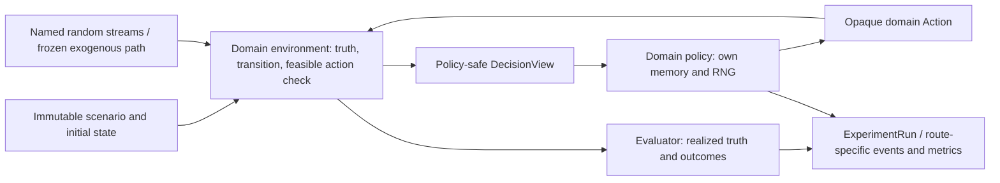

# HLS Laboratory — Laboratory Architecture and Extensibility Audit

**Date:** 2026-10-19
**Scope:** read-only architecture and engineering assessment. No code was
modified and no experiments were run.
**Repository state at review:** branch `feature/hls-laboratory-v1`; the
worktree already contained unrelated modified and untracked files. They were
left untouched. The inspected RQ0 implementation files
`src/hls/small_problem_world.py` and `src/hls/synthetic/c1.py` were among the
pre-existing modified files; the assessment describes the visible working
tree, and those local changes must be reviewed against `HEAD` before any later
implementation relies on them.

## 1. Executive assessment

HLS does not currently have one simulator with interchangeable environments,
action spaces, transition laws, and objectives. It has several real, tested
execution surfaces with meaningful reuse inside their intended domains:

1. A legacy 3×2 HLS simulator and an additive, dimension-independent N×K
   execution path for divisible effort, MIS-v2 competence evolution, teaching,
   competence estimation, and exogenous demand.
2. A separate synthetic RQ0 world with component `Protocol`s and exact solvers
   for its specific allocation/development formalization.
3. A separate Nembhard Direct route, plus a separate contextual query/candidate
   router.
4. A common post-execution experiment-record format with adapters; it is not a
   shared simulation engine.

The main architectural ceiling for broader benchmark work is not a lack of
abstractions altogether. It is that the existing abstractions belong to
different scientific contracts and are not connected by a generic episode
runner. In particular, the N×K runner's action is a divisible effort matrix;
the RQ0 synthetic core's state and action semantics are competence/development
specific; and Chen et al. require indivisible requests, service-time capacity,
integer experience, and a finite-horizon service-time objective.

**Recommendation: retain N×K and the RQ0 core unchanged, and adopt Option B
only as a thin, typed boundary for a separately implemented benchmark when a
concrete consumer is approved.** Reuse the existing experiment contract,
frozen exogenous trajectory, information-separation, and provenance patterns.
Keep benchmark-specific state, action, feasibility, transition, reward/cost,
and solver semantics in separate modules. Do not refactor into a generalized
simulator core now. A shared interface should be introduced only to eliminate
duplicated orchestration or improve fair paired evaluation for at least two
real consumers, not as a speculative plugin framework.

The laboratory's support for changing demand and several decision mechanisms
is established in code and tests. Support for request queues, state-dependent
consumption, generic policy lifecycle, and universal matched evaluation is
partial or absent. These are different claims from whether a given policy is
scientifically effective.

## 2. Scope and evidence hierarchy

Scientific meanings below follow the canonical HLS documents and frozen
theoretical/experimental records; implemented behavior follows source code.
Named tests establish scoped software contracts, not external scientific
validity. Existing experiment results are not reanalyzed here.

The Chen-specific compatibility review is
[`HLS_CHEN_SIMULATOR_COMPATIBILITY_AUDIT_2026-10-19.md`](../experiments/HLS_CHEN_SIMULATOR_COMPATIBILITY_AUDIT_2026-10-19.md).
It establishes that Chen's paper cannot be represented by configuring the
current N×K runner, although a separate benchmark implementation is
architecturally possible. Its model requirements cited here are from Chen et
al. (2018), Eqs. (1)–(7), pp. 124–125; policy formulations Eqs. (8)–(15),
pp. 125–127; experiment §5, pp. 126–130; and Appendix B, pp. 132–134. The
full-text mathematical review is
[`HLS_CHEN_FULL_TEXT_MATHEMATICAL_AUDIT_2026-10-19.md`](../research/HLS_CHEN_FULL_TEXT_MATHEMATICAL_AUDIT_2026-10-19.md).

RQ0's canonical question and policy classes are in
[`research_questions.md`](../research_questions.md),
[`HLS_CURRENT_STATE.md`](../HLS_CURRENT_STATE.md), and
[`theory/rq0_routing_integration_boundaries.md`](../theory/rq0_routing_integration_boundaries.md).
The HLS philosophy and method boundaries are in
[`HLS_PHILOSOPHY.md`](../HLS_PHILOSOPHY.md),
[`RESEARCH_DOCTRINE.md`](../../RESEARCH_DOCTRINE.md), and
[`HLS_LABORATORY_RESEARCH_FRAMEWORK.md`](../HLS_LABORATORY_RESEARCH_FRAMEWORK.md).
The last is a research-framework assessment, not proof that every suggested
component is implemented.

## 3. Current implementation inventory

### 3.1 Core execution surfaces

| Area | Actual modules and interfaces | Status | Assumptions, reuse, and limits |
|---|---|---|---|
| Legacy HLS simulator | `src/hls/hls_lab_v1.py`: `Organization`, `TeamState`, `ExpertState`, `ProblemSpec`, `EpisodeRecord`, `RunResult`, `IntegratedAction`-adjacent legacy contracts, `feasible_actions`, `evaluate_problem`; integrated extensions in `hls_lab_v1_integrated.py`. | **IMPLEMENTED** for frozen legacy contracts; tested by legacy regression tests. | Fixed historical 3-agent × 2-skill geometry and action catalogue. Preserve its configurations, transition timing, policy behavior, and serialization. Not a general heterogeneous scheduling API. |
| N×K organization and problem geometry | `src/hls/hls_lab_nk_geometry.py`: `OrganizationConfigNK`, `OrganizationStateNK`, `OrganizationResourcesNK`, `ProblemSpecNK`, `ProductiveAllocationNK`, allocation validation/enumeration. | **IMPLEMENTED**; geometry/feasibility tests. | Agent and competence dimensions are general N×K, but a period's task is a K-vector of requirements, not an arbitrary task object or batch. Actions are nonnegative effort matrices. |
| N×K production and objective diagnostics | `src/hls/hls_lab_nk_production.py`: `productive_outputs_nk`, `evaluate_problem_nk`, `ces_reward_nk`, `functional_effort_rank_nk`, `p0_rank_nk`. | **IMPLEMENTED**; hand calculations and 3×2 regressions tested. | Additive output `y[k]=Σ_i e[i,k]c[i,k]`; success/deficit/margin, CES, and effort ranking remain distinct. No generic evaluator or universal scalar utility. |
| N×K runner | `src/hls/hls_lab_nk_execution.py`: `run_nk_production_sequence` and mechanism-specific internal sequence runners; result record types for production, learning, teaching, information, environment, and Nembhard. | **IMPLEMENTED**; broad integration/regression tests. | One problem and one action per period. Dispatch is explicit for `mis_v2` and `nembhard_direct`; selected combination rules reject incompatible controls rather than silently compose them. |
| RQ0 synthetic world | `src/hls/synthetic/interfaces.py`, `state.py`, `environment.py`, `trajectory.py`; composition root `SyntheticEnvironment`; exact solvers in `exact.py`. Contracts include `TaskProcess`, `CompetenceModel`, `OpportunityKernel`, `DevelopmentKernel`, `RewardModel`, `ResourceModel`, `InformationModel`, `Policy`, `WorldState`, `Opportunity`, `DevelopmentDecision`, `PolicyView`. | **IMPLEMENTED** for the G0/RQ0 synthetic formalization; exact reference tests. | Components are replaceable within this formalization, but `WorldState` is a competence matrix plus time/resources; development is recipient × competence; `Policy` splits operational and development decisions. `solve_exact_hls`, `solve_exact_strong_sep`, and `solve_exact_sep_omega` are not generic job-shop solvers. Stochastic task demand is not integrated into the exact solver; `_task` requires `task_at` and refuses to silently sample. |
| Nembhard Direct | `src/hls/mechanisms/nembhard_direct.py`; N×K wrapper in `hls_lab_nk_nembhard.py`; ORACLE and ADAPTIVE routers in separate modules. | **IMPLEMENTED**; scalar, N×K, router, and runner tests. | Separate real-valued direct experience `D[N,K]` and productivity curve; operational adaptation maps effort × duration to exposure. Does not implement CHT's request counts, service-time packing, or ADPOL/ADPBF. |
| Contextual quality/cost route | `src/hls/contextual_router.py`. | **IMPLEMENTED** as an independent route with its own tests. | Query/context/candidate, normalized quality and simulated monetary cost. No executable mapping to an N×K problem, competence, or agent. |
| Common experiment record | `src/hls/experiment_contract.py`: `ExperimentRun`, `ExperimentEvent`, `MetricValue`, `UnitDeclaration`, `SeedRecord`, `RunAdapterContext`, route adapters and deterministic JSON validation. | **IMPLEMENTED**; contract tests. | A result/trace adapter after a run. It does not unify physical models, policies, RNG ownership, evaluation, or episode execution. |
| Nembhard E1 tooling | `src/hls/nembhard_campaign.py`: design registry/config validation, demand hashes, seed bundles, selected episode execution, safe persistence/resume, paired analysis. | **IMPLEMENTED** for its named protocol; tests. | Protocol-specific, not a reusable campaign engine. E1's existence does not demonstrate arbitrary campaign orchestration. |

### 3.2 Environment, agents, tasks, state and action

| Component | Existing interface and responsibility | Status / coupling |
|---|---|---|
| Environment representation | N×K: `DemandRegimeNK`, `ExogenousEnvironmentConfigNK`, `EnvironmentTrajectoryNK`, `generate_environment_trajectory_nk` in `hls_lab_nk_environment.py`. RQ0: `SyntheticEnvironment` composed from seven model contracts. Legacy dynamic: `DemandRegime` and `generate_problems` in `hls_lab_dynamic.py`. | **IMPLEMENTED**, but not one shared environment protocol. N×K maps demand emissions to `ProblemSpecNK`; synthetic RQ0 uses its own `WorldState` and kernels. |
| Agent representation | N×K: IDs and competence matrices in `OrganizationConfigNK` / `OrganizationStateNK`; Nembhard has its own state/profile; legacy path uses `Organization`, `TeamState`, and `ExpertState`. | **IMPLEMENTED**, with several non-interchangeable state types. No universal agent record with arbitrary per-agent capacities, costs, and mechanism state. |
| Task representation | `ProblemSpecNK` is a requirement vector with resource budget/CES weights. RQ0 `Task` is `Hashable` resolved by a `TaskProcess`. Chen needs a daily set of individually identified requests with task types. | **PARTIALLY IMPLEMENTED** across domains; no request-batch / queue contract. |
| State representation | N×K immutable competence state; Nembhard `D[N,K]`; contextual router keeps candidate predictor state; synthetic `WorldState(competence,time,resources)`. | **IMPLEMENTED** per mechanism. No common typed union/state transition. Mapping them into one state would erase units and meanings. |
| Action representation | N×K `ProductiveAllocationNK` continuous/nonnegative matrix, optionally paired with `TeachingActionNK` in `JointActionNK`; RQ0 `OperationalAction` is hashable plus a distinct `DevelopmentDecision`; contextual route selects a candidate ID. | **PARTIALLY IMPLEMENTED**. Every current policy protocol has domain-specific semantics. No binary request-level task assignment. |
| Feasibility | N×K static per-agent effort limits and shared/ProblemSpec effort budget, checked by `validate_productive_allocation_nk`, joint resource validation, and catalog enumeration. RQ0 `ResourceModel` applies development admissibility/cost. | **PARTIALLY IMPLEMENTED**. No generic state/task-dependent consumption `c[i,j](state)` or capacity-changing feasible set. |
| Capability evolution | MIS-v2 `mis_v2_transition_nk` updates bounded competence from assigned effort after current production. Directed teaching has its own `teaching_transition_nk`. Nembhard exposure advances independent `D`. RQ0 `DevelopmentKernel` has explicit development actions and opportunity-gated transitions. | **IMPLEMENTED** for these distinct laws; no generic transition plug-in in the N×K runner. |
| Reward/cost | N×K output and functional/CES diagnostics; teaching effort accounting. RQ0 `RewardModel` operation reward and `ResourceModel` development cost. Nembhard uses declared output units. Contextual quality and monetary simulated cost. | **PARTIALLY IMPLEMENTED** as separate domain metrics; no generic objective/cost semantics and no justified cross-route conversion. |
| Demand generation | C5 `StationaryTaskDemand`, `NonStationaryTaskDemand`, `MarkovTaskDemand` in `synthetic/c5.py`; N×K freezes generated problem paths before policy execution. Legacy `generate_problems` also materializes exogenous input. | **IMPLEMENTED** for one task/problem emission per period and registered demand laws. Not a batch of 50 jobs/day, queue/backlog, or arbitrary arrival intensity. |
| Policy interfaces | `NKCoordinationPolicy.choose(NKDecisionView, memory, parameters) -> JointActionNK`; legacy `IntegratedPolicy.choose`; RQ0 `Policy.choose_operational_action/choose_development_action(PolicyView,...)`; Nembhard-specific routers; contextual `decide`. | **PARTIALLY IMPLEMENTED**. Interfaces are real, but bound to their action/view contracts. They do not share lifecycle or fit/episode interface. |
| Metrics/reporting | Route-native record structures plus adapters in `experiment_contract.py`. | **IMPLEMENTED** per route; common envelope only. No single evaluator or confidence-interval service. |
| Reproducibility | Frozen N×K `EnvironmentTrajectoryNK`, hash/keyed emission streams; legacy keyed observation noise; E1 `SeedBundle`; synthetic `SeededRandomSource`; deterministic serialization. | **PARTIALLY IMPLEMENTED**. Good patterns exist; a seed value is not itself a common random realization. RNG domains and paired-trajectory protocol are not enforced by one runner. |

### 3.3 Existing test evidence

Tests support specific contracts, including:

- N×K geometry/catalogue and resource validation: `tests/test_hls_lab_v1_nk_geometry.py` and `tests/test_hls_lab_nk_execution.py` (e.g., per-agent/shared/problem budget checks, deterministic replay, P0 ranking, legacy 3×2 match).
- MIS-v2 transition and timing: `tests/test_hls_lab_nk_learning.py` and `tests/test_hls_lab_nk_learning_transition.py`.
- Teaching and joint resource accounting: `tests/test_hls_lab_nk_teaching.py`.
- Policy information view and catalogues: `tests/test_hls_lab_nk_policies.py`.
- C5 stationary/nonstationary/Markov generation and frozen N×K execution: `tests/synthetic/test_c5_dynamic_demand.py`, `tests/test_hls_lab_nk_environment.py`.
- Competence estimation and information boundaries: `tests/test_hls_lab_nk_estimation.py`, `tests/test_hls_lab_dynamic.py`.
- Nembhard mechanisms/routers: `tests/test_hls_lab_nk_nembhard.py`, `tests/test_hls_lab_nk_nembhard_oracle.py`, `tests/test_hls_lab_nk_nembhard_adaptive.py`.
- RQ0 exact policy classes: `tests/synthetic/test_exact_solver.py`, `tests/synthetic/test_rq0_runner.py`, and the G0/C1–C5-specific suites.
- Common result adaptation: `tests/test_hls_common_experiment_contract.py`.

These tests establish software behavior under their fixtures. They do not
validate every scientific model against primary literature or establish
general performance claims.

## 4. Scientific definitions and action-space requirements

### 4.1 Divisible versus indivisible allocations

The N×K contract is explicitly divisible: an action entry is a finite,
nonnegative effort amount `e[i,k]`. The catalog may discretize candidate
effort levels for selection, but the underlying units remain effort, not a
binary task assignment. A `ProductiveAllocationNK` cannot represent request
identities or enforce “each request exactly once.”

An indivisible benchmark can coexist without replacing that representation:
it should own a distinct action type, e.g. an immutable mapping from request
IDs to agent IDs, with its own completeness and feasibility validator. The
runner/policy seam may be shared only at the level of an opaque typed action
and common episode provenance; it must not coerce binary assignments to effort
matrices. This is required by Chen Eqs. (2)–(4), not a reason to generalize the
N×K catalog.

**Finding:** Separate action spaces are the minimum safe design. The existing
RQ0 `OperationalAction = Hashable` is more general at the type alias level,
but the surrounding world, reward, solver and policy contracts remain specific
to the HLS operational/development model.

### 4.2 Heterogeneous and state-dependent resource consumption

N×K resources currently constrain effort by per-agent caps, a collective cap,
and a problem-level cap. Effort used is separately accounted. These bounds do
not vary with agent-task service rate or competence. Teaching also charges
participants under its own declared effort convention.

Chen instead needs for each technician `i`,
`Σ_j x[i,j] c[i,j](s,w) ≤ B[i]`, where `c` is service duration and `x`
assigns a discrete request. In general `c` may depend on current capability
and environmental state. Production/reward and resource consumption must be
distinct functions: an environment may evaluate a completed task using one
outcome model and charge its resource duration using another. State evolution
may change future feasibility only when the benchmark explicitly defines that
link; it must not be inferred from a productivity parameter.

**Finding:** This is absent from the N×K resource contract. A benchmark-local
feasibility/action-space component is preferable to widening or changing
`OrganizationResourcesNK`.

### 4.3 Capability-transition mechanisms

| Candidate mechanism | Existing support | Scientific distinction and extension boundary |
|---|---|---|
| Explicit capability-development action | **Implemented in RQ0 synthetic core** (`DevelopmentDecision`, `DevelopmentKernel`, `Opportunity`, `ResourceModel`) and in HLS teaching path as a specific action. | Not a generic plug-in for the N×K production runner. The RQ0 decision class is recipient × competence, not arbitrary training schedule. Relevant to RQ0 and existing G3/G3-H; preserve its canonical assumptions. |
| Learning by doing | **Implemented** as MIS-v2 per-cell exposure law in N×K and legacy routes. | It is not a generic count-of-completed-jobs update. MIS-v2 applies `c' = 1-(1-c)exp(-λe)` after period production; exposure `e` is continuous effort. A CHT-style `q' = q + completed_count` is a different state, unit, and transition. |
| Combined operation and development | **Implemented in RQ0 model** as its own joint/separated decision comparison; **partially implemented operationally** in N×K as production plus directed teaching with fixed transition composition. | Does not mean every production runner supports arbitrary joint action-development optimization. Existing RQ0 `solve_exact_hls`, `solve_exact_strong_sep`, `solve_exact_sep_omega` are the relevant mathematical tools for their model. |
| Saturating learning | **Implemented** by MIS-v2 and Nembhard Direct curves, each with distinct state and meaning. | No shared saturation interface; Nembhard productivity is not normalized competence. Reuse formula only when units/transition/objective map exactly. |
| Forgetting / skill decay | **Absent** in the reviewed N×K MIS-v2 and Nembhard transition routes; not established as a general capability by the RQ0 contracts inspected. | Add only for a question requiring decay and with a primary model/calibration. A generic transition seam may permit it but does not make it scientifically supported. |
| Cross-skill transfer | **Partially implemented** as directed teaching to a designated learner-skill cell; transfer efficacy is a specific tensor and rule. | Not an arbitrary learned transfer matrix across competencies, not spontaneous peer learning, and not a general cross-skill spillover law. |
| Stochastic capability evolution | **Partially implemented** in RQ0 via stochastic opportunity followed by a declared transition; deterministic conditional update is the main N×K behavior. | N×K production/MIS-v2 transitions are deterministic. `SyntheticEnvironment` uses an injected `RandomSource` for both task sampling and opportunity sampling; there is no universal transition RNG contract or independent stream registry. |

### 4.4 Demand and finite horizon

C5 provides stationary IID, indexed nonstationary distributions, and a
first-order Markov process over task labels. `generate_environment_trajectory_nk`
materializes a finite sequence before policies run; policy calls cannot change
that frozen N×K demand path. It supports policy-independent scenario pairing.
It does not represent queues or multiple request arrivals within a period.

The RQ0 `TaskProcess` can depend on time, `WorldState`, and history; the exact
solver has a finite horizon and time in state. The exact solver deliberately
uses deterministic `task_at` semantics and says stochastic C5 integration is
a separate exact-integration problem. The sampled `SyntheticEnvironment`
uses its injected random source both to resolve stochastic tasks and sample
opportunities. Thus random streams are explicit/injectable but not inherently
split into environment, opportunity, policy, and observation namespaces.

The N×K `NKDecisionView` includes `period`, `periods_remaining`, current public
problem/requirements, estimated competences, feasible joint actions, and IDs.
This is strong support for a finite-horizon state-responsive N×K policy view.
The view is N×K-specific and currently exposes an enumerated feasible-action
tuple, which is not scalable to a 5^50 raw assignment space. The RQ0 `PolicyView`
contains task, optional state, immediate rewards, optional continuation values,
and an information contract; it does not itself carry remaining horizon as an
explicit field. The synthetic exact solver knows the configured horizon.

Information boundaries are route-specific. N×K policies get an estimated
competence view, not private efficacy/configuration; `nembhard_adaptive`
receives only its allowed history/observations and does not see true `k,p,r`;
ORACLE is explicitly full-information. The RQ0 `InformationModel` controls
state/reward/continuation visibility. In all cases, experiment/evaluator truth
must remain outside the policy view unless the policy is explicitly an oracle.

### 4.5 Policy classes and policy lifecycle

The code supports multiple kinds of decision behavior, but these labels must
not be conflated:

| Policy/solver | Actual behavior | Class description |
|---|---|---|
| P0/P1/P2 in N×K | Select a feasible joint production/teaching action from a view; P0 uses the functional rank, P1 applies its configured relation, P2 adapts relation choices using memory/observations. | P0 is state-responsive/myopic in its current view; P1 is relation-fixed with current problem-conditioned action; P2 is an observation-responsive heuristic. P2 is not automatically online policy learning or a long-horizon optimizer. |
| Nembhard ORACLE | Ranks current feasible allocations with true current productivity and functional ranking. | Full-information, current-period reference; not a future planner. |
| Nembhard ADAPTIVE | Estimates productivity from executed outcomes and may epsilon-explore among feasible actions. | Online estimation plus state-responsive decision/exploration; not learning unknown parameters `k,p,r`, and not long-horizon planning. |
| Contextual quality/cost router | Predicts quality and cost per candidate/context from selected outcomes, then applies its declared constrained rule. | Online contextual estimation/routing, independent of N×K; no endogenous candidate capability transition. |
| RQ0 exact HLS / strong-SEP / SEP-Omega | Optimizes policies in the RQ0 synthetic world using the exact finite-horizon recursion under their declared information/policy restrictions. | Joint, restricted separated, and continuation-informed separated architectures within that formalization; not universal policies for every environment. |
| Chen ADPOL / ADPBF | Not present in HLS. ADPOL is one-day lookahead using forecast information; ADPBF is offline approximate dynamic programming with fitted continuation value. | New benchmark-specific algorithms if that experiment is later authorized. They are not names for P0 or Nembhard routers. |

No shared fit/prepare/episode lifecycle exists. E1 has campaign-specific
configuration and persistence; `ExperimentRun` adapts finished outputs. For
future fitted policies, offline training/preprocessing must receive only
declared training trajectories and be completed/frozen before test episode
execution. Online state updates must be a separate policy state transition
from the environment's true capability transition. These are distinct from
agent capability development.

## 5. Experimental fairness assessment

### Existing safeguards

- N×K generated demand is frozen in `EnvironmentTrajectoryNK` before policy
  execution and can be replayed across organizations/mechanisms of the same
  K; `tests/test_hls_lab_nk_environment.py` verifies path reuse and integration.
- `hls_lab_v1_integrated.py` has `compare_integrated_policies`, with same
  initial organization, problem stream, and coordinate-indexed observation
  innovations. `hls_lab_dynamic.py` similarly has paired-run functions and
  indexed competence-observation innovations.
- Nembhard E1 provides explicit `SeedBundle` streams for demand, observation,
  and exploration and stores demand hashes; paired analysis functions are
  protocol-specific (`nembhard_campaign.py`).
- Result adapters retain seed scopes only when supplied through
  `RunAdapterContext`; they do not infer missing provenance.
- Policies get separate run instances/state when separate runner calls are
  made; there is no cross-run shared in-memory policy state unless explicitly
  passed by a caller.

### Remaining fairness limits

1. **No universal common-random-number runner.** Repeated runs can share a
   frozen exogenous path where supported, but there is no shared comparison
   harness that enforces equivalent initial-state, policy reset, information,
   resource, and RNG contracts across N×K, RQ0, Nembhard, and contextual routes.
2. **Random streams differ by surface.** N×K separates/pre-generates demand
   and keys emissions; legacy information noise is coordinate-indexed. In
   `SyntheticEnvironment`, one `RandomSource` is passed to task and opportunity
   mechanisms. A policy consuming that same source would risk shifting later
   exogenous draws; policy RNG ownership is not in the `Policy` contract.
   A seed equality alone does not guarantee matched realizations.
3. **Different endogenous state is correct, not a pairing defect.** Paired
   policies should share initial state and exogenous scenario innovations, but
   their experiences, estimates, action-conditioned opportunities, and
   resulting states may diverge. They must not be forcibly synchronized.
4. **Information and compute budgets are not universal.** Route-local views
   enforce some information boundaries, but no cross-policy policy registry
   declares true/estimated inputs, forecast horizon, preprocessing data, or
   computational budget. For comparisons involving optimization time, the
   protocol must state whether compute is a constraint or a reported outcome.
5. **Statistical inference is not a common service.** E1 includes paired
   summaries/bootstrap helpers; other campaign/test code is study-specific.
   A future protocol should identify the independent unit (e.g. exogenous
   trajectory), pair within that unit, report intervals appropriate to the
   design, and not treat deterministic replays as independent replications.

**Minimum fairness requirement for any new benchmark:** generate/store an
immutable exogenous scenario realization independently of policy execution;
instantiate independent policy memory and policy RNG streams per arm; pass
each policy only a declared immutable information view and current feasible
action interface; store initial-state/scenario hashes; run a separate evaluator
on truth; preserve each arm's endogenous transitions; compare paired outputs
by scenario ID. Prefer coordinate-addressed random variates for shocks whose
potential outcomes should match across actions. This can be done in a
benchmark-local runner first and does not require rewriting old runners.

## 6. Architecture options

| Criterion | A — Keep current architecture | B — Minimal shared interfaces | C — Generalized simulator core |
|---|---|---|---|
| Scientific flexibility | Low-to-medium: each new model can be independent, but adapters/orchestration repeat. | **High enough for a family** of models with distinct state/action contracts. | Potentially high, but risks forcing incompatible model semantics into one abstraction. |
| Implementation complexity | Low immediately; repeated benchmark plumbing over time. | **Low-to-medium** if limited to lifecycle/provenance/runner seams; domain environment/policy stays local. | High: broad refactor across state, action, dynamics, feasibility, reward, randomness, serialization. |
| Regression risk | **Lowest**; current paths untouched. | Low-to-medium if additive adapters and no migration of existing runner. | **Highest**; risks changing MIS-v2, P0/P1/P2, serializers, random order, historical experiments. |
| Reuse of existing code | Reuses each domain locally and result adapters. | Reuses experiment envelope, trajectory freezing, trace conventions and N×K regression fixtures without semantic coercion. | Would seek broad reuse, but substantial conversion work may reduce rather than increase immediate reuse. |
| Reproducibility | Per-benchmark; can be excellent but must be implemented repeatedly. | Strongest practical balance if immutable scenario paths and independent RNG domains are explicit. | Depends on new core; more shared code does not guarantee matched random streams or valid information boundaries. |
| Published benchmark integration | Every benchmark separate; suitable for one-off study, poor for repeated comparisons. | Separate benchmark modules can plug into a small runner/evaluator boundary. | Broad in principle, but benchmarks may not fit uniform state/action/reward semantics. |
| Maintenance | Simple core, duplicated orchestration and persistence. | Moderate, with a small number of contracts and tests. | High central ownership and compatibility burden. |
| Fit now | Valid if no additional benchmark is authorized. | **Recommended target when a second concrete execution domain is approved.** | Not justified by current consumers or Chen alone. |

Option B should not mean a universal simulator. The existing N×K and RQ0
engines remain separate implementations; shared pieces are lifecycle,
information/provenance, scenario replay, and result adaptation. If one isolated
benchmark can meet requirements cheaply and no second consumer exists, Option
A remains preferable until reuse is demonstrated.

## 7. Prioritized extension matrix

Effort estimates are relative, not time estimates. “Now” means the minimum
work needed for an approved next evaluation, not authorization in this audit.

| Extension | Scientific value | Reuse potential | Effort | Regression risk | Benchmark dependence | Recommendation | Basis |
|---|---|---|---|---|---|---|---|
| Immutable scenario/initial-state replay with arm-local policy state and explicit RNG domains | **HIGH** | **HIGH** | LOW–MEDIUM | LOW if additive | GENERAL | **NOW** (for next paired study) | Required for fair policy comparisons; N×K/E1 already demonstrate reusable patterns, synthetic single-source RNG shows the remaining seam. |
| Opaque environment-specific action contract plus environment-owned feasibility validator/oracle; retain N×K action type unchanged | **HIGH** | **HIGH** | MEDIUM | LOW–MEDIUM | MULTIPLE FAMILIES | **NOW**, only alongside a concrete non-N×K benchmark | Divisible and indivisible actions, dynamic service capacities, and current N×K catalog cannot share a matrix action. Avoid a no-consumer universal abstraction. |
| Separate reward/cost/resource model and independent evaluator interface | **HIGH** | **HIGH** | MEDIUM | LOW if new modules/adapters | MULTIPLE FAMILIES | **NOW**, paired with previous item | Existing route-native metrics differ (functional/CES, service-time cost, quality/monetary cost); a shared record must not merge them. |
| Generic policy lifecycle (`prepare/fit`, `reset`, `act`, optional `observe`) with immutable information view and explicit horizon | **HIGH** | MEDIUM–HIGH | MEDIUM | LOW–MEDIUM | MULTIPLE FAMILIES | **NOW**, when fitting policies are added | Needed to compare myopic, look-ahead, fitted ADP without leaking future path; existing policy protocols cover subsets but not lifecycle. |
| Generic agent/network schema and variable relationship topology | MEDIUM | MEDIUM | HIGH | HIGH | GENERAL | **LATER** | Current HLS may use variable N×K but canonical legacy research is 3×2; no approved question requires broad network refactor. |
| Forgetting, cross-skill spillovers, stochastic production/transition plugin family | MEDIUM | MEDIUM | HIGH | HIGH | MULTIPLE FAMILIES | **ONLY IF REQUIRED** | Plausible model family, not a current mandatory scientific mechanism; would change assumptions and introduce RNG/identification burden. |
| Batch arrivals, queues, deadlines and concurrent task assignment | **HIGH** for scheduling/portfolio questions | MEDIUM | MEDIUM–HIGH | LOW if isolated | MULTIPLE FAMILIES | **ONLY IF REQUIRED** (Chen is a possible consumer) | No current runner represents multiple request jobs in one period; must be an environment/action extension, not configuration. |
| Replace/refactor all execution surfaces into a generalized simulator core | LOW incremental value now | Uncertain | HIGH | HIGH | GENERAL | **REJECT for current scope** | No demonstrated need outweighs model-semantic and frozen-regression risk. |
| MILP/ADP solver dependency and Chen ADPOL/ADPBF algorithms | HIGH only for Chen reproduction | LOW outside scheduling family | HIGH | LOW if isolated | CHEN-SPECIFIC | **ONLY IF REQUIRED** | Chen compatibility review identifies new algorithms/solver and source ambiguities; not a generic laboratory requirement. |

## 8. Minimum architectural proposal (design only)

### 8.1 Component boundary



This is a proposed boundary, not an existing unified call graph. The
`ExperimentRun`/`ExperimentEvent` envelope already exists and can accept
route-specific events. The RQ0 component protocols and `EnvironmentTrajectoryNK`
are design precedents; neither should be falsely represented as the common
runner.

### 8.2 Narrow contracts

The following pseudocode states responsibilities, not a prescribed concrete
API. `State`, `Action`, `Task`, and `Outcome` must be domain-specific types;
there is intentionally no universal physical state or action schema.

```python
class Environment[State, Action, View, Outcome](Protocol):
    def initial_state(self, scenario: Scenario) -> State: ...
    def exogenous_path(self, scenario: Scenario, env_rng: RandomSource) -> ExogenousPath: ...
    def decision_view(self, state: State, path: ExogenousPath, t: int,
                      access: InformationContract) -> View: ...
    def validate_action(self, state: State, view: View, action: Action) -> None: ...
    def step(self, state: State, action: Action, exogenous: ExogenousEvent,
             mechanism_rng: RandomSource) -> tuple[State, Outcome]: ...

class Policy[View, Action](Protocol):
    def prepare(self, training_data: TrainingData | None, policy_rng: RandomSource) -> None: ...
    def reset(self, initial_policy_state: object) -> None: ...
    def act(self, view: View, feasible_actions: FeasibleActionView,
            remaining_horizon: int, policy_rng: RandomSource) -> Action: ...
    def observe(self, view: View, action: Action, feedback: object) -> None: ...

class Evaluator[State, Action, Outcome, Metrics](Protocol):
    def record(self, state: State, action: Action, outcome: Outcome) -> None: ...
    def finalize(self, terminal_state: State) -> Metrics: ...
```

For large action spaces, `FeasibleActionView` must not require materializing
every action. It may expose a domain-specific feasibility/optimization
interface; a daily 50-request assignment space must not be enumerated as
`5**50`. The policy chooses; the environment checks the returned action. The
policy may receive a feasible set or certified constraints, but only the
information explicitly permitted by the experiment. Current resources and
their state-dependent consumption belong to the environment/model contract,
not to a hidden policy shortcut.

Policy preparation/training is outside the test episode loop. Training
scenarios and budgets must be declared; after preparation, fitted parameters
are frozen for evaluation unless the policy's approved online update rule is
explicit. Online policy estimator state and physical capability state remain
separate. A full-information policy is marked as an oracle and cannot be
presented as information-matched with an estimator-based policy.

### 8.3 Ownership and execution order

1. **Scenario/configuration** owns initial conditions, finite horizon,
   task/demand process, resources, units, parameter provenance and seed bundle.
2. **Environment** owns true state, exogenous realization, domain action
   feasibility, physical execution, capability transition, and true outcomes.
3. **Information model** constructs a policy-safe view; it must not expose
   latent state or future exogenous realizations by default.
4. **Policy** owns its memory/estimator and decision RNG, receives current
   information/horizon and a feasible-action contract, returns one
   environment-specific action.
5. **Runner** orders `view → decide → validate → execute → observe → update
   policy state → record`, using current-state production before any declared
   end-of-period capability update where that is the mechanism's semantics.
6. **Evaluator** reads truth after execution for diagnostic metrics; it has no
   data path back into the policy except declared feedback.
7. **Recorder/adapter** emits common provenance plus mechanism-specific events
   and separately typed metrics. It does not reinterpret units.

### 8.4 Randomness and comparison

Use a `SeedBundle` with separately named seeds/streams for exogenous demand,
opportunities or physical shocks, observation noise, policy exploration, and
policy training. Prefer pre-generated immutable exogenous paths or
coordinate-keyed variates when common random numbers are required. The same
seed number is not proof of the same realization. Each policy arm receives a
fresh policy state and its own exploration/observation streams; scenario ID,
initial-state hash, exogenous-path hash, and stream scopes are recorded.

The random draw topology must be policy-independent for the exogenous
environment. If potential physical shocks are action-dependent, preregister
how paired outcomes are coupled; do not force endogenous state trajectories
to match. Report computation budgets separately or hold them equal when the
scientific estimand requires an algorithmic comparison. The evaluator can
produce route-specific individual and collective metrics; paired analysis
operates on scenario IDs and preserves mechanism-specific units.

## 9. Backward compatibility

Any future additive interface must preserve these invariants and regression
evidence:

- Default/explicit `mechanism_id="mis_v2"` behavior and historical
  serialization remain unchanged; tests in `test_hls_lab_nk_nembhard.py`
  pin the default/explicit equivalence.
- Legacy 3×2 competence, action catalogue order, P0/P1/P2 decisions, MIS-v2
  update timing, teaching transition, budget accounting and information views
  remain unchanged. Existing tests pin 64/508 catalogues, 3×2 actions and
  episode metrics.
- N×K frozen-demand replay, policy-independent generated paths, output-before-
  learning order, estimate/truth separation, and deterministic serializers
  remain unchanged.
- Nembhard Direct retains independent `D[N,K]`, beginning-of-period
  productivity, experience update order, and ORACLE/ADAPTIVE information
  contracts. It must not be routed through a competence plugin.
- RQ0 G0/A1/C1–C5 exact fixtures and HLS/strong-SEP/SEP-Omega policy
  restrictions remain unchanged; synthetic component protocols are not
  broadened by mutating frozen worlds.
- Contextual query routing remains independent. Its quality and monetary cost
  metrics are not converted to HLS production/CES/effort.
- `ExperimentRun` remains an additive adapter format. Existing native JSON
  serializers and frozen result files are not migrated or overwritten.

Regression strategy: add a new environment's contract tests in its own test
module; run all affected route suites plus the existing N×K and synthetic
exact reference suites; compare deterministic legacy serialized outputs or
declared hashes where already pinned; verify paired scenario hashes and
information access; do not update golden results merely to make a refactor
pass. New mechanism semantics require separate scientific authorization.

## 10. Minimum implementation roadmap

This is a relative, conditional roadmap; it does not amend the operative
calendar, approve Chen reproduction, or authorize implementation.

| Stage | Scope and scientific reason | Dependencies | Acceptance criteria / regression tests | Relative effort | Stop/go gate |
|---|---|---|---|---|---|
| **1 — Benchmark boundary specification and paired-run seam** | Define a benchmark-local typed state/action, immutable scenario and policy-safe view; reuse `ExperimentRun`, named seed patterns, and existing replay tests. This is the smallest step toward another published model without touching N×K. | A PI-selected benchmark and its fully reviewed mathematical contract; determine whether a second consumer exists before generalizing beyond a local runner. | Hand-checkable one-step environment invariants; identical exogenous-path hashes across policy arms; independent policy memory/RNG; evaluator-only truth; existing N×K and G0 exact reference tests remain byte/behavior compatible. | LOW–MEDIUM | **GO** only if an approved benchmark cannot be represented as a configuration; **STOP** if it merely duplicates E1/N×K. |
| **2 — Domain action and resource model** | Add only the chosen domain's action space and feasibility logic (e.g. request assignment plus task-/agent-dependent service capacity for a scheduling benchmark). | Stage 1 contract; equations, units, and parameter domains resolved from primary source. | Exhaustive tiny-instance validator agrees with domain feasibility/optimization; all requests assigned once; capacity conserved; state-dependent feasibility changes only as specified; no changes to `ProductiveAllocationNK`. | MEDIUM | **GO** if the benchmark's action/constraint structure is genuinely absent; **STOP** on unresolved scientific or source ambiguities. |
| **3 — Capability transition and outcome/evaluator adapter** | Implement the selected benchmark's transition/reward/cost and trace adapter as isolated components. | Domain model and action tests; units/ordering explicit. | Hand calculations, transition invariants, pre/post timing, complete individual/collective trace, unit-preserving `ExperimentRun`; existing model tests unchanged. | MEDIUM | **GO** after Stage 2 passes; **STOP** if a required mapping would conflate competence, productivity, effort, or monetary cost. |
| **4 — Published baseline(s) and comparison protocol** | Add exact paper policies/solver only after source and solver audit; freeze training/evaluation split, information access, compute budget, and paired scenarios. | Full algorithm sources; chosen solver; benchmark-specific lifecycle. | Small exact reference instances; policy-specific baseline regression; no future leakage; comparison is against the paper's actual strong baseline, not a substitute. | HIGH | **GO** only when algorithm and source details are complete; otherwise keep environment validation separate and make no reproduction claim. |
| **5 — Scale to selected reported results** | Reproduce a bounded published figure/table first, then consider full design. Full Chen reproduction is not mandatory. | Stages 1–4, pilot on target hardware, output/resume integrity, preregistered tolerance. | Protocol cell counts, seeds, traces and metric aggregation reconcile; artifact replay; deviations and uncertainty reported. | HIGH | **GO** only after bounded figure-level reproduction is stable; **STOP** if compute/provenance cost exceeds scientific value. |

Stage 1 should be kept local to the approved non-N×K benchmark. Do not first
rewrite the existing simulators to make them satisfy a hypothetical common
interface. A shared runner abstraction should be extracted only after a
second concrete consumer demonstrates common behavior and tests can pin it.

## 11. Final recommendation

**Choose Option B as a constrained architectural direction, not as a
generalized simulator project.** Its useful content is a narrow episode
lifecycle and fairness/provenance boundary around domain-owned state,
actions, feasibility, transitions, reward, and policies. Existing C5 replay,
N×K information separation, RQ0 component contracts, and
`ExperimentRun` adapters are the starting patterns. Current N×K and RQ0
implementations should remain operational and scientifically unchanged.

Before implementation, select a concrete benchmark and decide whether it
actually needs a shared runner. For Chen, the minimum faithful addition is a
separate batch-request/service-time environment and action/resource model;
the current N×K simulator must not be stretched to fit it. A separate
benchmark-local runner is sufficient initially. Add generic lifecycle
interfaces only if this and another approved environment need the same seam.

**Answer to the central question:** the minimum architectural investment is
not a universal simulator. It is an additive, typed execution boundary for
domain-specific `State`, `Action`, feasible-action validation, transition,
policy-safe `DecisionView`, evaluator, and named/replayable exogenous random
streams—paired with an immutable scenario and the existing common result
adapter. Implement one benchmark as an isolated consumer, retain the N×K and
RQ0 engines unchanged, and extract shared runner code only after a second
real consumer proves the reuse. This supplies a substantially more useful
laboratory for comparing published baselines while minimizing semantic and
regression risk.

## References and implementation evidence

- Chen, X., Hewitt, M., & Thomas, B. W. (2018), “An approximate dynamic
  programming method for the multi-period technician scheduling problem with
  experience-based service times and stochastic customers,” *IJPE* 196,
  122–134, DOI [10.1016/j.ijpe.2017.10.028](https://doi.org/10.1016/j.ijpe.2017.10.028);
  local primary PDF: [`Chen et al. (2018)`](../literature/competence_evolution/Chen_et_al_2018_Approximate_Dynamic_Technician_Scheduling.pdf).
- HLS code evidence: `src/hls/hls_lab_nk_geometry.py`,
  `hls_lab_nk_production.py`, `hls_lab_nk_learning.py`,
  `hls_lab_nk_teaching.py`, `hls_lab_nk_policies.py`,
  `hls_lab_nk_environment.py`, `hls_lab_nk_execution.py`,
  `hls_lab_nk_estimation.py`, `hls_lab_nk_nembhard.py`,
  `hls_lab_nk_nembhard_router.py`,
  `hls_lab_nk_nembhard_adaptive.py`, `hls_lab_dynamic.py`,
  `hls_lab_v1_integrated.py`, `synthetic/interfaces.py`,
  `synthetic/environment.py`, `synthetic/exact.py`,
  `experiment_contract.py`, and `nembhard_campaign.py`.
- Scientific definitions and boundaries: `docs/research_questions.md`,
  `docs/HLS_CURRENT_STATE.md`, `docs/HLS_PHILOSOPHY.md`,
  `docs/experimental_foundations/RQ0_INTEGRATED_DESIGN.md`,
  `docs/theory/HLS_DYNAMIC_THEORY.md`,
  `docs/theory/HLS_STATIC_THEORY.md`, and
  `docs/theory/rq0_routing_integration_boundaries.md`.
