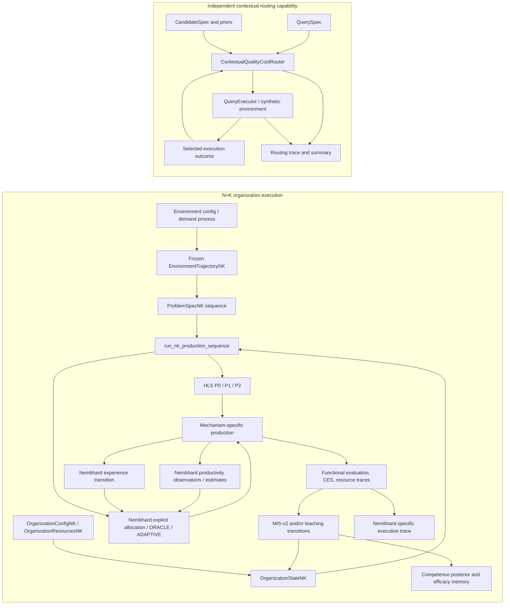

# HLS Laboratory Architecture (2026-10-17)

## 1. Purpose and scope

This document describes the architecture executable in the repository at
this review. It is an implementation map, not a claim that all mechanisms
form one simulator, that their constructs are interchangeable, or that any
policy is scientifically superior. HLS Laboratory remains **PARTIAL**.

The code contains two principal execution surfaces:

1. An N×K organization runner with HLS competence/MIS-v2 and a separately
   selected Nembhard Direct state-and-production route. Nembhard shares some
   task, resource, enumeration, and functional-evaluation contracts, but does
   not run HLS P0/P1/P2, MIS-v2, teaching, or competence estimation.
2. A standalone contextual quality/cost router with its own query and
   candidate contracts and synthetic executor. It is not wired into the N×K
   runner and has no executable mapping to an N×K agent or competence.

“Implemented” means code exists. “Tested” means named tests exercise a
contract; neither means its scientific interpretation has been validated in
an external domain.

## 2. Implemented architecture

The separation is intentional: the contextual router is not a caller of
`run_nk_production_sequence`; its query/candidate, quality, and monetary-cost
contracts have no automatic conversion to `ProblemSpecNK`, agent, competence,
CES, or effort.

## 3. Component map

| Component | Implemented contract; inputs → outputs | Dependencies / users | Status and evidence |
|---|---|---|---|
| A. N×K environment | `ExogenousEnvironmentConfigNK` and `generate_environment_trajectory_nk(config, seed)` → frozen problem sequence, latent states, regime labels, seed/config metadata. | Existing fixed/IID/Markov/nonstationary process contracts; consumed by N×K runner before execution. | **Implemented; tested for listed contracts.** `src/hls/hls_lab_nk_environment.py`; `tests/test_hls_lab_nk_environment.py`, including replay and 3×2 emission equivalence. |
| B. Organization, agents, resources | `OrganizationConfigNK` → `OrganizationStateNK`; `OrganizationResourcesNK` contains IDs, per-agent effort limits, collective budget without competence. `ProblemSpecNK` holds ID, K requirements, resource budget and CES weights. | Shared by N×K MIS-v2 and Nembhard route where compatible. | **Implemented; tested.** `src/hls/hls_lab_nk_geometry.py`; `tests/test_hls_lab_nk_execution.py`. |
| C. True state | HLS route: `competence_real[N,K]`; Nembhard route: `NembhardDirectStateNK.experience[N,K]` with separate `NembhardDirectProfileNK(k,p,r)`. | Physical production and each route’s own transition. These states are not interchangeable. | **Implemented; bounded validation.** `src/hls/hls_lab_nk_geometry.py`, `src/hls/hls_lab_nk_nembhard.py`; learning and Nembhard tests. |
| D. Observable information | N×K information-aware execution exposes decision-time estimates/observations per its mode. Nembhard adaptive receives reconstructed exposure and selected individual output observations. Contextual router receives query, candidate metadata/priors and outcomes after selected execution. | Each path keeps its own information boundary. | **Implemented; partially validated by path.** `src/hls/hls_lab_nk_execution.py`, `hls_lab_nk_nembhard_adaptive.py`, `contextual_router.py`; estimation, Nembhard-adaptive and contextual tests. |
| E. Estimation and memory | Competence posterior wrappers use the scalar historical estimator; P2 efficacy memory is held in organization policy memory. Nembhard adaptive uses a per-cell online productivity mean/dispersion estimator. Contextual router uses separate per-candidate ridge states for quality and cost. | N×K estimates feed its policies; Nembhard estimates feed its router; contextual forecasts feed only the contextual selector. | **Implemented; separate estimator contracts.** `src/hls/hls_lab_nk_estimation.py`, `hls_lab_nk_policies.py`, `hls_lab_nk_nembhard_adaptive.py`, `contextual_router.py`; corresponding tests. |
| F. Decision policies | N×K `NKCoordinationPolicy.choose(view, memory, parameters)` implements P0/P1/P2 over joint production/teaching actions. Nembhard exposes explicit allocation, `NembhardOracleRouterNK.choose`, and `NembhardAdaptiveRouterNK.choose`. Contextual `ContextualQualityCostRouter.decide` selects candidate IDs. | N×K policies are wired only to MIS-v2 organization route. Nembhard routes only to `nembhard_direct`. Contextual decision stays in its module. | **Implemented; tested in declared contracts, not universally integrated.** `src/hls/hls_lab_nk_policies.py`, both Nembhard router modules, `contextual_router.py`; policy and router tests. |
| G. Execution and production | `run_nk_production_sequence(...)` accepts explicit problems or environment, selected mechanism, optional N×K policy, information mode and mechanism controls. HLS production is additive in actual competence; Nembhard production uses beginning-of-period experience-derived productivity. Contextual execution calls `QueryExecutor.execute(candidate, query)`. | N×K mechanism dispatch is in one runner; contextual has its own online loop. | **Implemented; tested.** `src/hls/hls_lab_nk_execution.py`, `hls_lab_nk_production.py`, `hls_lab_nk_nembhard.py`, `contextual_router.py`; execution, policy, environment and router tests. |
| H. Learning / state evolution | HLS MIS-v2 updates competence after production; directed teaching is a separate transition composed in the historical order. Nembhard Direct advances experience after production. Contextual ridge parameters update only from selected-candidate feedback; they do not change candidate capability. | Mechanism-specific; Nembhard execution rejects MIS/teaching/HLS policy controls. | **Implemented; scoped tests.** `src/hls/hls_lab_nk_learning.py`, `hls_lab_nk_teaching.py`, `hls_lab_nk_nembhard.py`, `contextual_router.py`; learning, teaching and contextual tests. |
| I. Evaluation, metrics, traces | N×K: functional success, deficit/margin, gross CES, output and resource accounting. Nembhard returns mechanism-specific productivity/exposure trace plus compatible functional evaluation when its unit contract permits. Contextual traces keep predicted/observed quality and cost, eligibility, selection and model-update information separate. | No common cross-route result schema or common quality/cost evaluator exists. | **Implemented; trace contracts tested within each route.** `src/hls/hls_lab_nk_production.py`, `hls_lab_nk_execution.py`, `contextual_router.py`; replay and trace/summary tests. |

The runner dispatch is explicit: `mechanism_id` accepts `mis_v2` or
`nembhard_direct`; Nembhard permits explicit assignments or its two named
routers and rejects HLS policies, learning, teaching, and competence
estimation. The contextual router is not an additional `mechanism_id` or
`router_id` there. See `run_nk_production_sequence` in
`src/hls/hls_lab_nk_execution.py`.

Representative test evidence includes
`test_nk_p0_matches_legacy_3x2_decisions_and_outcomes_for_same_inputs`,
`test_3x2_policies_match_legacy_actions_with_perfect_information`,
`test_four_learning_teaching_switches_preserve_actual_transition_composition`,
`test_legacy_3x2_environment_emission_equivalence`,
`test_adaptive_decision_can_differ_from_oracle_under_imperfect_information`,
and `test_execution_is_selected_only_and_router_has_no_environment_truth`.
These are scoped regression checks, not cross-mechanism equivalence proofs.

### Shared versus mechanism-specific implementations

Within N×K, `ProblemSpecNK`, organization/resource geometry, feasible
productive-action enumeration, functional evaluation, and some ranking
helpers are shared where dimensions and units are compatible. The Nembhard
oracle reuses functional-effort ranking; it does not reuse HLS competence as
productivity. MIS-v2 and teaching update competence; Nembhard updates its own
experience state. Their physical production functions are distinct.

The contextual route shares no executable N×K domain interface. Its
`QueryExecutor` protocol, candidate-specific ridge predictor, outcome,
selection rule, synthetic environment, and serializer are independent. Reuse
of broad software practices (immutable records, explicit seeds, deterministic
ties) is not mechanism integration.

## 4. Ontology and magnitudes

“Valid equivalence” means the same declared entity/quantity under its
contract; “conditional correspondence” requires an explicit mapping and
calibration; “different” means no identity is implied; “N/A” means it is not
a native variable in that route.

| Concept | HLS N×K | Nembhard Direct route | Contextual quality–cost route |
|---|---|---|---|
| Agent | Agent row in organization (`agent_ids`). | Same worker/agent index only within the Nembhard-to-HLS adaptation. **Conditional correspondence.** | Candidate is not an agent. **Different.** |
| Candidate | No native candidate-system abstraction; an allocation is an action. | An allocation/action is not the contextual candidate. **Different.** | `CandidateSpec` is a system option for executing a query. **Valid in its route.** |
| Competence | `competence_real` / `competence_estimated`, bounded state. | Not used as Nembhard productivity. **Different.** | No competence state. **N/A.** |
| Productivity | Not a separately parameterized HLS quantity; output follows effort × competence. | `P_ik(D)` from Nembhard profile and experience. **Different from competence.** | Predicted quality/cost are not productivity. **Different.** |
| Experience | Exposure may drive MIS-v2 competence change, but is not stored as Nembhard `D` in HLS state. | Explicit `D[N,K]`; exposure increment follows the declared adaptation. **Different state.** | Feedback history is router data, not agent experience. **Different.** |
| Effort | Discrete productive effort subject to individual/shared caps. | Same allocation intensity under the adaptation; `ΔD=e·Δt` is an additional declared convention. **Conditional correspondence.** | No native effort variable. **N/A.** |
| Query | A work item can be represented by `ProblemSpecNK` only if its requirement/evaluation semantics fit. **Conditional.** | Uses the N×K problem contract in the adaptation, under its unit contract. **Conditional.** | `QuerySpec` has numeric context, quality target, optional monetary budget. **Different contract.** |
| Problem | `ProblemSpecNK`: K requirements, budget, CES weights. | Same task record can be consumed by the adapter. **Conditional on calibrated output units.** | A query is not automatically a K-requirement problem. **Different.** |
| Production/output | Additive K-vector from actual competence and effort. | Additive over effort × Nembhard productivity × period duration; units are declared by adapter contract. **Different law/units unless calibrated.** | No HLS production output; executor yields quality and cost. **Different.** |
| Quality | No generic quality scalar. Success and CES retain their own meanings. | No automatic quality variable. **Different.** | Explicit observed `quality∈[0,1]` under a versioned evaluator. **Valid only in its contract.** |
| Cost | Resource effort and budget, not monetary cost. | Effort/exposure, not money. **Different.** | Simulated monetary cost per query with declared currency/accounting version. **Valid only in its contract.** |
| Budget | Effort capacity per period (individual/collective/problem). | Uses shared effort geometry for allocation feasibility; not monetary budget. **Conditional.** | Optional predicted monetary-cost ceiling for query selection. **Different.** |
| Learning | MIS-v2 changes competence; teaching can change learner competence. | Experience accumulation changes productivity through its curve; it is not MIS learning. **Different.** | Router model updates from observed labels; candidate itself does not learn. **Different.** |
| Feedback | Production/teaching observations and task outcomes, per configured information path. | Individual selected agent-skill output observation in the adaptive route. | Selected candidate’s observed query quality/cost; no counterfactual feedback. |
| True information | Actual competence used by physical model. | Actual D/profile determine production; ORACLE sees them, ADAPTIVE does not. | Synthetic environment owns true response functions; router is not passed them. |
| Estimated information | Competence posterior/matrix shown according to information mode. | Productivity estimate from observed work output; distinct from HLS estimate. | Ridge quality/cost forecasts and diagnostics; distinct from competence and Nembhard productivity. |

No cross-route score conversion is implemented. In particular, competence ≠
productivity; production ≠ quality; effort ≠ monetary cost; an N×K agent ≠ a
contextual candidate; gross CES ≠ contextual quality or net utility.

The contextual route is MixLLM-inspired only in the broad use of contextual
quality/cost prediction and routing from observed outcomes. It implements the
approved HLS minimum-cost-subject-to-predicted-quality rule, not MixLLM's
original score with uncertainty and waiting-penalty terms, and it is not a
reproduction of that system.

## 5. Decision architecture

| Decision route | Action space and information | Objective / constraints | Estimation, exploration, horizon, feedback |
|---|---|---|---|
| P0 | Feasible productive allocations; N×K view uses authorized competence estimate. | Lexicographic current-period functional success, lower normalized deficit, higher margin, lower effort; catalogue order resolves residual tie. Production only; not CES maximization. | No separate policy estimator/exploration. Current-period decision. MIS-v2/observations may change state under runner configuration, not through P0 planning. |
| P1 | Feasible joint actions; configured directed teacher/learner/skill relation and decision-time estimated competence. | Among feasible actions for that exact relation, choose the best production-rank action; if none exists, choose the best production-only action. | Fixed relation; no future-return optimization or policy learning. |
| P2 | Feasible joint actions; estimated competence plus `OrganizationMemoryNK` efficacy observations. | If best production-only action succeeds, choose it. Otherwise consider configured relations only when that skill has positive requirement and estimated learner competence is below target; choose first unseen relation, else highest remembered efficacy (numeric-index tie order), subject to efficacy threshold. Choose best production-rank action for that relation or production fallback. | Memory adapts from recorded efficacy observations. Not long-horizon planning or future-performance optimization. |
| `nembhard_oracle` | Feasible productive catalogue; true current Nembhard D/profile and resources. | Same functional-effort lexicographic rank helper as P0, with stable catalog tie. | No estimator/exploration; current-period oracle. No future-learning value. |
| `nembhard_adaptive` | Same feasible catalogue; estimated cell productivity, reconstructed experience, current task/resources. | Same functional-effort rank as ORACLE over estimates. | Online per-cell mean/dispersion from selected individual output observations; optional seeded epsilon-greedy. Does not estimate k,p,r; myopic. |
| Contextual quality–cost router | Eligible candidate IDs for a `QuerySpec`; candidate metadata and ridge forecasts, never environment truth. | Minimum predicted monetary cost among candidates meeting predicted quality target; otherwise maximum predicted quality, then lower cost and stable ID. Optional predicted-budget filter and epsilon exploration over feasible set. | Per-candidate contextual ridge models for quality/cost; selected-only observed feedback updates after execution. One-query decision; no long-horizon planning. |

These are strategy bundles with different action and information spaces, not
controlled changes to one decision rule. “ORACLE” and “adaptive” do not imply
dynamic programming: both Nembhard routers rank current-period production
without valuing future learning.

## 6. Integration and compatibility

- **Directly shared within N×K:** `ProblemSpecNK`, resource geometry,
  feasible productive-action enumeration, and relevant functional evaluation
  and ranking functions. Nembhard output enters functional evaluation only
  under `NembhardOutputUnitContract`.
- **Adapted but distinct:** Nembhard experience updates from effort and
  duration under its adaptation contract; it does not reuse MIS-v2 or
  competence state. Nembhard ORACLE borrows the P0 functional ranking helper,
  not P0 competence information.
- **Coexists independently:** contextual router and `QueryExecutor` use a
  distinct query/candidate/outcome schema, ridge state, synthetic truth, and
  trace serializer. No N×K adapter is registered.
- **Must remain independent absent scientific mapping:** HLS competence,
  Nembhard productivity/experience, contextual quality, and contextual
  monetary cost. Current code does not justify a universal base class or
  shared scalar objective.

`run_nk_production_sequence` accepts explicit problems or a configured
environment and routes only `mis_v2` and `nembhard_direct`. Nembhard permits
explicit allocations, `nembhard_oracle`, or `nembhard_adaptive`; its validation
rejects MIS-v2, teaching, P0/P1/P2, and competence-estimation controls. The
contextual runner is `run_contextual_routing(queries, router, executor, ...)`
and does not enter this dispatch. This boundary is executable, not merely
documentary.

## 7. Defensible comparisons (design guidance only)

No comparisons or campaigns are executed by this architecture review.

### Within the N×K MIS-v2 route

Compare P0/P1/P2 with identical initial organization, problem trajectory,
individual and collective effort constraints, MIS-v2 parameters, teaching
and information modes, estimator/observation configuration, and random-stream
protocol. The deliberately changed factor is policy strategy; actions,
teaching exposure, resource use and subsequent states are outcomes, not
held equal. Report them separately. Distinguish policy choice from information
condition.

### Within Nembhard Direct

Explicit allocations, ORACLE and ADAPTIVE can be compared under the same
Nembhard profile, initial D, `Δt`, output-unit contract, resource/action
catalogue, problem trajectory and horizon. The varying factor is who supplies
the allocation rule. Explicit allocation is a controlled sequence, ORACLE has
true profile/D, and ADAPTIVE uses observations/estimates and optional
exploration; information advantage is part of the contrast unless separately
controlled. Do not describe ORACLE vs ADAPTIVE as isolating only an algorithm
while ignoring their information sets.

### Within the contextual router

There is currently one contextual selector, not a family of competing
policies. Future controlled comparisons may vary a declared setting (e.g.
epsilon, priors, or quality target) while holding query sequence, candidate
set/eligibility, synthetic response functions, evaluator/accounting versions,
initial model state and seeds fixed. Same-seed replay is supported, but
selected candidates can receive different sequential noise draws when routes
diverge; seeds alone do not create common counterfactual noise per
candidate/query. An alternative selector must be implemented and validated
before policy comparisons.

### Invalid without an adapter/protocol

Directly ranking N×K gross CES against contextual normalized quality, or
Nembhard output against contextual monetary cost, is not meaningful. A
defensible bridge requires a shared query/task definition, a versioned quality
evaluator applicable to both outputs, an explicit mapping from effort to a
common cost unit (if scientifically warranted), identical exogenous
conditions, and mechanism-specific traces. Those mappings are absent and
must not be inferred from names or scales.

## 8. Limitations and architectural gaps

### Implemented and tested within scope

- N×K organization/task/resource geometry, generated/frozen exogenous demand,
  production evaluation, MIS-v2 learning, directed teaching, information
  modes, P0/P1/P2, and deterministic trace paths have focused regression
  coverage, including historical 3×2 contracts.
- Nembhard Direct has its own experience/productivity state and explicit,
  ORACLE, and adaptive assignment paths with separate tests.
- Contextual routing has synthetic quality/cost execution, ridge prediction,
  selected-feedback updates, budget/eligibility handling, and replay tests.

This is not evidence of domain validity, equivalence of mechanisms, or
research findings. Test inventory: `tests/test_hls_lab_nk_*.py`,
`tests/test_hls_contextual_router.py`, and the per-mechanism test names in
those files. Current project status and known repository-wide integrity
findings remain governed by `docs/HLS_CURRENT_STATE.md`.

### Partial or unsupported

- Nembhard indirect transfer, grouping, and full paper reproduction are not
  part of the current route.
- Nembhard is not integrated with MIS-v2, HLS teaching, P0/P1/P2, or
  competence estimation.
- Contextual routing is not connected to N×K agents, generated N×K demand,
  or HLS production/CES; it is not a MixLLM reproduction.
- No common experiment manifest/result schema guarantees cross-route pairing,
  evaluator equivalence, or universal resource units.
- Action enumeration is exhaustive within its configured catalog and guarded
  by `max_candidates`; scalability is bounded by the combinatorial action
  space. No pruning or optimizer is part of this architecture.

### Three salient gaps (not projects or phases)

1. **Cross-route experiment/trace contract:** configuration, result and
   serialization shapes differ; reproducible pairing currently needs explicit
   external orchestration.
2. **Common evaluator and units:** no validated mapping exists among
   functional success/CES, Nembhard output, contextual quality, effort, and
   monetary cost. Cross-route performance claims are not directly supported.
3. **Information/noise comparability:** Nembhard adaptive’s individual
   productivity observations and contextual selected-query quality/cost
   feedback are different observation regimes; common seeds do not imply
   matched counterfactual noise or equal information.

## 9. Operational conclusions

HLS Laboratory is a modular collection of tested, mechanism-specific
experimental routes. The N×K route studies organization and competence under
its declared HLS equations; Nembhard provides a separately stated
experience/productivity adaptation sharing selected task/resource interfaces;
the contextual router studies candidate choice with query-conditioned
quality/cost predictions in a separate synthetic setting. Research can reuse
each route within its own contract. Cross-model comparisons require explicit
semantic, measurement, and information bridges; integration must not be
claimed where code establishes only conceptual correspondence.

This document records architecture, not a new calendar, campaign, mechanism,
or change in laboratory completion status.
