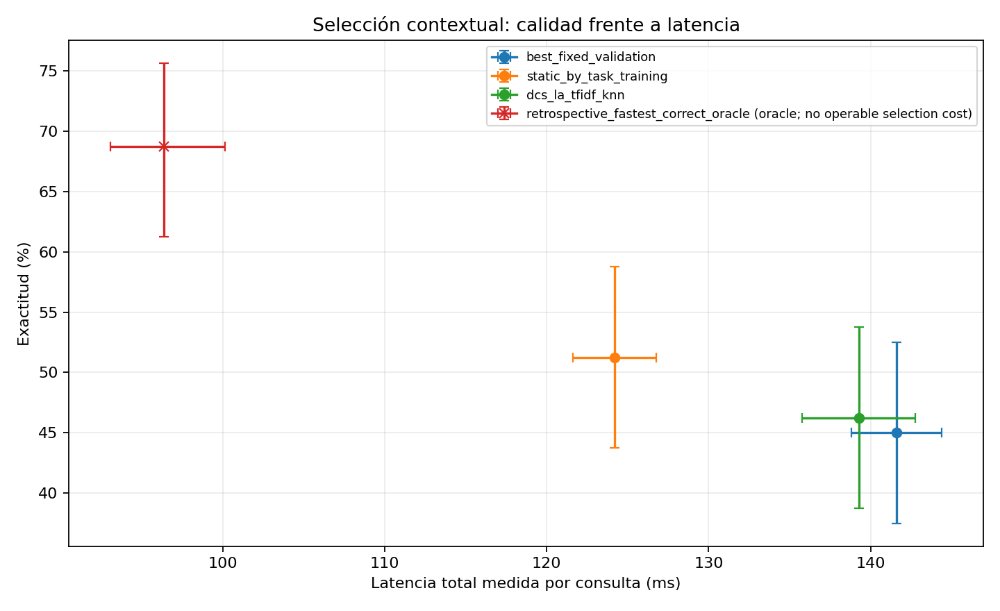

# HLS — Selección contextual de capacidades mediante DCS-LA

**Fecha:** 23/10/2026
**Estado:** piloto ejecutado y cerrado dentro del alcance autorizado.
**Pregunta:** ¿el texto observable de la consulta permite seleccionar capacidades con mayor rendimiento que la mejor política estática global?

## Resumen ejecutivo

Se implementó una adaptación de **Dynamic Classifier Selection by Local Accuracy (DCS-LA)**: para cada consulta se buscan los `k` ejemplos de entrenamiento más cercanos en TF-IDF y se selecciona el modelo con mayor exactitud empírica entre esos vecinos. Woods, Kegelmeyer y Bowyer describen DCS-LA como estimar la exactitud local de cada clasificador en los `K` vecinos del entrenamiento y seleccionar el clasificador localmente más preciso; el artículo distingue exactitud local general y condicionada a clase. Aquí usamos la exactitud local general, porque el resultado es una respuesta de cuatro opciones y el objetivo es elegir un modelo completo. [Referencia original, IEEE TPAMI 19(4), 405–410 (1997), DOI 10.1109/34.588027](https://doi.org/10.1109/34.588027).

La configuración ganadora en validación fue `k=21`, TF-IDF unigramas y peso de materia `0`. En test, DCS-LA obtuvo **46,25%** de exactitud y **139,3 ms** de latencia total por consulta, incluida selección. Frente al mejor modelo global elegido en validación (SmolLM2-1.7B), la diferencia fue **+1,25 puntos porcentuales** (IC95% emparejado `[−1,25; +3,75]`), no concluyente; la latencia fue **2,33 ms menor** (IC95% `[−4,29; −0,74]` ms, DCS menos fijo). La selección por materia alcanzó 51,25% y 124,2 ms, dominando a DCS-LA en el punto estimado. No encontramos evidencia de que la selección contextual mejore la exactitud frente a la mejor política estática.

## Datos y particiones

Se reutilizaron los scores y las latencias del piloto corregido, además de los enunciados recuperados de la revisión fijada `cais/mmlu@c30699e8356da336a370243923dbaf21066bb9fe`. No se ejecutaron inferencias nuevas de los modelos. La partición de test conserva las 160 consultas corregidas, 40 por materia, y se comprobó la disjunción por contenido con entrenamiento y validación.

| Partición | Consultas | Uso |
|---|---:|---|
| `auxiliary_train` | 200 | Vecinos y resultados de modelos ya disponibles; el split no registra materia |
| `dev` | 20 | Cinco consultas por materia, con materia disponible; se añade al conjunto de vecinos |
| `validation` | 88 | Selección de `k` y representación; no se añade al conjunto de vecinos |
| `test` | 160 | Evaluación final; etiquetas solo para métricas/oráculo |

El conjunto de vecinos tiene 220 ejemplos con resultados conocidos para los tres modelos; solo 20 llevan materia registrada. No inferimos materia de los otros 200 por sus respuestas. La validación seleccionó peso cero para la característica de materia (un empate de exactitud se resolvió por la regla fijada a favor de mayor `k`). Por tanto, el resultado final es DCS-LA basado en texto; la materia estuvo disponible y fue candidata, pero no aportó peso en la configuración seleccionada. Esto limita la prueba de selección contextual condicionada explícitamente por materia.

El mejor modelo fijo se eligió por exactitud en validación: SmolLM2-1.7B, 57,95%. El mapeo estático por materia se mantuvo congelado desde `dev` (cinco ejemplos por tipo). No se usaron resultados de test para elegir parámetros, modelos ni políticas. Los resultados de validación compararon 70 configuraciones: `k ∈ {1,3,5,7,11,15,21}`, unigramas o unigramas+bigrama y peso de materia `∈ {0, 0.5, 1, 2, 4}`. Se eligió máximo de exactitud de validación; los empates prefieren mayor `k`, representación más simple y luego menor peso de materia.

## Método y adaptación

Sea `x` el enunciado y `c` la materia disponible antes de ejecutar un modelo. El vector TF-IDF del texto se transforma con vocabulario e IDF ajustados **solo en entrenamiento**. Cuando tiene peso positivo, `c` se incorpora como una característica categórica one-hot observada; categorías desconocidas se ignoran y los valores ausentes permanecen ausentes. Se normaliza el vector concatenado y se usa similitud coseno exacta sobre los 220 ejemplos de entrenamiento.

Para los vecinos `N_k(x,c)`, la competencia local estimada del modelo `m` es:

`LC_m(x,c) = (1/k) Σ_{i ∈ N_k(x,c)} 1[ŷ_{i,m} = y_i]`.

Se elige `argmax_m LC_m`; los empates se resuelven por el orden declarado de `MODEL_IDS`. Los empates de vecinos se resuelven por similitud descendente y luego `query_id`. Es una adaptación de DCS-LA: representación TF-IDF dispersa, coseno, modelos LLM de respuesta múltiple como clasificadores base y parámetros ajustados en una validación separada. No se utiliza la respuesta, confianza ni corrección de ningún modelo en la consulta de test para seleccionar.

## Resultados

IC95% de exactitud y latencia media: bootstrap emparejado por consulta, estratificado por materia, 5.000 réplicas. Las unidades son consultas, no repeticiones temporales.

| Política | Exactitud (IC95%) | Latencia inferencia media | Coste selección medio | Latencia total media (IC95%) | P50 / P95 total |
|---|---:|---:|---:|---:|---:|
| Mejor modelo fijo por validación: 1.7B | 45,00% `[37,50; 52,50]` | 141,61 ms | <0,001 ms | 141,61 ms `[138,80; 144,40]` | 120,02 / 235,92 ms |
| Mejor fijo por materia | 51,25% `[43,75; 58,75]` | 124,20 ms | <0,001 ms | 124,20 ms `[121,64; 126,75]` | 98,96 / 235,92 ms |
| DCS-LA TF-IDF, `k=21` | 46,25% `[38,75; 53,75]` | 138,81 ms | 0,46 ms | 139,27 ms `[135,77; 142,77]` | 120,11 / 236,45 ms |
| Oráculo retrospectivo | 68,75% `[61,25; 75,63]` | 96,37 ms | No operable | 96,37 ms* | 86,55 / 133,44 ms |

`*` El oráculo elige con las etiquetas verdaderas el modelo más rápido que acertó, o el más rápido si todos fallaron. Su latencia excluye el coste imposible de conocer cuál acertará; es solo una cota retrospectiva, no un punto operativo comparable.

La curva y sus intervalos están también en [`quality_cost_frontier.csv`](../../results/experiments/hls_contextual_capacity_selection/quality_cost_frontier.csv).

### Diferencias emparejadas

| Contraste | Diferencia de exactitud | IC95% | Diferencia de latencia total | IC95% |
|---|---:|---:|---:|---:|
| DCS-LA − mejor fijo global | +1,25 pp | `[−1,25; +3,75]` | −2,34 ms | `[−4,30; −0,75]` ms |
| DCS-LA − fijo por materia | −5,00 pp | `[−11,25; +1,25]` | +15,07 ms | `[+12,87; +16,94]` ms |
| Oráculo − DCS-LA | +22,50 pp | `[+16,25; +28,75]` | — | — |

La ventaja de latencia de DCS frente al modelo fijo global proviene de que eligió modelos más baratos en 11 consultas. No hay evidencia concluyente de aumento de exactitud frente a ese fijo. El fijo por materia tuvo mejor exactitud puntual y fue más rápido; su exactitud frente a DCS no queda separada concluyentemente por el IC, pero la latencia media sí favorece al fijo por materia.

### Materias y selección de capacidades

| Materia | Fijo global 1.7B | Fijo por materia | DCS-LA | Modelos elegidos por DCS (360M / Qwen / 1.7B) |
|---|---:|---:|---:|---:|
| Biología | 42,5% | 60,0% | 45,0% | 1 / 1 / 38 |
| Matemáticas | 20,0% | 27,5% | 25,0% | 1 / 2 / 37 |
| Psicología | 57,5% | 57,5% | 57,5% | 2 / 2 / 36 |
| Historia de EE. UU. | 60,0% | 60,0% | 57,5% | 0 / 2 / 38 |

DCS eligió el 1.7B en 149/160 consultas (93,1%), Qwen en 7 (4,4%) y 360M en 4 (2,5%). Coincidió con el selector por materia en 76 consultas y tomó otra decisión en 84. En las 84 diferentes, DCS corrigió 9 respuestas incorrectas del selector por materia y perdió 17 respuestas correctas; en 58 la corrección/no corrección permaneció igual. Resultado neto: ocho aciertos menos que el selector por materia.

Frente al fijo global 1.7B, DCS cambió de modelo en 11 consultas: corrigió tres errores, perdió una respuesta correcta y no cambió el resultado de corrección en siete. Esas diferencias dan dos aciertos netos adicionales (+1,25 pp), con IC95% que incluye cero. La diversidad de resultados entre modelos, por tanto, fue explotada en muy pocos casos y no produjo una ganancia de exactitud demostrada.

## Coste del mecanismo

La preparación offline —ajuste de 70 representaciones/candidatos y evaluación en validación— tardó 6,26 s en esta máquina. Este coste no se carga por consulta, pero debe amortizarse y actualizarse si cambian los datos de entrenamiento.

En test se repitió siete veces el cálculo determinista de selección por consulta y se tomó la mediana por consulta. Medianas de componente, agregadas sobre consultas:

| Componente online | Tiempo |
|---|---:|
| Extracción/normalización del contexto | 0,0015 ms |
| Transformación TF-IDF | 0,0841 ms |
| Combinación/normalización de características | 0,0465 ms |
| Búsqueda exacta de vecinos | 0,2904 ms |
| Competencia local y decisión | 0,0075 ms |
| **Selección DCS total (mediana por consulta)** | **0,4369 ms** |

La media de las medianas por consulta de selección es 0,4561 ms (IC95% bootstrap `[0,4514; 0,4612]`); la tabla de componentes muestra la mediana de las medianas por etapa. El coste es aproximadamente 0,33% de la inferencia media DCS observada (138,81 ms). Es una medición local de CPU para 220 vecinos; no incluye carga de artefactos, red ni serving concurrente. Las latencias de inferencia provienen de las tres repeticiones del piloto corregido, para las mismas preguntas y revisiones de modelo.

## Respuestas a las preguntas del PI

1. **¿Las características observables permiten superar al mejor fijo global?** La estimación puntual de DCS es +1,25 pp sobre el fijo seleccionado en validación, pero el IC95% `[−1,25; +3,75]` no demuestra una mejora. Reduce la latencia media unos 2,33 ms por selección ocasional de modelos baratos.
2. **¿Cuándo coincide o difiere de la selección por materia?** Coincide en 76 consultas y difiere en 84. Al diferir, su exactitud fue 35,7%, frente a 45,2% de la selección por materia en esas mismas consultas; obtuvo nueve correcciones y 17 pérdidas.
3. **¿Las decisiones distintas mejoran la exactitud?** Frente al fijo global, 3 errores corregidos y 1 acierto perdido; resultado neto pequeño e incierto. Frente al fijo por materia, las decisiones distintas redujeron el total en ocho aciertos.
4. **¿Qué coste añade?** La selección online cuesta 0,445 ms de media por consulta, dominada por la búsqueda de vecinos (0,300 ms). La preparación/tuning medido fue 6,26 s.
5. **¿Qué distancia queda al oráculo?** 22,5 pp de exactitud (IC95% 16,25–28,75 pp). El oráculo no es operable y su cálculo de latencia omite el coste de conocer los resultados verdaderos.
6. **¿Hay evidencia de ventaja contextual general?** No. La selección no superó concluyentemente al mejor fijo global y quedó por debajo del selector por materia en este test. No se afirma novedad científica.

## Validez, límites y conclusión

- Los resultados de los modelos y latencias se reutilizaron, pero la limitación del corpus de contexto persiste: 200 ejemplos auxiliares no conservan materia y solo hay 20 ejemplos train etiquetados por materia, cinco por tipo. No se infirió esa metadata ausente.
- La configuración seleccionada por validación dio peso cero a la materia. El resultado prueba una adaptación contextual basada en texto, no una mejora por materia más texto. La validación contiene 88 preguntas; seleccionar entre 70 configuraciones puede sobreajustar ese pequeño conjunto, aunque el test permaneció independiente.
- DCS-LA estima competencia a partir de respuestas de entrenamiento; no combina las respuestas ni usa confianza. Sus vecinos pueden ser semánticamente cercanos sin tener la misma dificultad o distribución de errores.
- Solo se cubren cuatro materias, tres modelos, 160 consultas y un benchmark. Las conclusiones son condicionales a estas particiones y scores.
- No se utilizaron etiquetas de test para selección contextual; se reservaron para evaluación y para la cota oracular. Entrenamiento, validación y test fueron disjuntos por hash de pregunta y opciones.

**Conclusión:** la adaptación de DCS-LA es reproducible y barata online, pero en este piloto no demuestra mayor rendimiento que la mejor selección estática. Frente al fijo global obtiene una pequeña mejora puntual de exactitud no concluyente y una reducción medible de latencia; la selección por materia ofrece el mejor punto ejecutable observado. El resultado es evidencia negativa útil para este conjunto de features, tamaño de train, modelos y configuración, no una refutación general de DCS-LA.

## Implementación y procedencia

- Selector: [`contextual_capacity_selection.py`](../../src/hls/contextual_capacity_selection.py).
- Runner sin inferencias nuevas: [`run_hls_contextual_capacity_selection.py`](../../experiments/run_hls_contextual_capacity_selection.py).
- Pruebas: [`test_hls_contextual_capacity_selection.py`](../../tests/test_hls_contextual_capacity_selection.py).
- Resultados, cuatro `ExperimentRun` v1, decisiones por consulta, estado ajustado, CSV de curva y hashes: [`hls_contextual_capacity_selection/`](../../results/experiments/hls_contextual_capacity_selection/).
- Resultados de origen preservados: [`hls_dynamic_capacity_organization_corrected/`](../../results/experiments/hls_dynamic_capacity_organization_corrected/).

La evaluación usa HLS-PEF con tasa de éxito, recompensa original binaria y latencia total; el evaluador no participa en selección. Los artefactos almacenan revisión de MMLU/modelos, hashes de scores de origen y particiones, configuración seleccionada, eventos, procedencia y resultados estructurados.
