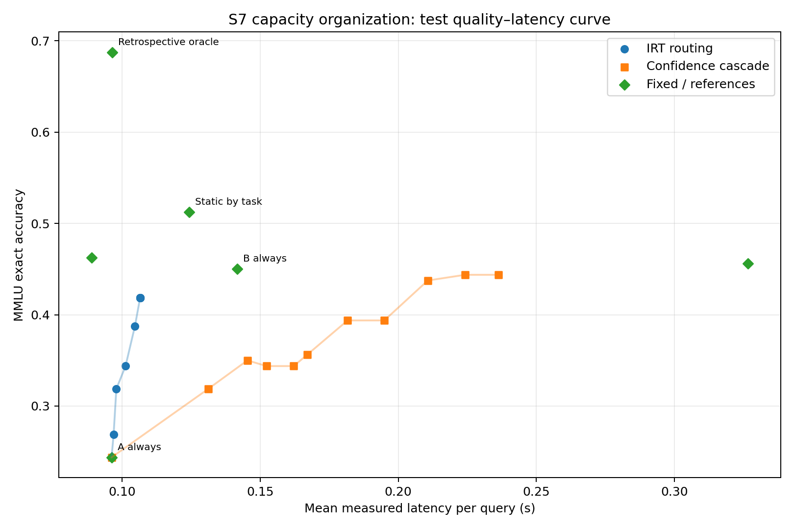

# HLS — Organización dinámica de capacidades: ejecución corregida

**Fecha:** 23/10/2026
**Estado:** piloto corregido ejecutado; resultados exploratorios, sin campaña adicional.
**Datos:** MMLU, revisión `c30699e8356da336a370243923dbaf21066bb9fe`.

## Resumen

El piloto anterior no representaba un compromiso de latencia estable. Medía generación autoregresiva de hasta ocho tokens, sin repeticiones y con orden fijo de modelos. En sus 160 preguntas, SmolLM2-360M generó en promedio 6,775 tokens y tardó 0,519 s; SmolLM2-1.7B generó 2,844 tokens y tardó 0,406 s. La diferencia de longitud de salida explica plausiblemente la inversión, aunque el diseño anterior no permite separar causalmente el efecto de longitud del orden de ejecución y otras variaciones del backend.

La ejecución corregida puntuó directamente las cuatro opciones con una pasada causal por consulta, en el mismo MPS, precisión FP16, calentamiento, orden balanceado y tres mediciones temporales. Usó un **test oficial nuevo de 160 preguntas**, 40 por materia, excluyendo por contenido las 160 preguntas ya vistas en el piloto anterior. Pareja, precios y umbrales se fijaron antes de cargar este test.

La pareja preseleccionada SmolLM2-360M (A) → SmolLM2-1.7B (B) sí presenta en el test nuevo una diferencia local: 24,38 % frente a 45,00 % de exactitud, con latencias medias de 0,096 y 0,142 s. Pero Qwen2.5-0.5B, evaluado como capacidad fija adicional y sin intervenir en la selección, obtuvo 46,25 % en 0,089 s y dominó ambos puntos. La selección fija por materia obtuvo 51,25 % en 0,124 s; su mejora puntual sobre B fue de 6,25 pp, con IC95% emparejado [0,00; 12,50] pp. La regla de escalado por confianza no aportó una región no dominada: la señal de A apenas ordenó errores (AUC 0,508 en test), y todos los puntos de cascada fueron dominados por Qwen fijo en calidad y latencia.

**Conclusión:** hay heterogeneidad útil entre materias y un punto estático por tarea prometedor, pero el escalado A→B evaluado no mejoró la frontera global. El resultado principal no es que la cascada funcione: en esta muestra, la selección por tarea fue el punto de mayor calidad entre las políticas ejecutables y Qwen fijo fue la alternativa más rápida y más precisa que A o B. La incertidumbre por materia y la muestra pequeña impiden afirmar superioridad general.

## 1. Diagnóstico de la inversión anterior

### Configuración anterior

| Modelo | Revisión fijada | Parámetros | Exactitud previa | Configuración temporal previa | Salida media en el test previo | Latencia media previa |
|---|---|---:|---:|---|---:|---:|
| `HuggingFaceTB/SmolLM2-360M-Instruct` | `a10cc1512eabd3dde888204e902eca88bddb4951` | 361.821.120 | 0,2313 | FP16, Transformers, MPS; `generate(do_sample=False, max_new_tokens=8)` | 6,775 tokens | 0,5191 s |
| `Qwen/Qwen2.5-0.5B-Instruct` | `7ae557604adf67be50417f59c2c2f167def9a775` | 494.032.768 | 0,3813 | Igual protocolo | 7,056 tokens | 0,5588 s |
| `HuggingFaceTB/SmolLM2-1.7B-Instruct` | `31b70e2e869a7173562077fd711b654946d38674` | 1.711.376.384 | 0,4500 | Igual protocolo | 2,844 tokens | 0,4056 s |

Se cargaba un modelo cada vez, se ejecutaban dos calentamientos y se medía una sola generación por pregunta, en orden fijo de modelo. La latencia cubría la generación hasta EOS o el límite de ocho tokens, no solo una pasada comparable. La medida excluía carga y tokenización. `do_sample=False` hacía determinista la generación; temperatura/top-p/top-k no eran factores activos en este runner. Hardware: Apple M2 Max, 64 GB unificados, macOS 27.0.1, PyTorch 2.4.1, Transformers 4.45.0, MPS disponible, 12 CPUs y 8 hilos PyTorch.

La longitud de respuesta varió fuertemente aunque las entradas fueran de longitud equivalente. Eso basta para explicar plausiblemente que el modelo pequeño completara más pasos de decodificación. El nuevo protocolo encontró la dirección de coste esperada (360M más rápido que 1.7B), así que **no hay evidencia de un error de implementación**. El piloto anterior no tenía repeticiones ni orden contrabalanceado y no permite atribuir toda la inversión únicamente al número de tokens.

## 2. Diseño corregido y selección sin test

### Inferencia y medición

- Mismo hardware y pool residente de los tres modelos; pesos FP16 y backend `Transformers eager forward` sobre MPS.
- Misma instrucción textual MMLU, con la plantilla de chat/tokenizador correspondiente a cada modelo.
- Una pasada de logits por pregunta; masa softmax de los token IDs de `A`/` A` hasta `D`/` D`, normalizada entre las cuatro opciones. Una respuesta puntuada; no hay generación libre ni tokens de salida de longitud variable.
- Calentamiento de tres consultas por modelo. Orden de modelos rotado y orden de consultas permutado en las mediciones repetidas.
- Latencia excluye tokenización y carga, e incluye forward, score de opciones y sincronización MPS. Para cada consulta/modelo, el coste de evaluación es la mediana de tres pasadas. Una cascada serial cobra siempre A y, cuando se activa, suma B.
- Los tres modelos se ejecutaron para obtener outcomes contrafactuales. Los costes por política son replay de llamadas medidas que esa política habría invocado; no son medidas de serving concurrente.

En el test nuevo, la entrada tuvo media de 175,9 tokens para ambos SmolLM2 (mediana 126,5; máximo 569) y 170,5 para Qwen (mediana 120; máximo 558). Se puntuó un token de respuesta por consulta/modelo; no se generaron secuencias de respuesta. Las longitudes de entrada difieren ligeramente por tokenizador/plantilla, aunque el texto de la instrucción y las opciones fueron los mismos.

### Particiones

| Partición | Datos y uso | Tamaño |
|---|---|---:|
| Entrenamiento de MIRT | `all/auxiliary_train`, selección fija reproducible con seed 20261023 | 200 |
| Train del selector estático | `all/dev`, 5 consultas por materia | 20 |
| Validación | `all/validation`, 22 por materia; precios del router y umbrales | 88 |
| Test final | `all/test`, seed 20261025; 40 por materia, excluyendo por pregunta+opciones las 160 consultas del piloto anterior | 160 |

Se verificó cero solapamiento por hash de pregunta y opciones entre entrenamiento, dev, validación, test y test anterior. La pareja y los parámetros se congelaron antes de cargar las preguntas nuevas de test. La selección de A/B exigió que B fuese más precisa y más lenta que A tanto en train como en validación; entre pares elegibles se priorizó la calidad de B en train y después las latencias train. Resultado: A=SmolLM2-360M, B=SmolLM2-1.7B. El test no seleccionó modelos, precios, asignaciones, umbrales ni el selector estático.

El selector fijo eligió, con solo cinco ejemplos dev por tipo: Qwen para biología, 360M para matemáticas y 1.7B para psicología e historia. El router MIRT ajustó su predictor en los 200 ejemplos auxiliares y eligió `argmax(q_hat − λ c_hat)`; los once precios se determinaron en validación. La cascada usó la confianza observable de A y once umbrales fijados por tasas objetivo de activación en validación, sin usar aciertos para elegirlos.

### Caracterización controlada

| Modelo | Train exactitud | Validación exactitud | Test exactitud (diagnóstico) | Test latencia media (IC95% query) | Mediana / P95 por consulta | Bytes FP16 de parámetros | MPS asignado tras carga* |
|---|---:|---:|---:|---:|---:|---:|---:|
| SmolLM2-360M | 0,270 | 0,273 | 0,244 | 0,0962 [0,0951; 0,0972] s | 0,0915 / 0,1249 s | 0,724 GB | 1,116 GB |
| Qwen2.5-0.5B | 0,530 | 0,432 | 0,463 | 0,0889 [0,0879; 0,0900] s | 0,0827 / 0,1189 s | 0,988 GB | 1,838 GB |
| SmolLM2-1.7B | 0,560 | 0,580 | 0,450 | 0,1416 [0,1388; 0,1446] s | 0,1200 / 0,2359 s | 3,423 GB | 6,132 GB |

*La asignación MPS es acumulada conforme se carga el pool en orden, no un incremento por modelo. Los bytes de parámetros son almacenamiento FP16; no se midieron energía ni FLOPs. La latencia no equivale a coste monetario ni a latencia de servicio con concurrencia.

El test confirma el compromiso local 360M→1.7B: B−A = **+20,63 pp** de exactitud (IC95% emparejado [11,25; 30,00]) con **+45,4 ms** (IC95% [+43,2; +47,6]). Sin embargo, el orden entre Qwen y 1.7B previsto por validación no se generalizó: Qwen fue 1,25 pp más preciso y 52,7 ms más rápido que 1.7B en este test; el IC de exactitud de Qwen−1.7B fue [−8,13; +10,63] pp. Ese contraste se informa como evaluación, no se utilizó para rediseñar políticas.

Las latencias medias train/validación que participaron en la selección fueron: 360M 0,2734/0,1147 s; Qwen 0,3059/0,1157 s; 1.7B 0,3780/0,1598 s. La diferencia de 1 ms entre 360M y Qwen en la media de validación es pequeña frente a la variabilidad de las repeticiones (SD 0,0521 y 0,0636 s, respectivamente); por ello el orden de coste para esa pareja no es estable. Los valores completos por repetición y los parámetros bloqueados están en `validation_latency_repetitions.csv` y `locked_train_validation_configuration.json`.

## 3. Resultados de organización

IC95% de exactitud y latencia: bootstrap emparejado estratificado por materia, 5.000 remuestreos de **consultas**. Las tres repeticiones temporales no se contaron como unidades estadísticas.

| Política | Exactitud (IC95%) | Latencia s/consulta (IC95%) | Uso de capacidades |
|---|---:|---:|---|
| A — 360M siempre | 0,244 [0,181; 0,313] | 0,0962 [0,0951; 0,0972] | A: 160 |
| B — 1.7B siempre | 0,450 [0,375; 0,525] | 0,1416 [0,1388; 0,1446] | B: 160 |
| Qwen-0.5B fijo | 0,463 [0,388; 0,538] | **0,0889 [0,0879; 0,0900]** | Qwen: 160 |
| Mejor modelo fijo por materia | **0,513 [0,438; 0,588]** | 0,1242 [0,1217; 0,1269] | Qwen: 40; 360M: 40; 1.7B: 80 |
| IRT-router, nivel de coste 0,5 | 0,419 [0,344; 0,494] | 0,1065 [0,1022; 0,1110] | 360M: 65; Qwen: 47; 1.7B: 48 |
| Cascada, objetivo validación 0,3 | 0,344 [0,275; 0,419] | 0,1523 [0,1414; 0,1636] | 65/160 escaladas (40,6%); se pagan A+B |
| Pluralidad de los tres modelos | 0,456 [0,381; 0,531] | 0,3267 [0,3222; 0,3314] | Ejecuta los tres |
| Oráculo retrospectivo | 0,688 [0,613; 0,756] | 0,0964 [0,0931; 0,1001] | No operable; cota con etiqueta test |

La curva completa (11 niveles IRT, 11 umbrales de cascada, baselines, IC y comparaciones emparejadas) está en [`quality_cost_curve_summary.csv`](../../results/experiments/hls_dynamic_capacity_organization_corrected/quality_cost_curve_summary.csv) y [`results.json`](../../results/experiments/hls_dynamic_capacity_organization_corrected/results.json).

### Contrastes relevantes

- **B frente a A:** +20,63 pp [11,25; 30,00]. La mejora de calidad tiene un coste de +45,4 ms [43,2; 47,6].
- **Qwen frente a B:** +1,25 pp [−8,13; +10,63], y −52,7 ms [−54,8; −50,6]. En la muestra Qwen es más rápido y ligeramente más preciso, pero la diferencia de calidad no es concluyente.
- **Selector fijo frente a B:** +6,25 pp [0,00; 12,50] y −17,4 ms [−18,4; −16,5]. La estimación puntual favorece al selector; el límite de confianza en exactitud toca cero.
- **Selector fijo frente a A:** +26,88 pp [18,13; 35,63], a +28,0 ms [26,0; 30,1].
- **IRT, coste 0,5 frente a A:** +17,50 pp [9,38; 25,63], a +10,4 ms [6,6; 14,5]. Frente a Qwen fijo, el IRT obtiene menor exactitud y mayor latencia; no mejora la frontera observada.
- **Cascada, objetivo 0,3 frente a B:** −10,63 pp [−17,50; −3,75], a +10,7 ms [−0,8; +22,3]. Qwen fijo también supera la cascada en calidad con menor latencia.

Todos los puntos ejecutables de la cascada y el router MIRT quedaron dominados por Qwen fijo en esta muestra (más exactitud, menor latencia). El selector estático por materia ofrece otro punto: mayor exactitud puntual que Qwen, con mayor coste. La diferencia selector–Qwen es +5,00 pp (IC95% emparejado [−1,88; +11,88]), por lo que el orden de calidad no queda establecido. El oráculo se dibuja solo como cota; su coste cuenta la llamada seleccionada retrospectivamente e **ignora el coste de descubrir cuál era correcta**, así que no es una alternativa operativa ni un punto válido de la frontera.

### Especialización y complementariedad

| Materia | A: 360M | Qwen | B: 1.7B | Selector fijo |
|---|---:|---:|---:|---:|
| Biología | 0,250 | **0,600** | 0,425 | 0,600 |
| Matemáticas | 0,275 | 0,275 | 0,200 | 0,275 |
| Psicología | 0,200 | 0,550 | 0,575 | 0,575 |
| Historia de EE. UU. | 0,250 | 0,425 | **0,600** | 0,600 |

A/B acertaron ambos 21 consultas, solo A 18, solo B 51, ninguno 70. Hay perfiles distintos: A supera a B en matemáticas, mientras B es mucho mejor en psicología e historia. Qwen acertó 31 preguntas que B falló y B acertó 29 que Qwen falló. Sin embargo, la pluralidad de los tres modelos obtuvo 45,63 %, por debajo de Qwen fijo (46,25 %) y del selector por materia (51,25 %), a casi cuatro veces la latencia de Qwen. La diversidad de errores existe, pero esta regla de combinación no la convierte en valor colectivo.

### Escalado y señales

En la cascada de objetivo 0,3 se activó B en 65 consultas: B corrigió 24 errores de A, perjudicó 8 respuestas correctas de A, ambos eran correctos en 10 casos y ambos fallaron en 23. Por tanto, **41 de 65** activaciones no mejoraron la corrección final (incluidos 8 empeoramientos). La cascada tuvo 55 aciertos frente a 39 de A, pero 72 de B, y además costó más que B en promedio.

La confianza A fue masa softmax condicional entre las cuatro opciones. En validación su Brier fue 0,2133 frente a 0,1983 para la constante de prevalencia; su AUC para ordenar errores fue 0,430 y ECE-10 0,122. En el test nuevo: Brier 0,1996 frente a constante 0,1843, AUC de error 0,508 y ECE-10 0,120. No fue una señal útil de error. La confianza de B no puede guiar la decisión previa de ejecutarlo.

El predictor MIRT del router, entrenado solo en los 200 ejemplos auxiliares, tuvo Brier 0,2907 en validación y 0,2828 en test, peores que la referencia constante basada en prevalencias train (0,2325 y 0,2326). El ordenamiento por pares de outcomes discordantes fue 0,564 en validación y 0,561 en test. Esto es compatible con que el router no seleccionara bien los modelos, y limita cualquier conclusión sobre el potencial de selección adaptativa con un estimador mejor.

## 4. HLS-PEF, procedencia y reproducibilidad

Se generaron 28 `ExperimentRun` v1, cada uno con 160 eventos (4.480 eventos en total), y evaluaciones HLS-PEF independientes de la selección: tasa de éxito funcional MMLU, recompensa binaria acumulada y latencia total de llamadas modeladas. Los registros contienen política, modelos/revisiones, configuración FP16/MPS, partición, perfil, semilla, régimen informacional, decisión por consulta, ruta invocada y procedencia. Los resultados no equiparan exactitud con coste ni con calidad de servicio general.

Artefactos nuevos:

- Runner: [`run_hls_dynamic_capacity_corrected.py`](../../experiments/run_hls_dynamic_capacity_corrected.py).
- Resumen, validación de señales y figura: [`summarize_hls_dynamic_capacity_corrected.py`](../../experiments/summarize_hls_dynamic_capacity_corrected.py).
- Políticas auxiliares y bootstrap: [`dynamic_capacity_organization.py`](../../src/hls/dynamic_capacity_organization.py).
- Pruebas: [`test_hls_dynamic_capacity_organization.py`](../../tests/test_hls_dynamic_capacity_organization.py).
- Datos, curvas, registros y hashes: [`hls_dynamic_capacity_organization_corrected/`](../../results/experiments/hls_dynamic_capacity_organization_corrected/).

La prueba focalizada pasó **25 tests** de políticas, escalado, costes secuenciales, router, votación, muestreo estadístico, regresión PEF y predictor de calidad. También pasaron compilación Python, round-trip de los 28 `ExperimentRun`, verificación de los hashes del artefacto corregido y `git diff --check`. Los archivos de resultados del piloto anterior permanecen sin cambios.

## 5. Interpretación y límites

### Resultados respaldados

1. La inversión previa de latencia desaparece bajo una pasada uniforme sin generación variable; la explicación por más tokens generados por el modelo pequeño es plausible y consistente con los conteos registrados.
2. La selección fija por materia logra la mayor exactitud puntual entre políticas ejecutables en esta muestra. Su ventaja sobre B no es concluyente con el IC emparejado.
3. La cascada por confianza no mejora la frontera observada; el coste de A+B y la baja capacidad de la confianza A para detectar errores la perjudican.
4. El MIRT adaptado no predice mejor que la referencia constante en esta muestra; el IRT-router no supera a Qwen fijo.
5. Los modelos tienen errores complementarios, pero la pluralidad medida no mejora el resultado.

### No demostrado

- No se demuestra que el escalado adaptativo sea inútil con otras señales, modelos o tareas.
- No se demuestra una superioridad general del selector estático por materia; cada regla por tipo tuvo solo cinco ejemplos de ajuste.
- La medición local de latencia no estima rendimiento concurrente, energía, coste monetario, tiempo de carga ni memoria bajo serving real.
- El test contiene 160 preguntas de cuatro materias y un único hardware. Los IC condicionan a esa muestra y no representan variación entre datasets, seeds de entrenamiento, modelos o máquinas.
- La confianza se evalúa como score de opción normalizado, no como probabilidad calibrada de acierto.
- La política evalúa outcomes generados offline y los reusa para comparaciones contrafactuales; no mide efectos de colas, batching ni interacción de políticas en un servicio real.
- El test nuevo evita reutilizar los ítems previos, pero pertenece al mismo benchmark y a las mismas cuatro materias.

**Valor científico actual:** una caracterización reproducible del fallo de medición de latencia, una señal de especialización por tarea y evidencia negativa para estas reglas concretas de cascada, routing MIRT y pluralidad. No sostiene por sí sola una afirmación publicable de ventaja general de organización dinámica.
