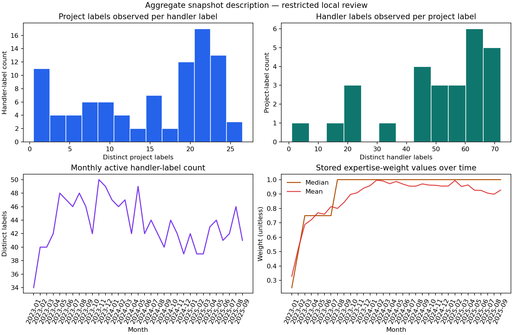
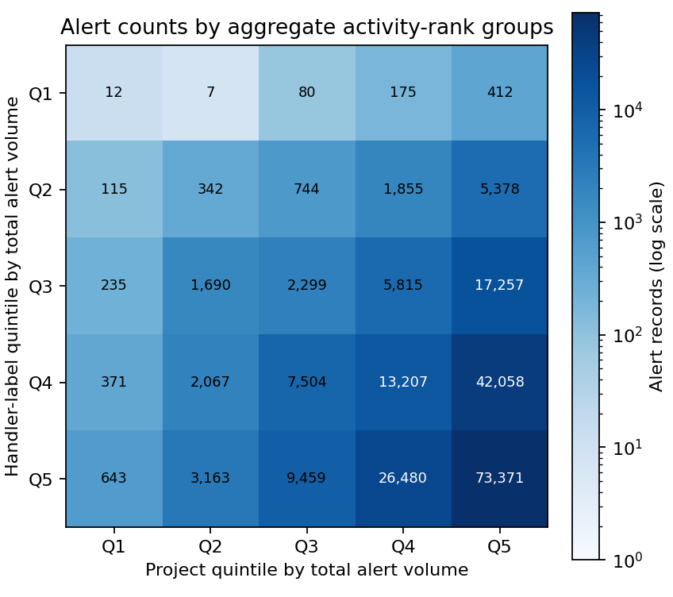
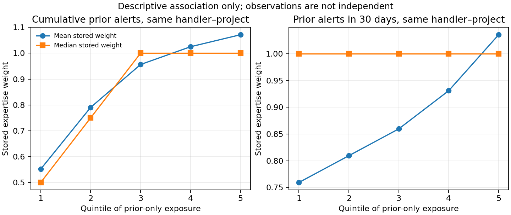

# Auditoría de experiencia, especialización y trayectorias de tramitadores

**Fecha del análisis:** 2026-10-28
**Estado:** análisis local agregado para revisión del PI; sin autorización de difusión.
**Fuente cuantitativa principal:** snapshot local `dataset_20250919.csv` (214.739 registros; intervalo observado 2022-12-31 a 2025-09-18).
**Restricciones:** no se copiaron datos de origen ni identificadores individuales; no se entrenaron modelos, no se ejecutaron simulaciones HLS y no se modificó el core. No se hizo commit ni push.

## Conclusión ejecutiva

El material SOCTRA contiene una **propuesta documentada de ponderación estática** basada en recuentos históricos por operador/proyecto y una lista de expertos suministrada por CERT. No contiene una definición reproducible de la actualización temporal llamada `sample_weight_dinamic_expertise`, ni código que la genere o metadatos que prueben que la propuesta estática produjo `weight_matrix.csv`. El entregable describe experiencia mediante volumen de investigaciones/alertas y juicio operativo; no la valida como competencia.

El snapshot permite reconstruir **asociaciones de alertas registradas** por etiqueta de `tramitador`, proyecto y timestamp. Se observan concentración de actividad, asociaciones con varios proyectos y cambios temporales de pesos. No permite identificar con seguridad personas, asignaciones efectivas en tiempo real, esfuerzo, carga simultánea, experiencia laboral ni aprendizaje. La mayoría de los pesos por pareja operador–proyecto aumenta en el tiempo y se asocia positivamente con exposición previa; es compatible con una regla acumulativa de exposición, pero no demuestra que esa sea la fórmula ni que represente mejora de capacidad.

**Consecuencia para HLS:** los datos pueden calibrar distribuciones de volumen, concentración, mezcla de proyectos y proxies de exposición. No justifican calibrar directamente matrices de competencia, tasas de aprendizaje, productividad individual, utilización laboral o capacidad liberada en horas.

## 1. Fuentes, alcance y jerarquía de evidencia

Se analizó exclusivamente el snapshot de mayor cobertura de `Journal/data/interim/raw/dataset_20250919.csv`; se contrastó con snapshots acumulativos anteriores, `weight_matrix.csv`, código Python y documentación técnica local. Los documentos DOCX originales permanecen en sus ubicaciones SOCTRA y no se copiaron al repositorio.

| Fuente | Uso y evidencia que aporta | Límite |
|---|---|---|
| `WP4/Docs/WP4_SOCTRA_Entregable_Etapa3_v1.docx`, §4.2, pp. 46–47, Tablas 11–12 | Expone una matriz de recuentos por analista/proyecto, reglas de ponderación y excepción de expertos. | Describe el método, pero no proporciona código de generación, fecha de corte de cada peso ni prueba de que sea la fuente de las columnas del snapshot. |
| `WP4/Docs/WP4_SOCTRA_Fase3-DTS_v1.docx`, §5.3 | Conserva el encabezado “(Escribir GMV)” y una nota explícita de que faltaba documentar cómo se calcularon los pesos y qué criterios se siguieron. | Confirma una brecha de especificación en esa versión. |
| `WP4/Docs/Informe Final Etapa 2/WP4_SOCTRA_TriajeAlertas-DTS_v1-2.docx`, §4.2 y esquema de datos | Repite las reglas propuestas; el esquema marca las fechas de asignación/primera asignación de tramitador como no disponibles online. | No acredita identidad humana ni cronología de asignación. |
| `New_Code_2025/uc3m/uc3mprep.py`, `func_load_data` | Carga una columna de pesos ya presente en el CSV o la busca en una matriz por `(tramitador, proyecto)`. | Consume valores; no genera la ponderación de experiencia. |
| `New_Code_2025/task_cv_model_new.py` | Selecciona `sample_weight_dinamic_expertise`; activa `flag_uniform=True`, `mode_uniform='dynamic'`; la uniformización ocurre antes de crear/cargar el split temporal. | El comportamiento de uniformización es distinto de la generación del peso de experiencia; ver §5. |
| `New_Code_2025/uc3m/uc3mstats.py`, `calculate_contextual_alarm_statistics` | Calcula recuentos móviles de alertas previas por SOC/proyecto/tramitador con ventana configurada y `closed='left'`. | Es intensidad de registros previos, no trabajo activo, tiempo ni disponibilidad. |
| `task_coding_all_col_label.py` | Une `weight_matrix.csv` por tramitador y toma la celda del proyecto; denomina el valor `fiabilidad`. | Etiqueta semántica del código, no validación independiente de fiabilidad o competencia. |

La búsqueda en el código disponible no localizó un generador ejecutable de las tres columnas `sample_weight_*` ni de `weight_matrix.csv`. La historia Git del repositorio local `SoC_WP4_main` tampoco contiene esos datos como fuente versionada. La matriz está en otro directorio local y carece de metadatos de procedencia visibles. No se pudo verificar una fórmula adicional en las notas DOCX examinadas.

## 2. Origen y semántica de los pesos

### 2.1 Propuesta estática documentada

El entregable de Etapa 3 indica que la matriz base cuenta investigaciones resueltas por proyecto y analista; el texto de las reglas alterna “investigaciones” y “alertas”. A partir de esa matriz propone asignar por pareja analista–proyecto:

| Condición escrita en el documento | Peso propuesto |
|---|---:|
| Más de 250 alertas en el proyecto **o** más de 2.000 globales para el tramitador | 1,00 |
| Más de 150 en el proyecto **o** más de 1.000 globales | 0,75 |
| Más de 50 en el proyecto **o** más de 500 globales | 0,50 |
| Menos de 50 en el proyecto **o** menos de 500 globales | 0,25 |
| Excepción de la lista de analistas expertos por proyecto facilitada por CERT | 1,50 |

Esto es una **regla propuesta/documentada**, no una función reproducida. Las condiciones usan umbrales solapados con “o”; no especifican formalmente precedencia, desempate entre reglas ni valores exactamente iguales a los umbrales. Tampoco aclaran de forma consistente si la unidad contada es una investigación en estado DONE, una alerta resuelta o ambas. La excepción 1,50 depende de una lista externa de CERT que no se encontró junto con el snapshot. Por tanto, la tabla no basta para reconstruir `weight_matrix.csv` de manera única.

### 2.2 Variante temporal y columnas del CSV

La misma documentación dice que en el enfoque dinámico todos empiezan con 0,25 —salvo quienes figuran como expertos— y que acumulan “experiencia” aumentando progresivamente su peso. **No define** incremento, cadencia, umbrales dinámicos, tratamiento de proyectos, inactividad, cambios de identidad, retrocesos ni fecha de corte. La nota de la versión DTS que pide completar el cálculo de pesos refuerza esta falta de especificación.

En el snapshot, las tres columnas tienen valores distintos:

| Campo | Valores distintos observados | Parejas tramitador–proyecto con variación temporal |
|---|---:|---:|
| `sample_weight_dinamic_expertise` | 5 | 927 / 1.341 (69,1 %) |
| `sample_weight_dinamic` | 4 | 935 / 1.341 (69,7 %) |
| `sample_weight_static` | 5 | 77 / 1.341 (5,7 %) |

Para `sample_weight_dinamic_expertise`, los cinco valores observados son 0,25, 0,50, 0,75, 1,00 y 1,50; no hay ausencias en el snapshot. La matriz `weight_matrix.csv` tiene 68 filas de operador y 24 columnas de proyecto (1.632 celdas numéricas). Frente al snapshot de 91 valores de tramitador y 27 etiquetas de proyecto, faltan 23 valores de operador y 3 proyectos. Hay una celda matricial poblada para 197.786 alertas (92,1 %), pero solo coincide exactamente con la columna expertise en 41,3 % de esas filas; las coincidencias con las columnas dynamic y static son 45,2 % y 50,5 %. Las columnas pueden codificar variantes o versiones distintas: estas discrepancias impiden afirmar equivalencia directa, no prueban por sí solas un error.

### 2.3 ¿Dependen de operador, proyecto, tiempo o etiquetas?

- **Operador y proyecto:** el esquema de la matriz y el código de unión establecen que `weight_matrix.csv` es indexada por tramitador y proyecto. En el snapshot, la mediana del peso expertise por pareja operador–proyecto varía entre operadores en 26 de 27 proyectos; para 65 de 91 etiquetas de operador, las medianas de pareja varían entre proyectos. Esto establece dependencia descriptiva de ambos ejes, no su causa.
- **Tiempo:** el peso expertise cambia en 927 parejas; 1.252 parejas tienen al menos dos timestamps. Al colapsar empates por timestamp con la mediana, 922 secuencias aumentan monotónicamente, 325 quedan planas, 4 disminuyen y 1 no es monótona. Esta forma es compatible con actualización acumulativa, pero el snapshot no demuestra que el peso se calculase “as of” cada timestamp.
- **Etiquetas de decisión:** la regla estática descrita depende de recuentos y una lista de expertos, no formula explícitamente una función del acierto, `escalada_L2` o `reportado`. Los pesos se adjuntan a ejemplos etiquetados y se usan como `sample_weight`; eso no significa que se hayan estimado a partir de la corrección de la etiqueta. El campo `fiabilidad` del otro pipeline es una interpretación del código, no validación empírica de la calidad de las decisiones.
- **Información futura:** no hay versión/as-of de los pesos. Una matriz basada en recuentos globales y expertos, unida a registros históricos, podría incorporar actividad posterior al instante evaluado; no se puede descartar con lo disponible. Para la variante dinámica tampoco se puede verificar ausencia de look-ahead.

### Riesgo separado en el procesamiento de etiquetas

En el runner `New_Code_2025/task_cv_model_new.py`, `flag_uniform=True` y `mode_uniform='dynamic'`; la llamada a `func_uniform` ocurre después de cargar/preprocesar todo el dataset y **antes** de construir el split por fecha. La función en `uc3mprep.py` agrupa patrones por las características configuradas, calcula distribución y transiciones con las etiquetas del DataFrame completo y vuelve a asignar etiquetas ordinales/binarias a los patrones ambiguos. Por tanto, si una misma combinación de características aparece en entrenamiento y en validación/test, sus etiquetas futuras participan en la transformación de etiquetas anteriores. Esto constituye una ruta concreta de fuga temporal potencial (y de información entre particiones) en ese pipeline. Es independiente de cómo se generaron los pesos de experiencia; no se ejecutó el pipeline ni se verificó si afectó a resultados publicados.

## 3. Actividad y estructura entre proyectos

En el snapshot final hay 214.739 alertas con `id_alerta` único, 91 valores no vacíos de `tramitador`, 27 proyectos y 1.341 parejas activas tramitador–proyecto. El nombre `tramitador` se interpreta prudentemente como una **etiqueta de operador asociada al registro**; no prueba que sea un individuo, el asignado original, quien tomó ambas decisiones o el único participante.

| Agregado de actividad | Resultado |
|---|---:|
| Proyectos etiquetados por operador: mediana [Q1, Q3], rango | 18 [8, 21,5], 1–25 |
| Operadores etiquetados por proyecto: mediana [Q1, Q3], rango | 56 [44,5, 63], 1–72 |
| Operadores con una sola etiqueta de proyecto | 9 / 91 |
| Operadores con ≥5 etiquetas de proyecto | 76 / 91 |
| Gini de recuentos de alertas por etiqueta de operador | 0,554 |
| Cuota de las 10 etiquetas con más registros | 33,1 % |
| Gini de recuentos por proyecto | 0,603 |
| Cuota de los 5 proyectos con más registros | 59,2 % |

La actividad no está uniformemente repartida. El número de etiquetas de proyecto por operador sobrestima la diversidad efectiva cuando la mayor parte de su actividad se concentra en pocos proyectos: la diversidad efectiva `exp(entropía)` de las cuotas de actividad por operador tiene mediana 6,81 proyectos (Q1 3,19; Q3 10,73). Es una medida de distribución de registros, no de polivalencia ni conocimiento transferible. La matriz agregada agrupa operadores y proyectos en quintiles de volumen; no revela celdas individuales.

Como proxy de familiaridad temática, `use_case_id` tiene 590 valores no ausentes distintos y 107 filas sin valor; el número de valores distintos por etiqueta de operador tiene mediana 120 (Q1 37; Q3 214,5). Su semántica como taxonomía estable y su correspondencia con tecnologías/amenazas deben validarse antes de usarlo como categoría científica.

**Especialización observada:** sí hay concentración de asociaciones de alertas por operador/proyecto y pesos que varían entre ambas dimensiones. No hay evidencia suficiente para afirmar especialización de competencia: faltan evaluaciones de capacidad por tipo de tarea, identidad humana estable, horas/roles y medidas de calidad atribuibles al individuo con criterio de verdad externo.

## 4. Evolución temporal reconstruible

El timestamp cubre 2022-12-31 a 2025-09-18 y no contiene zona horaria. Entre enero de 2023 y septiembre de 2025 (33 meses), se observan 34–50 etiquetas de tramitador activas por mes (mediana 42; media 43,4). Son etiquetas con registros en el mes, no headcount, turnos ni plantilla disponible. La primera aparición de una etiqueta en el extracto tampoco demuestra incorporación laboral; puede reflejar alcance de datos o recodificación.

Se observan 16–23 etiquetas de proyecto activas al mes (mediana 21). Cinco de las 27 etiquetas aparecen por primera vez en el extracto desde enero de 2024. “Primera observación” no significa fecha real de alta de cliente/proyecto: puede deberse a cobertura, cambio de codificación o entrada tardía al conjunto.

La actividad diaria por etiqueta permite contar intervalos sin registros: la mediana entre días activos consecutivos es 1 día, el percentil 90 es 3 días y el máximo observado es 703 días; 131 intervalos son de al menos 30 días. Sin roster, horarios, vacaciones, roles y cobertura completa, no pueden llamarse ausencias ni bajas. No se puede recuperar la carga concurrente ni la continuidad laboral real.

El peso expertise tiene asociación descriptiva con exposición estrictamente previa al timestamp del registro. Al ordenar por operador–proyecto y excluir todas las alertas empatadas en timestamp, el peso medio pasa de 0,552 en el quintil inferior a 1,071 en el superior de recuentos previos acumulados de esa pareja; las medianas son 0,50 y 1,00. Para actividad de esa pareja en los 30 días anteriores, las medias aumentan de 0,759 a 1,035 (medianas 1,00 en los cinco quintiles). Son relaciones descriptivas, no independientes por alerta y potencialmente incorporan la propia regla de generación del peso; no estiman efecto del aprendizaje.

Los resultados son compatibles con que el peso codifique una exposición acumulada o una clase de experiencia de negocio; la subida casi monótona dentro de parejas favorece esa interpretación como hipótesis. No distinguen acumulación de exposición, revisión retrospectiva, fiabilidad subjetiva, corrección de identidad o cambios de pipeline. Que el peso descienda en algunas parejas o que su media agregada baje después de 2024 puede deberse a composición de operadores/proyectos y no implica pérdida individual de competencia.

## 5. Calidad, identificadores, empates y versiones

### Integridad del snapshot

- No se encontraron IDs de alerta duplicados ni filas completas duplicadas en el snapshot principal; tampoco ausencias en `tramitador`, `proyecto`, `@timestamp0`, las tres columnas de peso, contadores seleccionados y etiquetas `escalada_L2`/`reportado`.
- `id_nuntiare` está ausente en 170.382/214.739 registros (79,3 %), por lo que no permite enlazar universalmente alerta y caso/agrupación.
- Hay 7.437 grupos de dos o más registros con mismo operador, proyecto y timestamp (12.198 filas adicionales respecto a una fila por grupo). Son alertas distintas, no duplicados por ID.
- En 14 grupos de timestamp coincidente, 55 registros tienen más de un valor expertise. En los 14 varían `assigned_alerts_count` y `alert_count`; sus rangos dentro del grupo se asocian positivamente con el peso (Spearman mediano 0,933). `escalada_L2` y `reportado` son constantes dentro de esos 14 grupos. Algunos metadatos de alerta también cambian; por ello, la secuencia de contador es una explicación plausible de las diferencias, pero no se identifica una fórmula única.
- `assigned_alerts_count` y `alert_count` cambian dentro de todos los grupos multi-registro empatados. Tras reducir cada timestamp a la mediana y ordenar timestamps estrictamente, ambos contadores de asignaciones se observan no decrecientes en 91/91 etiquetas de operador y 1.341/1.341 parejas. Ese patrón es compatible con contadores acumulativos, pero la semántica, unidad, reinicios y productor no están definidos. El orden entre alertas con timestamp idéntico no se puede reconstruir.

### Estabilidad de las etiquetas entre snapshots

Las siete exportaciones de `Journal/data/interim/raw/` son acumulativas por ID; `dataset_2025_septiembre.csv` y `dataset_20250919.csv` son byte-idénticos. Las copias de `dataset_20250919.csv` en `Journal`, `Journal.Macarra` y `Journal.work` también tienen el mismo SHA-256. No deben contarse como réplicas independientes.

En comparaciones por `id_alerta`, las etiquetas `tramitador` de enero (74 valores), febrero (77) y abril (81) se relacionan con las etiquetas del snapshot final de forma uno-a-uno, pero coinciden literalmente en solo 684, 2 y 1 filas, respectivamente. En marzo (77 valores) aparecen relaciones muchos-a-muchos; julio (87) y septiembre coinciden exactamente con el snapshot final. Proyecto y timestamp permanecen iguales en estas correspondencias. Esto demuestra recodificación/revisión del campo entre versiones, no explica quién decidió cada alerta ni si fue una anonimización, corrección o reasignación. La cronología por etiqueta solo es defendible dentro de una versión, y la estabilidad de identidad humana entre versiones queda sin verificar.

Los campos de fecha de asignación y primera asignación se señalan como no disponibles online en el informe de Etapa 2. También faltan trazas de historial de reasignación. Por tanto, un timestamp de alerta unido al `tramitador` de una exportación posterior no garantiza quién estaba asignado en ese momento.

## 6. Indicadores reproducibles admisibles para HLS

Los siguientes indicadores pueden calcularse sin llamarlos competencia. Para todo tiempo de corte `t`, usar únicamente registros con timestamp **estrictamente menor que `t`**; excluir empates temporales hasta disponer de una secuencia fiable. Los valores deben llevar etiqueta de proxy de exposición/actividad.

| Indicador | Definición operativa sugerida | Interpretación admisible |
|---|---|---|
| Exposición acumulada | Conteo de alertas elegibles asociadas al operador antes de `t` | Historial de registros observados |
| Exposición específica de proyecto | Conteo antes de `t` por operador × proyecto | Familiaridad de actividad registrada en ese proyecto |
| Exposición reciente | Conteo en ventanas predefinidas, por ejemplo 7/30/90 días previos, o suma exponencial con semivida fijada antes de evaluar | Intensidad reciente de registros; sensibilidad al corte |
| Diversidad de proyectos | Número de proyectos y `exp(H)` de la distribución histórica de alertas por proyecto | Diversidad de actividad observada |
| Concentración | HHI/Gini de cuotas de alertas por operador y de operador dentro de proyecto | Desigualdad de asociación/carga registrada |
| Continuidad | Días activos / días observables, número y distribución de gaps, solo si la ventana de observación es explícita | Continuidad de registros en la ventana, no asistencia |
| Familiaridad con categorías | Conteos previos y entropía por categoría observable (p. ej., `use_case_id` o severidad) | Exposición previa a categorías; no destreza |

Si se requiere competencia, debe existir un criterio independiente de resultado (adjudicación fiable, evaluación controlada o rúbrica validada), identidad y atribución de tarea, más control de dificultad y oportunidad de observación. El `reportado`/`escalada_L2` del operador no equivale por sí solo a verdad de referencia.

## 7. Consecuencias para dimensionamiento y preguntas a GMV-CERT

### Calibrable ahora, con reservas

- Volúmenes temporales de alertas del extracto y mezcla observada de proyectos/categorías.
- Distribución de registros por etiqueta `tramitador`, proyecto y sus concentraciones.
- Número observado de etiquetas activas por mes, diversidad de proyecto por etiqueta y distribución de gaps de registro, siempre descritos como cobertura de datos.
- Distribución empírica de los pesos almacenados y su relación descriptiva con recuentos históricos.

### Debe seguir hipotético hasta recibir evidencia

- Número real de analistas, plantilla por turno, composición L1/L2 y disponibilidad.
- Horas de servicio por alerta, trabajo en curso, colas, interrupciones, complejidad y capacidad efectiva.
- Matriz individual de competencia por clase/tarea, productividad, curva de aprendizaje, olvido, polivalencia y especialización real.
- Costes/tiempos de formación y mentoría, coste de oportunidad, límites de reasignación y efecto operativo causal de la IA.
- Reglas de escalado/decisión como resultado de competencia individual y no de proceso, permisos o preferencias.

### Solicitud de datos/metadatos

1. Diccionario versionado de `tramitador`, incluidos tipo de entidad, identificador estable seudonimizado, cuentas técnicas/compartidas, asignado vs. actuante, responsables por decisión, revisiones, co-tramitación y cambios de codificación.
2. Código, versión, fecha de corte y reglas completas de cada peso; matriz original con procedencia autorizada; lista/categoría del override de expertos y aclaración de “investigaciones DONE” frente a “alertas resueltas”.
3. Historial temporal de asignación, reasignación, inicio/fin/resolución, SLA, esperas, WIP, disponibilidad/turnos, dedicación y carga concurrente.
4. Taxonomía estable de proyectos/clientes, categorías, amenazas y cambios de entorno, con eventos de alta/baja y fechas efectivas.
5. Registros de formación/mentoría y evaluación de competencias con rúbrica, fecha y oportunidades comparables; resultados adjudicados independientemente del tramitador.
6. Linaje de snapshots y explicación de la recodificación de `tramitador`; definición/unidad/productor de `assigned_alerts_count`, `alert_count` y `numero_eventos`.

## 8. Separación de afirmaciones

- **Observado:** las asociaciones de alertas del snapshot muestran distribución desigual entre etiquetas de operador y proyectos; hay pesos por registro de cinco niveles, mayormente no decrecientes dentro de pareja tras colapsar timestamps; entre versiones antiguas se recodificó `tramitador`.
- **Derivado:** Gini, entropía efectiva, actividad mensual, exposición acumulada/reciente y diferencias de peso son transformaciones de los registros, no variables medidas por SOCTRA.
- **Inferencia compatible:** la trayectoria de peso parece ligada a acumulación de actividad; los contadores variables en empates son una posible explicación de algunos cambios dentro de un timestamp.
- **No demostrado:** que el peso mida experiencia individual, fiabilidad validada o competencia; que una etiqueta sea una persona; que actividad alta signifique aprendizaje; que un proyecto observado por un operador indique especialización; que se haya usado solo pasado; que una correlación de pesos y exposición represente aprendizaje.

## Fuentes locales revisadas

Rutas relativas a los directorios SOCTRA locales; se citan para trazabilidad, no se copian ni distribuyen:

- `Journal/data/interim/raw/dataset_20250919.csv` y snapshots acumulativos enero–septiembre de 2025.
- `WP4/data/interim/raw/weight_matrix.csv`.
- `New_Code_2025/uc3m/uc3mprep.py`: `func_load_data`, `func_uniform`.
- `New_Code_2025/task_cv_model_new.py`: selección de `sample_weight_dinamic_expertise`, orden de uniformización y partición.
- `New_Code_2025/uc3m/uc3mstats.py`: `calculate_contextual_alarm_statistics`.
- `task_coding_all_col_label.py`: lectura de matriz y campo `fiabilidad`.
- `WP4/Docs/WP4_SOCTRA_Entregable_Etapa3_v1.docx`, §4.2, pp. 46–47, Tablas 11–12.
- `WP4/Docs/WP4_SOCTRA_Fase3-DTS_v1.docx`, §5.3.
- `WP4/Docs/Informe Final Etapa 2/WP4_SOCTRA_TriajeAlertas-DTS_v1-2.docx`, §4.2 y esquema de datos.

**Confidencialidad:** las cifras y figuras de esta versión son agregadas, pero derivan de datos locales SOCTRA/GMV-CERT. Permanecen para revisión del PI y no deben publicarse ni subirse a GitHub sin autorización de divulgación.

### Disposición al cierre documental

El 2026-10-28 a las 20:32:49 CET (+0100), el PI autorizó expresamente el commit y push de este informe agregado y de sus tres figuras anónimas como documentación del estudio en este repositorio y en la PR de revisión, que permanece en borrador. La autorización no incluye CSV fuente, filas, identificadores individuales, perfiles por persona ni reutilización en un manuscrito u otra distribución. La autorización del propietario de los datos y los permisos editoriales siguen sujetos a confirmación cuando correspondan.
