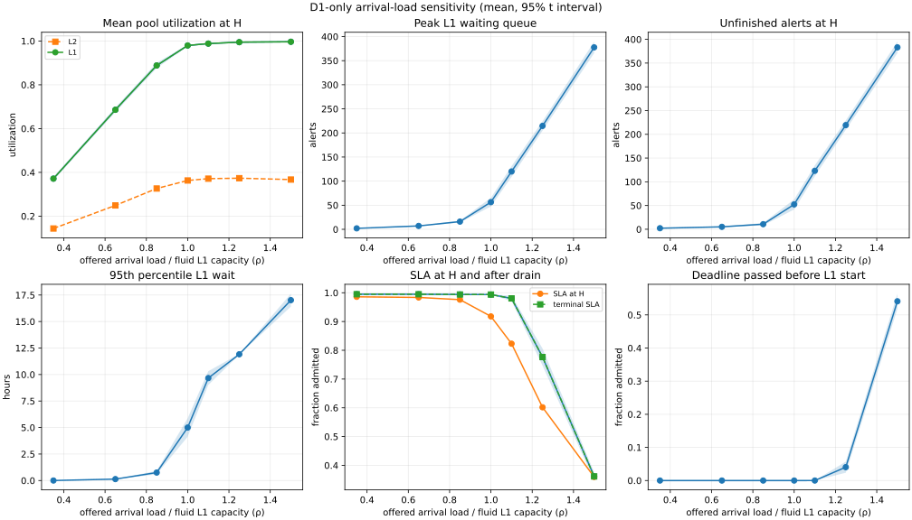
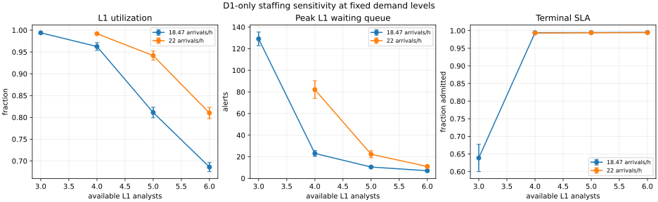
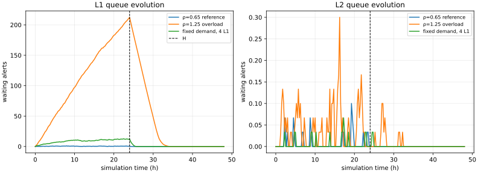
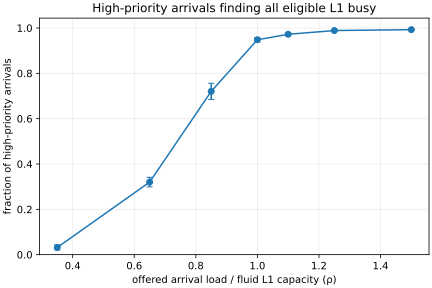

# A0 — Caracterización de congestión del baseline D1

**Estado:** piloto de caracterización D1 ejecutado y revisado científicamente como exploratorio en la [consolidación](SOC_SCIENTIFIC_CONSOLIDATION.md). Resultados sintéticos y descriptivos; no son evidencia sobre el SOC real de GMV-CERT.
**Ejecución:** 19-11-2026; 420 episodios, 14 configuraciones × 30 semillas (`261140000`–`261140029`); duración 36,5 s en el host de ejecución.
**Reproducibilidad:** [`run_a0_baseline_congestion.py`](run_a0_baseline_congestion.py), [`config/a0_baseline_congestion.json`](config/a0_baseline_congestion.json). Los CSV y SVG se guardan localmente en `results/soc_a0_baseline_congestion/`, ignorado por Git.

## 1. Dictamen operativo del motor

La inspección de `src/hls/ia_l1_l2_simulation.py::generate_alerts` confirma llegadas Poisson homogéneas para estas corridas; clase, severidad/prioridad, dificultad y referencia de escalado se generan según parámetros sintéticos. `src/hls/rq1_l1_l2.py::simulate_l1_l2` ejecuta el pool L1 y luego crea entradas L2 en la finalización L1 para alertas cuya recomendación sintética se acepta en el escenario.

En `src/hls/rq1_allocation.py::simulate`, los eventos de llegada y finalización se procesan con despacho inmediato. `::_dispatch_d1` recorre analistas libres en orden aleatorio reproducible, selecciona localmente y retira cada alerta elegida; si no hay analista libre elegible, las alertas permanecen en la cola. El servicio es secuencial y no preemptivo. D1 no usa batching ni una ventana de espera.

Las colas son diccionarios pendientes sin límite de capacidad. El código no descarta alertas por saturación, no las elimina al vencer su deadline y no implementa expiración. Un SLA incumplido es un resultado de puntualidad, no una pérdida de alerta. Al cierre H, `EndToEndMetrics.pending` cuenta alertas aún no resueltas terminalmente, incluidas las que están en servicio. Tras el drenaje H+D, las alertas no completadas se contarían como pendientes/censuradas; en las corridas A0 el valor fue cero. Para las alertas escaladas, el SLA terminal se decide al completar L2.

**Calidad:** no se simula ni observa una resolución correcta/incorrecta realizada. Se registra únicamente el proxy esperado de calidad `competencia × (1 − 0,35 × dificultad sintética)`. No se trata como exactitud real. Las salidas terminales y por prioridad usan como denominador todas las alertas admitidas (`arrival < H`); la cola de espera, en cambio, excluye tareas ya iniciadas.

## 2. Configuración del piloto

Se mantuvieron fijos el roster base, competencias, velocidades, elegibilidad media 2,5 clases/L1, tres analistas L2, clase base (0,592/0,236/0,172), mezcla de prioridades (0,50/0,35/0,15), deadlines hipotéticos low/medium/high de 12/4/1 h y regla D1. La decisión de encaminamiento fue aceptación hipotética de recomendaciones sintéticas; la tasa base modelada de escalado/recomendación es baja, por lo que el dimensionamiento L2 es condicional a esa regla. No se consultaron registros SOCTRA.

| Serie | Variación | Valores probados | Criterio |
|---|---|---|---|
| A — demanda | Tasa de llegada con 6 L1 y 3 L2 | \(\rho_{L1}=0,35; 0,65; 0,85; 1,0; 1,1; 1,25; 1,5\), respecto a capacidad fluida de 28,419 alertas/h | Extiende los puntos A1 hacia una zona de transición y sobrecarga severa. |
| B — disponibilidad | 18,472 llegadas/h, misma traza y 3 L2; L1 activos 6, 5, 4 y 3 | Capacidades fluidas estimadas: 28,419; 23,886; 18,793; 13,797 alertas/h; \(\rho\): 0,650; 0,773; 0,983; 1,339 | Subconjuntos predefinidos del roster de seis, manteniendo intactos los perfiles individuales de quienes siguen activos. |
| C — carga alta y dotación reducida | 22 llegadas/h, 3 L2; L1 activos 6, 5 y 4 | \(\rho\): 0,774; 0,921; 1,171 | Contraste conjunto de demanda alta con reducción moderada de plantilla; no se extendió a tres L1. |

Todas las series usan horizonte de admisión H=24 h y drenaje D=24 h. Las llegadas se detienen en H; se publican por separado las métricas en H y H+D. La capacidad es el límite fluido LP de `calibrate_a1_scenarios.effective_capacity` para mezcla, roster, servicios y elegibilidad hipotéticos, no una medición de plantilla GMV.

## 3. Resultados de carga

Medias de 30 semillas por celda. `Q L1 máx.` es el máximo de alertas esperando, no incluye el trabajo en servicio; `Q L1 media` es el área temporal de la cola de espera dividida por H. Utilización L1/L2 es la media por analista en H. SLA-H y SLA-terminal se calculan sobre todas las alertas admitidas. La tabla completa con desviaciones e IC95% está en `summary_metrics.csv`.

| \(\rho_{L1}\) | Llegadas/h | Util. L1/L2 | Q L1 media/máx. | P95 espera L1 (h) | SLA H / H+D | Pendientes H | Altas con todos los elegibles ocupados | Vencidas antes de iniciar L1 |
|---:|---:|---:|---:|---:|---:|---:|---:|---:|
| 0,35 | 9,95 | 0,372 / 0,144 | 0,015 / 2,0 | 0,002 | 0,986 / 0,995 | 2,2 | 3,2% | 0,0 |
| 0,65 | 18,47 | 0,686 / 0,249 | 0,463 / 7,1 | 0,137 | 0,984 / 0,995 | 5,1 | 32,0% | 0,0 |
| 0,85 | 24,16 | 0,888 / 0,326 | 3,539 / 16,0 | 0,753 | 0,976 / 0,994 | 10,7 | 72,0% | 0,0 |
| 1,00 | 28,42 | 0,980 / 0,363 | 27,383 / 56,5 | 4,999 | 0,918 / 0,994 | 52,4 | 94,8% | 0,0 |
| 1,10 | 31,26 | 0,988 / 0,371 | 61,429 / 120,0 | 9,666 | 0,823 / 0,980 | 123,1 | 97,2% | 0,03 |
| 1,25 | 35,52 | 0,995 / 0,374 | 112,371 / 214,6 | 11,912 | 0,602 / 0,777 | 219,4 | 98,9% | 35,1 |
| 1,50 | 42,63 | 0,997 / 0,367 | 193,666 / 377,6 | 17,018 | 0,360 / 0,361 | 383,2 | 99,3% | 551,6 |

En \(\rho=0,85\), la utilización se acerca a 0,89 y la cola/espera ya crecen, aunque el SLA terminal permanece cerca de 0,994 por el drenaje. En \(\rho=1\), la utilización media L1 es 0,980, con cola máxima media 56,5 y P95 de espera de 5 h; el SLA-H cae a 0,918, mientras el drenaje eleva el terminal a 0,994. A \(\rho=1,25\), la cola máxima media alcanza 214,6 y el SLA terminal cae a 0,777. A 1,5, el SLA terminal es 0,361 y más de la mitad de las alertas, en promedio, ya habían vencido antes de empezar L1.

Los valores terminales elevados hasta aproximadamente \(\rho=1\) no significan que la cola esté sana: H+D permite completar trabajo tardío cuando las llegadas cesan. La diferencia H frente a H+D muestra el sesgo que introduciría reportar sólo el resultado drenado.

### Sensibilidad a la dotación L1

| Serie y dotación | Capacidad/h | \(\rho\) | Util. L1/L2 | Q L1 máx. | P95 espera L1 (h) | SLA H / H+D | Pendientes H |
|---|---:|---:|---:|---:|---:|---:|---:|
| B: 6 L1, 18,47/h | 28,42 | 0,650 | 0,686 / 0,249 | 7,1 | 0,137 | 0,984 / 0,995 | 5,1 |
| B: 5 L1, 18,47/h | 23,89 | 0,773 | 0,811 / 0,249 | 10,5 | 0,367 | 0,981 / 0,995 | 6,2 |
| B: 4 L1, 18,47/h | 18,79 | 0,983 | 0,963 / 0,242 | 23,1 | 2,029 | 0,957 / 0,994 | 16,8 |
| B: 3 L1, 18,47/h | 13,80 | 1,339 | 0,994 / 0,189 | 129,1 | 12,107 | 0,519 / 0,639 | 130,4 |
| C: 6 L1, 22/h | 28,42 | 0,774 | 0,810 / 0,300 | 11,0 | 0,329 | 0,980 / 0,994 | 7,7 |
| C: 5 L1, 22/h | 23,89 | 0,921 | 0,942 / 0,296 | 22,3 | 1,542 | 0,965 / 0,994 | 15,6 |
| C: 4 L1, 22/h | 18,79 | 1,171 | 0,992 / 0,259 | 82,1 | 7,660 | 0,838 / 0,993 | 82,9 |

La plantilla reducida a cuatro L1 con 18,47 llegadas/h queda cerca de la capacidad fluida y ya acumula esperas; con tres L1 la carga excede la capacidad estimada y el SLA-H baja a 0,519. En la serie C, cuatro L1 ante 22/h llevan \(\rho\) a 1,171. El L2 permanece por debajo de 0,38 de utilización media incluso en el mayor barrido de demanda; con la tasa de escalado sintética usada, el cuello observado es L1. Cambiar la tasa/decisión de escalado puede cambiar esta conclusión.

## 4. Prioridades, clases y alertas urgentes bloqueadas

El porcentaje de alertas high que llega cuando **todos** los L1 elegibles están ya ocupados aumenta de 3,2% a \(\rho=0,35\), 72,0% a 0,85, 94,8% a 1,0 y más de 98% desde 1,25. En la celda \(\rho=1,25\), las esperas acumuladas de alertas high suman 34,35 horas por episodio de 24 h; en 1,5 suman 138,92 horas. Son sumas sobre alertas y pueden solaparse en el tiempo, no duración de un único periodo de equipo saturado. En esas celdas, el 100% de la espera high observada coincide con todos sus analistas elegibles ocupados.

En el escenario de 1,5×, el SLA terminal por prioridad es 0,558 para high, 0,496 para medium y 0,207 para low; bajo 1,25× las tres fracciones quedan próximas a 0,776. En la composición de clases, a 1,25× el SLA terminal es 0,661 para `portfolio_top5`, 0,912 para `portfolio_next5` y 0,982 para `portfolio_tail`; a 1,5× es 0,260, 0,449 y 0,586, respectivamente. Son estratos sintéticos basados en proporciones agregadas, no nombres de clientes ni resultados de clientes reales. La disparidad muestra carga relativa desigual en la simulación; no identifica por sí sola una ineficiencia evitable de D1.

El diagnóstico de bloqueo se calcula para cada alerta high admitida comprobando la ocupación del intervalo de servicio de todos los L1 elegibles en su instante de llegada y durante su espera observada. En el motor, una tarea urgente no interrumpe servicios ya iniciados: el procesamiento es no preemptivo. Bajo congestión, un analista ocupado no puede tomar alertas nuevas aunque sean más urgentes; ésa es una restricción de capacidad/servicio existente, no una pérdida de alerta ni prueba de que otra política la evitaría.

## 5. Calidad, vencimientos, pendientes y pérdidas

En todas las 420 ejecuciones, todas las alertas generadas fueron admitidas (llegada antes de H), no hubo descartes y se conservó la identidad `admitidas = completadas terminales + pendientes al cierre`. No quedaron alertas censuradas tras D=24 h en estas trazas. Eso no implica que D=24 h garantice drenaje bajo cualquier carga o duración: el motor no tiene límite de cola, y en un episodio de más largo horizonte o drenaje menor podrían quedar pendientes.

Las “vencidas antes de iniciar L1” son alertas cuyo servicio L1 empezó después del deadline (o aún no había empezado al corte terminal). Se contaron 35,1 por episodio en media con \(\rho=1,25\) y 551,6 en 1,5. No son descartes: la cola las conserva y el servicio puede comenzar/completarse tarde. La calidad esperada de resolución modelada varió entre 0,638 y 0,699 en estas celdas, no es una medida empírica de resolución correcta y depende de la composición de trabajos completados y de competencias/dificultad sintéticas.

## 6. Gráficas y artefactos

Las figuras se producen con el runner y usan medias/IC t del 95% entre 30 semillas.

Artefactos locales (excluidos de Git): `episode_metrics.csv` (420 filas), `summary_metrics.csv` (medias, SD e IC95%), `stratified_metrics.csv`/`stratified_summary.csv` (prioridad y clase), `queue_trajectories.csv` (cuadrícula de 0,25 h), cuatro figuras SVG y `run_metadata.json`. El resumen de semilla es una media de métricas por episodio; los IC95% son t de Student con 29 grados de libertad y no se ajustaron por multiplicidad.

## 7. Interpretación y alcance para la comparación posterior

- **Régimen holgado:** aproximadamente \(\rho\leq0,65\) para este roster, con bajo backlog y SLA terminal techo. Una comparación de políticas basada sólo en SLA terminal tendría poco poder discriminativo.
- **Transición:** entre 0,85 y 1,0 suben utilización, espera, cola y SLA incumplido en H. Es el rango más útil para observar deterioro operacional sin que la mayoría de tareas quede fuera de plazo.
- **Sobrecarga:** desde aproximadamente 1,1–1,25 las colas y esperas crecen con rapidez; en 1,5, SLA y capacidad quedan fuertemente degradados. El cambio de régimen es de este modelo sintético, no una frontera operacional GMV.
- **Cuello de botella:** con aceptación IA/escalado fijada en el nivel base, el cuello es L1. La reducción L1 deja L2 aún más ocioso. No se identificó una pérdida de alertas ni un límite de cola.
- **Eficiencia local:** el despacho D1 procesa inmediatamente todo par elegible disponible. Al final de cada época D1 no deja un analista libre que pudiera atender alguna alerta pendiente elegible; cuando quedan cola y analistas libres, la explicación compatible con el código es falta de elegibilidad para esa cola. Esto no elimina los periodos en que los especialistas necesarios están ocupados.
- **No atribución causal:** la congestión, alertas high bloqueadas y diferencias entre clases no demuestran cuánto podría corregirse mediante otra organización. A0 no comparó políticas y no permite atribuir una fracción de las pérdidas a D1.

Para la comparación posterior se recomienda conservar como anclas un régimen holgado (\(\rho\approx0,65\)), uno de transición (0,85–1,0) y una sobrecarga moderada (1,1–1,25), además de la sensibilidad de plantilla a demanda fija (seis, cinco y cuatro L1). La celda 1,5 es útil como límite de estrés, no como escenario representativo. Mantener deadlines base y reportar H y H+D por separado; la celda más severa muestra que el drenaje no restaura los deadlines. Estas son recomendaciones de cobertura derivadas de la respuesta del modelo, no calibración a GMV ni selección para favorecer una política.

## 8. Limitaciones

Las llegadas son Poisson homogéneas; competencias, servicios por clase/analista, roster, elegibilidad, deadlines, probabilidades de escalado y rendimiento IA son sintéticos o hipotéticos. La disponibilidad reducida usa subconjuntos de los perfiles existentes, por lo que conserva las competencias de los individuos activos pero cambia la composición del pool disponible. No se modelan turnos, breaks, ausencia, L3, colas finitas, abandono, reaperturas, calidad observada, error de resolución realizado ni aprendizaje. El SLA low/medium/high de 12/4/1 h no está validado como SLA contractual. El drenaje fijo D=24 h puede ocultar retrasos; por ello se reportan los cortes.

**Conclusión:** A0 localiza la transición sintética cerca de la capacidad efectiva L1, muestra crecimiento de colas y bloqueo de alertas high con saturación, y descarta descartes por cola como mecanismo del motor actual. No identifica por sí sola pérdidas organizativas evitables ni demuestra mejora de política alguna.

El [diagnóstico cuantitativo de debilidades D1](SOC_A0_D1_ORGANIZATIONAL_WEAKNESSES.md) añade 18 episodios acotados: pérdidas positivas de orden local sólo en la carga 1,25, sin intercambios simultáneos ni ociosidad factible observados. Son oportunidades locales, no mejoras terminales demostradas.
