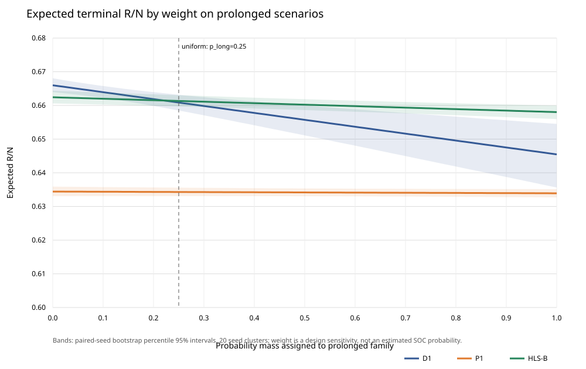
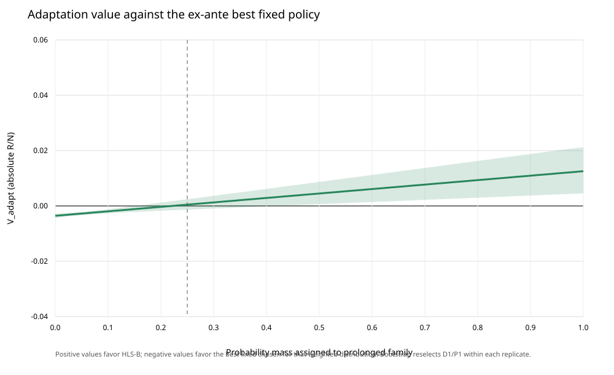
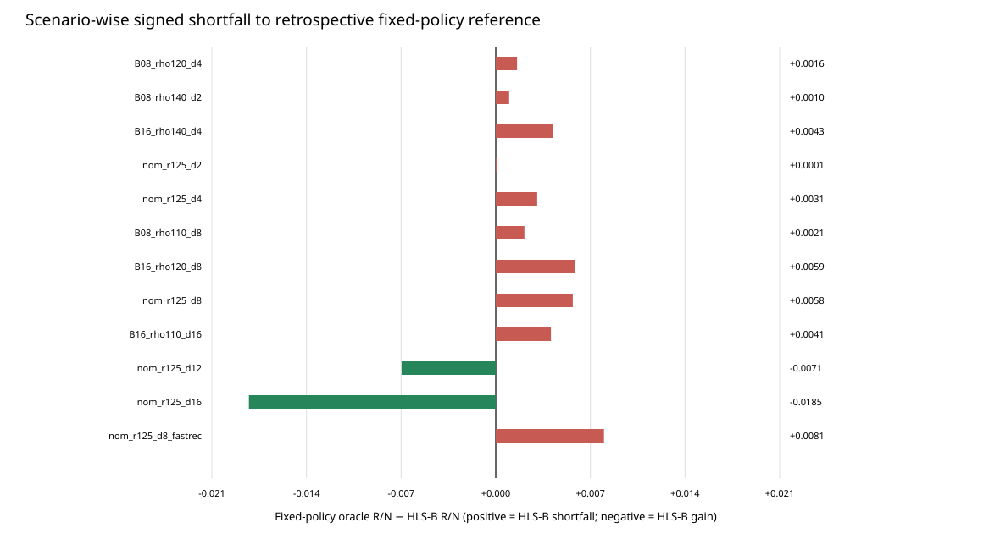

# SOCTRA–HLS — Valor de la adaptación bajo incertidumbre operativa

**Alcance:** análisis secundario de CSV publicados en el commit bec423a54588de2e5157265f810f3617d1994b4d. No se ejecutó el simulador, no se ajustó HLS-B y no se cambiaron D1/P1, motor ni configuraciones. Todas las conclusiones de esta nota son exploratorias, salvo la cita separada a la validación confirmatoria previa.

## Pregunta y estimandos

Para una distribución de escenarios p fijada sin seleccionar resultados favorables, el valor adaptativo se estima como V_adapt = E_p[R(HLS-B)] − max(E_p[R(D1)], E_p[R(P1)]). D1/P1 se elige una sola vez para la distribución completa y representa una organización fija ex ante. El oracle retrospectivo limitado usa E_p[max(mean_s R(D1,s), mean_s R(P1,s))]; selecciona D1 o P1 por escenario con sus medias observadas. No es política implementable ni oracle de decisiones individuales. HLS-B es el supervisor causal evaluado, no una selección retrospectiva.

El regret firmado frente a esa referencia se define como R_oracle−E_p[R(HLS-B)]; puede ser negativo cuando HLS-B supera incluso al mejor fijo retrospectivo. La mejora relativa es V_adapt dividido por el R/N esperado de la mejor fija ex ante. La métrica primaria es V_adapt absoluta en R/N.

## Datos y validaciones

Se usaron 12 escenarios, 20 semillas (261240000–261240019), tres políticas y el corte H+D=48 h de [`episodes.csv`](../../results/soc_hls_operating_regions/episodes.csv). Para cada escenario-semilla se comprobó una fila por política, hash de traza común, admitidas comunes y admitidas=completadas+pendientes. El valor R/N se usa directamente, sin reconstruir denominadores. Hay 1200 filas de sensibilidad SLA/plantilla; los hashes comunes por política y configuración se comprobaron, y se mantienen fuera de la distribución central.

Los perfiles comparten identificadores de semilla y usan streams aleatorios correlacionados entre escenarios. El bootstrap trata cada identificador de semilla como un clúster y remuestrea juntos sus 12 escenarios y tres políticas; no trata 240 filas como independientes. Los IC de V_adapt son percentiles de 10.000 remuestras emparejadas, con semilla bootstrap 20261120 y mejor política fija reseleccionada en cada réplica. Solo hay 20 clústeres originales: los intervalos son exploratorios y no incluyen incertidumbre sobre la distribución real de escenarios.

## Distribución uniforme: referencia matemática

Uniforme significa 1/12 para cada fila central, no 1/12 para cada tipo real de episodio. Se usa solo como benchmark. Las familias disjuntas son: breve (5 escenarios, pulso ≤4 h), moderada (3 escenarios, pulso de 8 h y recuperación habitual), prolongada (3 escenarios, pulso ≥12 h) y recuperación rápida (1 variante d8, rho recuperación .70). Cada familia reparte su masa por igual entre sus miembros. En la distribución uniforme, masas son 5/12, 3/12, 3/12 y 1/12; la variante rápida queda separada para no duplicar el escenario nominal de 8 h en las familias de duración.

| Política | R/N esperado uniforme | Diferencia vs mejor fija ex ante | Relativa vs mejor fija |
|---|---:|---:|---:|
| D1 | 0.660855 | +0.000000 | +0.000% |
| P1 | 0.634296 | -0.026559 | -4.019% |
| HLS-B | 0.661325 | +0.000470 | +0.071% |
| Mejor fija ex ante | **0.660855 (D1)** |  |  |

**V_adapt uniforme = +0.000470 R/N** (+0.071% de la mejor fija D1); IC95% bootstrap emparejado [-0.001327, +0.002417], P(V>0) bootstrap=0.675. La política fija seleccionada por la media es D1; en remuestras bootstrap fue D1 ganadora 100.0% y P1 0.0%. HLS-B tuvo menor rendimiento seed-portfolio que esa fija en 50.0% de los 20 seed portfolios. Estas fracciones describen variabilidad Monte Carlo en el conjunto, no probabilidades operativas.

**Oracle retrospectivo uniforme:** R_oracle=0.662208; signed shortfall/regret R_oracle−HLS-B=+0.000883. Diferencia relativa oracle–HLS-B=+0.134% de la mejor fija ex ante. El regret máximo entre medias de escenario es +0.008109 en nom_r125_d8_fastrec; es un máximo observado dentro de 12 escenarios seleccionados, no una cota de peor caso.

## Sensibilidad a los pesos: no son prevalencias SOC

Las cuatro familias son una partición exhaustiva y no solapada de las 12 celdas. Para cada barrido se varía la masa de una familia p=0…1; el resto se distribuye proporcionalmente al número de escenarios de las otras familias en el diseño central. Dentro de cada familia, la masa se reparte igualmente. Así la curva de peso prolongado reproduce exactamente la distribución uniforme en p=0.25. No se optimizaron pesos para favorecer HLS-B; no son estimaciones de frecuencia en GMV-CERT.

Puntos de lectura de la familia prolongada:

| Peso prolongado | Peso breve/moderado/rápido | D1 | P1 | HLS-B | Mejor fija ex ante | V_adapt [IC95 bootstrap] | Oracle−HLS-B | Pérdida HLS-B vs fija en seed portfolios |
|---:|---|---:|---:|---:|---|---|---:|---:|
| 0.00 | 0.556/0.333/0.111 | 0.665985 | 0.634423 | 0.662427 | D1 | -0.003558 [-0.004288; -0.002832] | +0.003558 | 100.0% |
| 0.25 | 0.417/0.250/0.083 | 0.660855 | 0.634296 | 0.661325 | D1 | +0.000470 [-0.001327; +0.002417] | +0.000883 | 50.0% |
| 0.50 | 0.278/0.167/0.056 | 0.655725 | 0.634170 | 0.660224 | D1 | +0.004498 [+0.000637; +0.008683] | -0.001792 | 45.0% |
| 0.75 | 0.139/0.083/0.028 | 0.650596 | 0.634043 | 0.659122 | D1 | +0.008526 [+0.002594; +0.015004] | -0.004467 | 30.0% |
| 1.00 | 0.000/0.000/0.000 | 0.645466 | 0.633916 | 0.658020 | D1 | +0.012554 [+0.004537; +0.021207] | -0.007142 | 30.0% |

Regiones de ganador por media a lo largo de esta familia 1D:
- p_prolonged ∈ [0.0000, 0.2208]: D1 tiene mayor R/N esperado entre las tres.
- p_prolonged ∈ [0.2208, 1.0000]: HLS-B tiene mayor R/N esperado entre las tres.
V_adapt cambia de signo en p_prolonged=0.2208 (frontera calculada sobre medias lineales de grupo). No es una frontera probabilística operativa y su ubicación no incluye incertidumbre estadística.

Sensibilidades focales restantes (pesos para p=0, .25, .50, .75, 1; estas celdas complementan el CSV completo):

| Familia a la que se da peso focal | p focal | pesos brief/moderate/prolonged/fast-recovery | D1 | P1 | HLS-B | fija ex ante | V_adapt |
|---|---:|---|---:|---:|---:|---|---:|
| brief | 0.00 | 0.000/0.429/0.429/0.143 | 0.65817 | 0.63384 | 0.66041 | D1 | +0.00224 |
| brief | 0.25 | 0.250/0.321/0.321/0.107 | 0.65978 | 0.63411 | 0.66096 | D1 | +0.00118 |
| brief | 0.50 | 0.500/0.214/0.214/0.071 | 0.66139 | 0.63439 | 0.66151 | D1 | +0.00012 |
| brief | 0.75 | 0.750/0.107/0.107/0.036 | 0.66300 | 0.63466 | 0.66205 | D1 | -0.00095 |
| brief | 1.00 | 1.000/0.000/0.000/0.000 | 0.66461 | 0.63493 | 0.66260 | D1 | -0.00201 |
| moderate | 0.00 | 0.556/0.000/0.333/0.111 | 0.65853 | 0.63451 | 0.66070 | D1 | +0.00217 |
| moderate | 0.25 | 0.417/0.250/0.250/0.083 | 0.66086 | 0.63430 | 0.66133 | D1 | +0.00047 |
| moderate | 0.50 | 0.278/0.500/0.167/0.056 | 0.66318 | 0.63408 | 0.66195 | D1 | -0.00123 |
| moderate | 0.75 | 0.139/0.750/0.083/0.028 | 0.66551 | 0.63387 | 0.66258 | D1 | -0.00292 |
| moderate | 1.00 | 0.000/1.000/0.000/0.000 | 0.66783 | 0.63365 | 0.66321 | D1 | -0.00462 |
| fast_recovery | 0.00 | 0.455/0.273/0.273/0.000 | 0.66027 | 0.63431 | 0.66152 | D1 | +0.00125 |
| fast_recovery | 0.25 | 0.341/0.205/0.205/0.250 | 0.66203 | 0.63428 | 0.66094 | D1 | -0.00109 |
| fast_recovery | 0.50 | 0.227/0.136/0.136/0.500 | 0.66379 | 0.63424 | 0.66036 | D1 | -0.00343 |
| fast_recovery | 0.75 | 0.114/0.068/0.068/0.750 | 0.66555 | 0.63421 | 0.65978 | D1 | -0.00577 |
| fast_recovery | 1.00 | 0.000/0.000/0.000/1.000 | 0.66731 | 0.63418 | 0.65920 | D1 | -0.00811 |

Los valores esperados varían linealmente dentro de cada familia porque los pesos dependen linealmente de p; el máximo entre D1/P1 puede producir un quiebre. Los intervalos bootstrap de la curva prolongada miden solo incertidumbre Monte Carlo condicionada a esas ponderaciones. La dispersión entre curvas representa sensibilidad a elecciones de p, no incertidumbre sobre la distribución real.

## Riesgo por escenario y mecanismo observado

El CSV [`scenario_risk.csv`](../../results/soc_hls_adaptation_value/scenario_risk.csv) da para las 12 celdas R/N D1/P1/HLS-B, diferencias HB−D1/HB−P1, HLS-B−mejor fija retrospectiva, magnitud/porcentaje de pérdida o ganancia, SLA y calidad completada. `seed_scenario_risk.csv` conserva las 240 diferencias por semilla-escenario emparejadas. El shortfall firmado del oracle no es siempre positivo: d12/d16 muestran ganancia de HLS-B sobre ambos fijos por media; el oracle está restringido a fijas.

HLS-B tiene shortfall positivo frente al fijo retrospectivo por medias en 10/12 escenarios y ganancia en 2/12. El mayor shortfall de media es 0.008109 (1.22% de esa fija) en nom_r125_d8_fastrec; el máximo no ofrece garantía sobre episodios futuros. En d16 rho=1.25, D1 SLA=0.9105, P1 SLA=0.9943, HLS-B SLA=0.9919; calidad esperada entre completadas D1/P1/HLS-B=0.6754/0.6378/0.6579. D1 conserva más calidad modelada pero pierde puntualidad; P1 protege deadlines con pérdida de calidad; HLS-B queda entre medias y mejora R/N frente a ambas en esta celda.

En escenarios breves y la mayoría de moderados, D1 suele ser la fija retrospectiva más alta; HLS-B mantiene rendimiento cerca de D1, pero sus pequeñas pérdidas repetidas pueden hacer preferible D1 ex ante si esos escenarios pesan mucho. En los pulsos prolongados, la acumulación y deadlines tardíos hacen que P1 o HLS-B recupere valor. HLS-B combina modos causalmente mediante estimación de carga e histéresis; esa posibilidad de adaptación no garantiza que detecte a tiempo cada episodio o que supere una fija para toda mezcla.

## SLA y plantilla: valores condicionales, no una mezcla operativa

La sensibilidad publicada solo cruza escenarios nominales de 8/16 h con cinco SLA y cinco plantillas. No hay probabilidades defendibles para configuraciones SLA/roster; no se asignan pesos conjuntos ni se mezclan estas celdas con los 12 escenarios centrales.

Resumen de V_adapt condicional (20 semillas emparejadas, bootstrap por semilla con mejor fija reseleccionada):

| Bloque | Condición | d (h) | Mejor fija ex ante | V_adapt [IC95 bootstrap] | Pérdida HLS-B vs fija entre seeds |
|---|---|---:|---|---|---:|
| sla | T0=1.0 f=4/12 | 8 | D1 | -0.00678 [-0.00800; -0.00555] | 100.0% |
| sla | T0=0.75 f=4/12 | 8 | D1 | +0.00380 [-0.00327; +0.01224] | 75.0% |
| sla | T0=1.25 f=4/12 | 8 | D1 | -0.00694 [-0.00838; -0.00547] | 100.0% |
| sla | T0=1.0 f=2/8 | 8 | D1 | +0.01000 [+0.00222; +0.01479] | 55.0% |
| sla | T0=1.0 f=8/16 | 8 | D1 | -0.00712 [-0.00842; -0.00578] | 100.0% |
| sla | T0=1.0 f=4/12 | 16 | P1 | +0.01852 [+0.01413; +0.02055] | 0.0% |
| sla | T0=0.75 f=4/12 | 16 | P1 | +0.00648 [-0.00179; +0.01356] | 20.0% |
| sla | T0=1.25 f=4/12 | 16 | D1 | -0.01089 [-0.01552; -0.00539] | 80.0% |
| sla | T0=1.0 f=2/8 | 16 | P1 | +0.01321 [+0.00445; +0.02152] | 15.0% |
| sla | T0=1.0 f=8/16 | 16 | D1 | -0.01772 [-0.01962; -0.01584] | 100.0% |
| staff | 5×3 (rho 1.03/1.52) | 8 | D1 | +0.00882 [-0.00042; +0.01798] | 45.0% |
| staff | 6×2 (rho 0.85/1.25) | 8 | D1 | -0.00637 [-0.00754; -0.00513] | 100.0% |
| staff | 6×3 (rho 0.85/1.25) | 8 | D1 | -0.00678 [-0.00801; -0.00553] | 100.0% |
| staff | 6×4 (rho 0.85/1.25) | 8 | D1 | -0.00670 [-0.00797; -0.00542] | 100.0% |
| staff | 7×3 (rho 0.72/1.06) | 8 | D1 | -0.00249 [-0.00430; -0.00090] | 35.0% |
| staff | 5×3 (rho 1.03/1.52) | 16 | D1 | +0.01584 [+0.00354; +0.02240] | 30.0% |
| staff | 6×2 (rho 0.85/1.25) | 16 | P1 | +0.01824 [+0.01425; +0.02032] | 0.0% |
| staff | 6×3 (rho 0.85/1.25) | 16 | P1 | +0.01852 [+0.01403; +0.02063] | 0.0% |
| staff | 6×4 (rho 0.85/1.25) | 16 | P1 | +0.01838 [+0.01377; +0.02035] | 0.0% |
| staff | 7×3 (rho 0.72/1.06) | 16 | D1 | -0.00496 [-0.00832; -0.00199] | 50.0% |

SLA 1:4:12 y factores alternativos modifican el signo y magnitud de HB−D1; en d16 la referencia da ventaja y T0=1.25 o separación 8:16 la invierten. Con demanda absoluta constante, más L1 reduce rho (7×3 tiene rho .724/1.065); 5×3 la eleva a 1.033/1.519. La ventaja cambia con el entorno y no puede expresarse como valor esperado sobre plantillas sin una distribución externa. Tabla completa y calidad/SLA por episodio permanecen en el CSV original publicado.

## Confirmatorio frente a exploratorio y límites

La validación confirmatoria previa mantuvo HLS-B congelada y halló en su distribución sintética equiponderada HLS-B−D1=+.02820 [+.02526;+.03115], n=100; el beneficio se concentra en sobrecarga estacionaria, no en las dos transiciones individuales. Ese resultado no es V_adapt de los 12 perfiles y no se combina con esta exploración. La comparación estacionaria D1/P1 confirmó complementariedad de régimen, no un óptimo universal.

Las 12 celdas centrales comparten los 20 seed IDs, por lo que el bootstrap por semilla es imprescindible; sin embargo, solo cuantifica Monte Carlo de las realizaciones condicionadas. No conocemos la distribución real de severidad, duración, recuperación, SLA o plantilla. El escenario uniforme y las familias de pesos son referencias matemáticas, no mezcla GMV-CERT. No se hicieron correcciones confirmatorias ni se reutilizaron las semillas confirmatorias para esta inferencia.

La demanda es Poisson por tramos y las cargas, SLA terminales, capacidad continua, competencias, servicios, routing y equipos son hipotéticos. SOCTRA aporta volúmenes de alerta, no tiempos de trabajo ni prevalencia de estos perfiles. El resultado no valida un contrato SLA ni cobertura por turnos. R/N combina puntualidad y calidad esperada y debe interpretarse junto a SLA y calidad completada.

**Conclusión:** con pesos uniformes sobre las 12 filas, el valor esperado de HLS-B frente a la mejor fija seleccionada ex ante es el V_adapt calculado arriba; la sensibilidad muestra en qué familias de pesos se vuelve positivo o negativo. El signo no es universal: D1 puede ser preferible si predominan episodios breves/moderados, mientras suficiente peso en carga prolongada puede favorecer HLS-B o P1. No hay base para determinar qué mezcla representa un SOC real, así que el análisis caracteriza condiciones de valor, no una recomendación operativa universal.

## Reproducción

Análisis puro de CSV, sin simulador: [configuración de pesos](config/soc_hls_adaptation_value.json), [script](analyze_soc_hls_adaptation_value.py). Resultados reproducibles en `results/soc_hls_adaptation_value/`: `uniform_summary.csv`, `uniform_bootstrap.csv`, `weight_sensitivity.csv`, `weight_decision_regions.csv`, `scenario_risk.csv`, `seed_scenario_risk.csv`, `conditional_sensitivity.csv`. Figuras: `figures/soc_hls_adaptation_weight_sensitivity.svg`, `figures/soc_hls_adaptation_value_ci.svg`, `figures/soc_hls_adaptation_scenario_regret.svg`.
