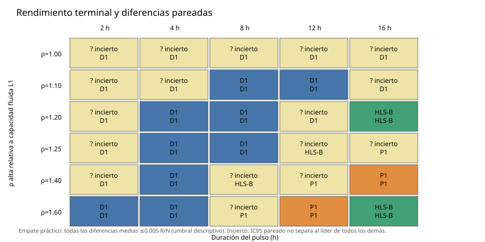
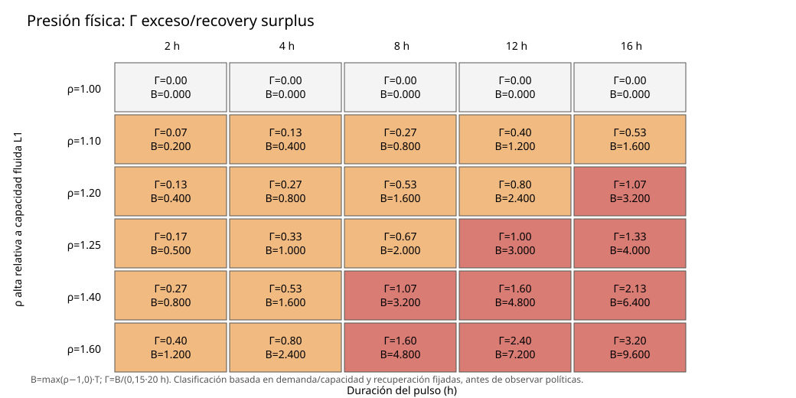
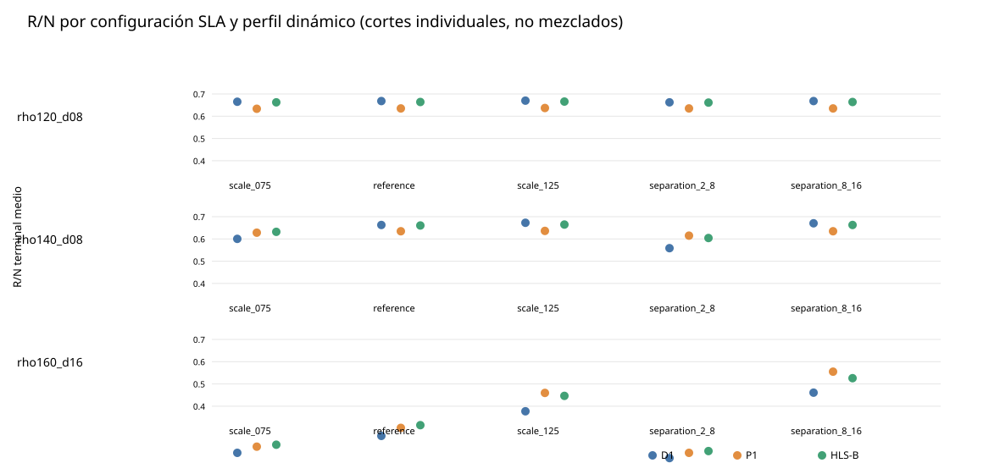
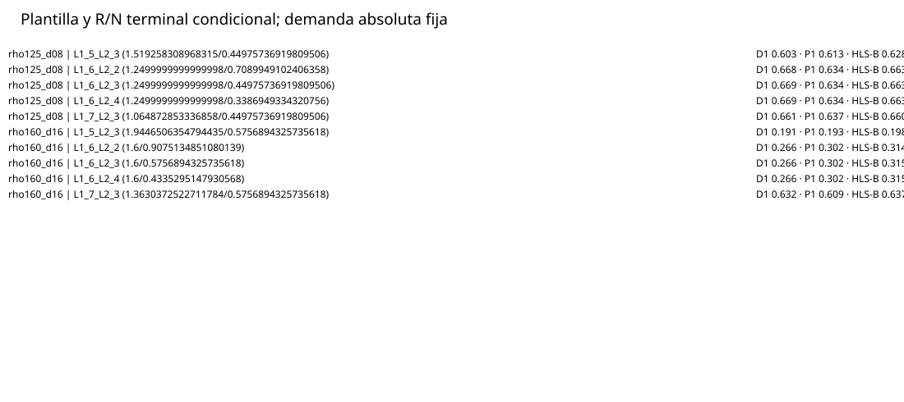

# SOCTRA–HLS — Mapa operativo paramétrico final

**Alcance:** estudio exploratorio y sintético. Se ejecutaron episodios completos emparejados con el simulador existente. D1, P1, HLS-B y el motor permanecieron congelados. No se usaron datos privados de SOCTRA ni datos confidenciales de GMV.

## Auditoría de evidencia anterior
La cifra de SLA para `nom_r125_d16` en el informe de valor adaptativo era documentalmente incorrecta. Las 20 semillas del CSV central al corte H+D=48 h dan D1=0,910502, P1=0,994254 y HLS-B=0,991937. El informe fue corregido a 0,9105 / 0,9943 / 0,9919.
La configuración y runner de `nom_r125_d8_fastrec` usan ρrec=0,70 durante 12 h. Con μL1=28,4185877 alertas/h, la exposición esperada es 4×0,85+8×1,25+12×0,70=21,8 horas equivalentes de carga; la esperanza es 619,5. El CSV muestra 618,1 admitidas medias. La tabla operativa anterior había copiado 670,7, calculado con ρrec=0,85; fue corregida. Los episodios guardados eran compatibles con configuración, por lo que no se repitieron.
Durante la verificación de la nueva serie temporal se detectó que el primer postproceso contaba alertas futuras como cola antes de su llegada. Se corrigió la regla temporal: el snapshot previo a despachar en t incluye solo alertas con llegada estrictamente anterior a t. Se repitieron las ejecuciones para regenerar los resúmenes de cola, trabajo y recuperación. Las políticas y el motor no se alteraron; la discrepancia estaba en métricas derivadas, no en la configuración de demanda ni en el R/N por episodio. Las primeras series de postproceso se descartaron.
Las pruebas del set publicado comprobaron hash de traza y denominadores iguales por política, admitidas=completadas+pendientes, coherencia de corte y SLA. Ver [`validation_checks.json`](../../results/soc_hls_final_operating_map/validation_checks.json). En especial, el CSV confirma las cifras d16 anteriores. No hubo inconsistencia que justificase repetir campañas históricas.

## Regímenes y diseño
La matriz se define antes de ver rendimientos: ρ habitual/recovery=0,85; inicio del pulso=4 h; ρalta={1,00;1,10;1,20;1,25;1,40;1,60}; duración={2,4,8,12,16 h}. Cada episodio tiene exactamente 20 h de recuperación con nuevas llegadas, y 24 h de drenaje. Admisión H=4+Tpulso+20 h (26–40 h), con plazo terminal máximo de 12 h y corte H+24 h. Así todos los deadlines maduran antes del corte; lo no resuelto permanece pendiente. La mezcla de alertas y el denominador total varían entre perfiles, pero son iguales entre políticas dentro de cada celda.
B=max(ρalta−1,0)·Tpulso expresa deuda fluida en horas equivalentes a capacidad; Γ=B/[(1−0,85)·20]. La clase normal/borde es ρalta≤1,00 (B=0); congestión operativa es ρalta>1 y Γ<1; congestión severa es Γ≥1. ρ=1,00 es saturación sin margen, no holgura; los periodos de carga habitual 0,85 son el control realmente subcapacidad. La clasificación es exógena al resultado de políticas. Estos índices son aproximaciones fluidas para el pool L1 y no resumen la elegibilidad, ruteo L2 ni deadlines por clase.
Se ejecutaron 20 semillas nuevas (261260000–261260019) en las 30 celdas. Se preasignaron 40 semillas adicionales nuevas (261270000–261270039) a las seis celdas con 0,67≤Γ≤1,33, definidas por proximidad a la frontera física Γ=1 y sin inspeccionar resultados de políticas: rho120_d12, rho120_d16, rho125_d12, rho125_d16, rho140_d08, rho160_d04. Hay 840 combinaciones semilla-perfil centrales únicas; el CSV de episodios tiene cortes H y H+D.
R/N terminal = suma de `competence×(1−0,35×difficulty)` en resoluciones puntuales, dividida por todas las admitidas. SLA es fracción puntual entre admitidas; calidad completada es el promedio de competencia ajustada entre completadas, incluidas las tardías. Los IC95 son t pareados por semilla, sin ajuste por 30 celdas ni selección; son exploratorios. No se tratan celdas como réplicas independientes. En el mapa, empate práctico significa todas las diferencias medias ≤0,005 R/N (umbral descriptivo); incertidumbre indica que el líder medio no queda separado de todos los rivales por IC pareado.

## Mapa principal: intensidad × duración

La media más alta fue D1 en 21/30 celdas, P1 en 5/30 y HLS-B en 4/30. Esto no implica dominancia. Con el criterio de mapa, 17 celdas son inciertas; los líderes separados exploratoriamente son D1=9, P1=2, HLS-B=2; empate práctico=0. Sin corrección de multiplicidad, no se elevan a validación confirmatoria.

### Resultados por celda
| Perfil | ρ alta | Pulso h | B | Γ | n | admitidas media/esperadas | pulso media/esperadas | D1 R/N | P1 R/N | HLS-B R/N | líder / estatus | HB−D1 [IC95] | HB−P1 [IC95] | D1−P1 [IC95] |
|---|---:|---:|---:|---:|---:|---:|---:|---:|---:|---:|---|---:|---:|---:|
| rho100_d02 | 1.00 | 2 | 0.000 | 0.000 | 20 | 628.0/636.6 | 56.0/56.8 | 0.6563 | 0.6351 | 0.6563 | D1 / uncertain | 0.0000 [0.0000; 0.0000] | 0.0212 [0.0183; 0.0241] | 0.0212 [0.0183; 0.0241] |
| rho100_d04 | 1.00 | 4 | 0.000 | 0.000 | 20 | 686.5/693.4 | 114.5/113.7 | 0.6583 | 0.6350 | 0.6583 | D1 / uncertain | -0.0000 [-0.0002; 0.0001] | 0.0233 [0.0202; 0.0263] | 0.0233 [0.0201; 0.0264] |
| rho100_d08 | 1.00 | 8 | 0.000 | 0.000 | 20 | 801.1/807.1 | 229.1/227.3 | 0.6615 | 0.6350 | 0.6608 | D1 / uncertain | -0.0007 [-0.0019; 0.0005] | 0.0258 [0.0236; 0.0281] | 0.0265 [0.0240; 0.0290] |
| rho100_d12 | 1.00 | 12 | 0.000 | 0.000 | 20 | 910.1/920.8 | 338.1/341.0 | 0.6629 | 0.6343 | 0.6625 | D1 / uncertain | -0.0005 [-0.0012; 0.0003] | 0.0281 [0.0264; 0.0298] | 0.0286 [0.0267; 0.0305] |
| rho100_d16 | 1.00 | 16 | 0.000 | 0.000 | 20 | 1022.6/1034.4 | 450.6/454.7 | 0.6646 | 0.6350 | 0.6640 | D1 / uncertain | -0.0006 [-0.0013; 0.0002] | 0.0291 [0.0270; 0.0311] | 0.0296 [0.0274; 0.0318] |
| rho110_d02 | 1.10 | 2 | 0.200 | 0.067 | 20 | 633.5/642.3 | 61.4/62.5 | 0.6586 | 0.6350 | 0.6586 | D1 / uncertain | 0.0000 [0.0000; 0.0000] | 0.0235 [0.0205; 0.0266] | 0.0235 [0.0205; 0.0266] |
| rho110_d04 | 1.10 | 4 | 0.400 | 0.133 | 20 | 697.4/704.8 | 125.3/125.0 | 0.6597 | 0.6350 | 0.6590 | D1 / uncertain | -0.0007 [-0.0017; 0.0004] | 0.0240 [0.0213; 0.0267] | 0.0247 [0.0218; 0.0275] |
| rho110_d08 | 1.10 | 8 | 0.800 | 0.267 | 20 | 821.9/829.8 | 249.8/250.1 | 0.6656 | 0.6348 | 0.6634 | D1 / D1 | -0.0022 [-0.0036; -0.0009] | 0.0286 [0.0260; 0.0311] | 0.0308 [0.0279; 0.0337] |
| rho110_d12 | 1.10 | 12 | 1.200 | 0.400 | 20 | 945.0/954.9 | 373.0/375.1 | 0.6674 | 0.6344 | 0.6644 | D1 / D1 | -0.0031 [-0.0048; -0.0013] | 0.0299 [0.0280; 0.0318] | 0.0330 [0.0304; 0.0356] |
| rho110_d16 | 1.10 | 16 | 1.600 | 0.533 | 20 | 1069.0/1079.9 | 497.0/500.2 | 0.6670 | 0.6343 | 0.6656 | D1 / uncertain | -0.0013 [-0.0052; 0.0026] | 0.0313 [0.0296; 0.0331] | 0.0327 [0.0275; 0.0378] |
| rho120_d02 | 1.20 | 2 | 0.400 | 0.133 | 20 | 638.5/647.9 | 66.4/68.2 | 0.6591 | 0.6356 | 0.6588 | D1 / uncertain | -0.0003 [-0.0008; 0.0002] | 0.0233 [0.0200; 0.0265] | 0.0235 [0.0201; 0.0270] |
| rho120_d04 | 1.20 | 4 | 0.800 | 0.267 | 20 | 708.5/716.1 | 136.5/136.4 | 0.6630 | 0.6344 | 0.6612 | D1 / D1 | -0.0017 [-0.0027; -0.0007] | 0.0268 [0.0241; 0.0295] | 0.0286 [0.0258; 0.0313] |
| rho120_d08 | 1.20 | 8 | 1.600 | 0.533 | 20 | 843.1/852.6 | 271.1/272.8 | 0.6681 | 0.6349 | 0.6638 | D1 / D1 | -0.0043 [-0.0054; -0.0033] | 0.0289 [0.0270; 0.0308] | 0.0332 [0.0313; 0.0352] |
| rho120_d12 | 1.20 | 12 | 2.400 | 0.800 | 60 | 982.8/989.0 | 406.8/409.2 | 0.6640 | 0.6348 | 0.6620 | D1 / uncertain | -0.0020 [-0.0052; 0.0013] | 0.0272 [0.0257; 0.0287] | 0.0292 [0.0252; 0.0331] |
| rho120_d16 | 1.20 | 16 | 3.200 | 1.067 | 60 | 1118.0/1125.4 | 541.9/545.6 | 0.6360 | 0.6347 | 0.6498 | HLS-B / HLS-B | 0.0137 [0.0074; 0.0200] | 0.0151 [0.0106; 0.0195] | 0.0013 [-0.0082; 0.0108] |
| rho125_d02 | 1.25 | 2 | 0.500 | 0.167 | 20 | 641.5/650.8 | 69.5/71.0 | 0.6595 | 0.6358 | 0.6589 | D1 / uncertain | -0.0006 [-0.0014; 0.0002] | 0.0232 [0.0203; 0.0260] | 0.0238 [0.0207; 0.0268] |
| rho125_d04 | 1.25 | 4 | 1.000 | 0.333 | 20 | 714.9/721.8 | 142.8/142.1 | 0.6640 | 0.6346 | 0.6616 | D1 / D1 | -0.0024 [-0.0034; -0.0014] | 0.0270 [0.0246; 0.0293] | 0.0294 [0.0267; 0.0321] |
| rho125_d08 | 1.25 | 8 | 2.000 | 0.667 | 20 | 854.2/863.9 | 282.2/284.2 | 0.6691 | 0.6343 | 0.6633 | D1 / D1 | -0.0057 [-0.0066; -0.0049] | 0.0290 [0.0273; 0.0307] | 0.0348 [0.0330; 0.0366] |
| rho125_d12 | 1.25 | 12 | 3.000 | 1.000 | 60 | 1000.4/1006.0 | 424.4/426.3 | 0.6547 | 0.6345 | 0.6561 | HLS-B / uncertain | 0.0015 [-0.0030; 0.0060] | 0.0216 [0.0187; 0.0246] | 0.0201 [0.0134; 0.0269] |
| rho125_d16 | 1.25 | 16 | 4.000 | 1.333 | 60 | 1140.5/1148.1 | 564.5/568.4 | 0.5997 | 0.6342 | 0.6340 | P1 / uncertain | 0.0343 [0.0267; 0.0419] | -0.0002 [-0.0062; 0.0058] | -0.0345 [-0.0467; -0.0223] |
| rho140_d02 | 1.40 | 2 | 0.800 | 0.267 | 20 | 649.9/659.3 | 77.8/79.6 | 0.6612 | 0.6356 | 0.6605 | D1 / uncertain | -0.0007 [-0.0015; 0.0002] | 0.0249 [0.0220; 0.0277] | 0.0256 [0.0225; 0.0286] |
| rho140_d04 | 1.40 | 4 | 1.600 | 0.533 | 20 | 734.8/738.9 | 162.7/159.1 | 0.6668 | 0.6346 | 0.6625 | D1 / D1 | -0.0043 [-0.0053; -0.0034] | 0.0278 [0.0255; 0.0301] | 0.0322 [0.0298; 0.0345] |
| rho140_d08 | 1.40 | 8 | 3.200 | 1.067 | 60 | 892.7/898.0 | 316.6/318.3 | 0.6587 | 0.6346 | 0.6591 | HLS-B / uncertain | 0.0003 [-0.0038; 0.0045] | 0.0245 [0.0222; 0.0267] | 0.0241 [0.0185; 0.0298] |
| rho140_d12 | 1.40 | 12 | 4.800 | 1.600 | 20 | 1045.5/1057.2 | 473.4/477.4 | 0.5763 | 0.6330 | 0.6212 | P1 / uncertain | 0.0449 [0.0309; 0.0589] | -0.0117 [-0.0236; 0.0002] | -0.0567 [-0.0792; -0.0341] |
| rho140_d16 | 1.40 | 16 | 6.400 | 2.133 | 20 | 1204.2/1216.3 | 632.1/636.6 | 0.4474 | 0.5335 | 0.5113 | P1 / P1 | 0.0639 [0.0537; 0.0741] | -0.0221 [-0.0401; -0.0041] | -0.0860 [-0.1071; -0.0649] |
| rho160_d02 | 1.60 | 2 | 1.200 | 0.400 | 20 | 661.6/670.7 | 89.6/90.9 | 0.6634 | 0.6344 | 0.6611 | D1 / D1 | -0.0024 [-0.0035; -0.0012] | 0.0267 [0.0240; 0.0294] | 0.0290 [0.0262; 0.0319] |
| rho160_d04 | 1.60 | 4 | 2.400 | 0.800 | 60 | 756.3/761.6 | 180.3/181.9 | 0.6682 | 0.6343 | 0.6633 | D1 / D1 | -0.0049 [-0.0056; -0.0043] | 0.0290 [0.0278; 0.0303] | 0.0340 [0.0327; 0.0352] |
| rho160_d08 | 1.60 | 8 | 4.800 | 1.600 | 20 | 934.1/943.5 | 362.1/363.8 | 0.5924 | 0.6336 | 0.6256 | P1 / uncertain | 0.0332 [0.0219; 0.0445] | -0.0080 [-0.0201; 0.0041] | -0.0412 [-0.0605; -0.0220] |
| rho160_d12 | 1.60 | 12 | 7.200 | 2.400 | 20 | 1114.3/1125.4 | 542.2/545.6 | 0.4047 | 0.4883 | 0.4696 | P1 / P1 | 0.0649 [0.0533; 0.0765] | -0.0187 [-0.0371; -0.0004] | -0.0836 [-0.1091; -0.0581] |
| rho160_d16 | 1.60 | 16 | 9.600 | 3.200 | 20 | 1293.2/1307.3 | 721.2/727.5 | 0.2662 | 0.3024 | 0.3147 | HLS-B / HLS-B | 0.0485 [0.0401; 0.0568] | 0.0123 [0.0095; 0.0150] | -0.0362 [-0.0451; -0.0273] |

### Estado de colas, calidad y recuperación
Cola y trabajo pendientes al final del pulso y en H son medias entre semillas bajo D1. El trabajo pendiente es una suma estimada de servicio nominal por clase para tareas L1/L2 incompletas (espera y servicio), no duración de trabajo observada. Recuperación significa que cola y trabajo estimado de ambos niveles vuelven a los valores de t=4 h durante tres horas consecutivas; `NR` es no recuperado antes de H+D. El SLA y la calidad modelada se muestran aparte. Backlog/trabajo HLS-B al retorno usa la observación horaria más cercana a la decisión de volver a D1, no un estado capturado exactamente en el instante de la decisión.

**Aclaración de auditoría sobre `rho160_d16`:** en esa fila, `292.65` es la suma media de `queue_l1 + queue_l2` en el snapshot horario más cercano al retorno HLS-B→D1; `69.395 h` es la suma de `work_l1_h_est + work_l2_h_est` en ese snapshot. Los CSV por semilla reproducen ambas cifras. La serie guarda aparte analistas ocupados (media L1+L2: 6.85) y no hay una columna de “170 h” ni una magnitud medida de trabajo residual total. El estimador de trabajo suma el servicio nominal de la clase para cada etapa incompleta, tanto en espera como en servicio; no calcula el servicio residual real, y todavía no incluye el trabajo L2 de alertas que no han terminado L1. Cola y ocupación son conteos distintos de etapas; la ocupación no se debe sumar a las horas. La cifra de aproximadamente 170 h mencionada en un resumen narrativo anterior no se reproduce con las columnas publicadas y se retira como cifra sin respaldo. El snapshot es el más cercano a la transición, no un checkpoint del instante exacto.
| Perfil | D1 SLA H | D1 calidad completadas H | Cola L1/L2 fin pulso | Trabajo L1/L2 h fin pulso | Cola L1/L2 H | Trabajo L1/L2 h H | recuperación D1/P1/HLS-B (h) | HLS-B P1 fracción pulso | activación D1→P1 (h) | retorno P1→D1 tras fin pulso (h) | backlog/trabajo al retorno |
|---|---:|---:|---:|---:|---:|---:|---|---:|---:|---:|---:|
| rho100_d02 | 0.981 | 0.660 | 7.4/0.1 | 2.9/1.0 | 8.1/1.1 | 1.9/0.9 | 13.9 / 14.15 / 13.9 | 0.00 | never | never | no returns / no returns h |
| rho100_d04 | 0.981 | 0.662 | 14.5/0.0 | 4.5/1.5 | 7.9/1.4 | 1.8/1.2 | 15.5 / 15.35 / 15.5 | 0.01 | 4.661832007373471 | 2.710692899334216 | 36.0 / 9.650000000000002 h |
| rho100_d08 | 0.983 | 0.665 | 23.2/0.1 | 6.3/1.1 | 8.3/1.1 | 1.9/1.0 | 16.3 / 16.2 / 16.3 | 0.04 | 4.080205439383551 | 1.3201174973032295 | 50.0 / 12.85 h |
| rho100_d12 | 0.985 | 0.667 | 26.4/0.0 | 6.8/0.8 | 8.2/1.3 | 1.9/1.2 | 15.9 / 16.35 / 15.9 | 0.04 | 4.080205439383551 | 0.05704378118340081 | 58.5 / 14.499999999999991 h |
| rho100_d16 | 0.985 | 0.668 | 33.1/0.1 | 8.2/1.2 | 8.9/1.2 | 2.0/1.1 | 16.8 / 16.45 / 16.8 | 0.04 | 8.747918055786073 | 0.018382339572144524 | 54.75 / 14.049999999999994 h |
| rho110_d02 | 0.980 | 0.662 | 11.8/0.0 | 3.9/1.0 | 8.1/1.2 | 1.9/1.1 | 14.65 / 15.15 / 14.65 | 0.00 | never | never | no returns / no returns h |
| rho110_d04 | 0.981 | 0.663 | 23.4/0.1 | 6.4/1.3 | 8.7/1.2 | 2.0/1.1 | 16.15 / 16.1 / 16.15 | 0.04 | 3.81526698384874 | 2.1896701391278817 | 34.333333333333336 / 10.041666666666666 h |
| rho110_d08 | 0.982 | 0.669 | 43.7/0.1 | 10.4/1.1 | 9.9/1.2 | 2.2/1.1 | 17.9 / 18.35 / 17.85 | 0.19 | 4.976044206754589 | 0.7922863168917291 | 45.54545454545455 / 12.345454545454544 h |
| rho110_d12 | 0.973 | 0.672 | 61.9/0.1 | 14.1/1.1 | 19.4/1.1 | 4.2/1.0 | 19.65 / 19.55 / 19.6 | 0.20 | 5.267817296135055 | 0.4731474587350097 | 64.66666666666667 / 16.17499999999999 h |
| rho110_d16 | 0.959 | 0.674 | 81.0/0.0 | 18.0/0.8 | 34.0/1.4 | 7.1/1.3 | 21.25 / 20.75 / 21.15 | 0.23 | 6.822449955830382 | 0.5884247102639525 | 81.8 / 19.88333333333332 h |
| rho120_d02 | 0.980 | 0.663 | 16.7/0.1 | 5.0/1.0 | 8.5/1.1 | 1.9/1.1 | 16.05 / 15.5 / 16.1 | 0.01 | 2.4405523849381088 | 2.9202276285468667 | 29.0 / 8.55 h |
| rho120_d04 | 0.980 | 0.667 | 35.0/0.1 | 8.8/1.3 | 9.5/1.2 | 2.1/1.1 | 17.65 / 17.15 / 17.75 | 0.14 | 3.023316968676238 | 2.028687741622207 | 35.54545454545455 / 10.263636363636362 h |
| rho120_d08 | 0.969 | 0.672 | 65.9/0.0 | 15.1/0.9 | 21.1/1.4 | 4.5/1.2 | 20.3 / 20.1 / 20.3 | 0.46 | 3.9473003770979584 | 0.9676087319296623 | 57.1578947368421 / 15.09210526315789 h |
| rho120_d12 | 0.935 | 0.675 | 98.2/0.0 | 21.6/1.3 | 50.0/1.2 | 10.3/1.1 | 22.116666666666667 / 22.083333333333332 / 22.05 | 0.52 | 4.502021623068159 | 1.2547302840928583 | 89.05357142857143 / 22.227678571428555 h |
| rho120_d16 | 0.873 | 0.677 | 129.8/0.1 | 28.0/1.2 | 76.6/1.2 | 15.7/1.1 | 23.166666666666668 / 23.116666666666667 / 23.183333333333334 | 0.59 | 5.014319773347547 | 1.1902289228385685 | 115.89830508474576 / 28.54322033898303 h |
| rho125_d02 | 0.980 | 0.663 | 19.7/0.1 | 5.6/1.0 | 8.6/1.2 | 2.0/1.1 | 16.4 / 15.55 / 16.4 | 0.01 | 2.6113557182119522 | 2.9412468167599113 | 27.333333333333332 / 8.016666666666667 h |
| rho125_d04 | 0.977 | 0.668 | 41.5/0.1 | 10.2/1.3 | 11.8/1.2 | 2.6/1.1 | 17.8 / 18.15 / 17.75 | 0.19 | 2.9988253760976513 | 2.1559386341320033 | 36.86666666666667 / 10.393333333333333 h |
| rho125_d08 | 0.958 | 0.674 | 78.0/0.1 | 17.7/1.5 | 30.8/1.4 | 6.4/1.3 | 21.25 / 20.7 / 21.45 | 0.44 | 1.4867322433746435 | 0.20452740806241004 | 71.85 / 18.66749999999999 h |
| rho125_d12 | 0.904 | 0.676 | 116.7/0.0 | 25.5/1.0 | 67.0/1.3 | 13.7/1.1 | 22.783333333333335 / 22.666666666666668 / 22.75 | 0.64 | 3.892775302481044 | 1.6335495133785354 | 102.1 / 25.47666666666665 h |
| rho125_d16 | 0.800 | 0.677 | 153.6/0.1 | 33.1/1.1 | 97.6/1.2 | 20.2/1.1 | 24.05 / 24.0 / 24.116666666666667 | 0.71 | 3.892775302481044 | 1.6508176526907479 | 136.01666666666668 / 33.58833333333332 h |
| rho140_d02 | 0.979 | 0.665 | 28.4/0.1 | 7.5/0.9 | 9.3/1.2 | 2.1/1.1 | 16.65 / 15.9 / 16.6 | 0.04 | 2.370896110966938 | 2.9975081101345316 | 33.42857142857143 / 10.014285714285714 h |
| rho140_d04 | 0.965 | 0.671 | 62.0/0.1 | 14.7/1.3 | 21.2/1.4 | 4.5/1.2 | 19.5 / 19.25 / 19.0 | 0.36 | 2.553858199106138 | 2.585716314297262 | 50.4 / 13.737499999999995 h |
| rho140_d08 | 0.903 | 0.676 | 113.8/0.0 | 25.4/1.1 | 65.5/1.2 | 13.4/1.1 | 22.7 / 22.633333333333333 / 22.7 | 0.65 | 2.78258986784379 | 2.4103217634958964 | 98.78333333333333 / 24.905833333333316 h |
| rho140_d12 | 0.746 | 0.678 | 168.2/0.2 | 36.7/1.5 | 110.5/1.4 | 23.1/1.2 | 24.55 / 24.5 / 24.6 | 0.79 | 2.553858199106138 | 2.3293499705766996 | 149.3 / 36.27249999999999 h |
| rho140_d16 | 0.544 | 0.674 | 220.1/0.0 | 48.3/0.8 | 155.4/1.4 | 34.3/1.2 | 26.25 / 26.75 / 26.4 | 0.84 | 2.553858199106138 | 2.357958511304569 | 201.95 / 48.48250000000006 h |
| rho160_d02 | 0.975 | 0.668 | 40.5/0.0 | 10.2/0.7 | 12.1/1.4 | 2.6/1.2 | 17.9 / 17.5 / 17.9 | 0.09 | 1.8700782446055884 | 2.978708010114949 | 36.13333333333333 / 10.963333333333333 h |
| rho160_d04 | 0.945 | 0.674 | 80.4/0.0 | 18.8/1.1 | 36.9/1.2 | 7.7/1.1 | 21.3 / 21.133333333333333 / 21.1 | 0.50 | 1.9975833677801087 | 2.8926743149680907 | 68.8 / 18.04999999999999 h |
| rho160_d08 | 0.760 | 0.679 | 160.2/0.1 | 35.8/1.2 | 106.5/1.6 | 22.1/1.4 | 24.35 / 24.4 / 24.45 | 0.75 | 1.9736246823147672 | 2.8350300649559306 | 143.2 / 34.634999999999984 h |
| rho160_d12 | 0.475 | 0.674 | 238.1/0.1 | 52.3/1.3 | 171.1/1.6 | 38.2/1.4 | 26.75 / 27.3 / 27.0 | 0.84 | 1.9736246823147672 | 2.7439762803092833 | 216.65 / 52.170000000000066 h |
| rho160_d16 | 0.331 | 0.677 | 303.9/0.1 | 68.7/1.2 | 244.9/1.3 | 54.5/1.2 | 29.25 / 30.2 / 29.75 | 0.87 | 0.8485430867168905 | 1.6793664855577624 | 292.65 / 69.39500000000014 h |

| Perfil | D1 SLA / calidad H | P1 SLA / calidad H | HLS-B SLA / calidad H | R/N terminal D1/P1/HLS-B | pendiente terminal D1/P1/HLS-B |
|---|---:|---:|---:|---:|---:|
| rho100_d02 | 0.981 / 0.660 | 0.981 / 0.639 | 0.981 / 0.660 | 0.6563/0.6351/0.6563 | 0.0/0.0/0.0 |
| rho100_d04 | 0.981 / 0.662 | 0.982 / 0.639 | 0.981 / 0.662 | 0.6583/0.6350/0.6583 | 0.0/0.0/0.0 |
| rho100_d08 | 0.983 / 0.665 | 0.983 / 0.639 | 0.983 / 0.665 | 0.6615/0.6350/0.6608 | 0.0/0.0/0.0 |
| rho100_d12 | 0.985 / 0.667 | 0.985 / 0.638 | 0.985 / 0.666 | 0.6629/0.6343/0.6625 | 0.0/0.0/0.0 |
| rho100_d16 | 0.985 / 0.668 | 0.986 / 0.638 | 0.985 / 0.668 | 0.6646/0.6350/0.6640 | 0.0/0.0/0.0 |
| rho110_d02 | 0.980 / 0.662 | 0.981 / 0.638 | 0.980 / 0.662 | 0.6586/0.6350/0.6586 | 0.0/0.0/0.0 |
| rho110_d04 | 0.981 / 0.663 | 0.981 / 0.638 | 0.981 / 0.663 | 0.6597/0.6350/0.6590 | 0.0/0.0/0.0 |
| rho110_d08 | 0.982 / 0.669 | 0.982 / 0.638 | 0.982 / 0.667 | 0.6656/0.6348/0.6634 | 0.0/0.0/0.0 |
| rho110_d12 | 0.973 / 0.672 | 0.977 / 0.638 | 0.974 / 0.669 | 0.6674/0.6344/0.6644 | 0.0/0.0/0.0 |
| rho110_d16 | 0.959 / 0.674 | 0.968 / 0.638 | 0.964 / 0.670 | 0.6670/0.6343/0.6656 | 0.0/0.0/0.0 |
| rho120_d02 | 0.980 / 0.663 | 0.980 / 0.639 | 0.980 / 0.663 | 0.6591/0.6356/0.6588 | 0.0/0.0/0.0 |
| rho120_d04 | 0.980 / 0.667 | 0.980 / 0.638 | 0.980 / 0.665 | 0.6630/0.6344/0.6612 | 0.0/0.0/0.0 |
| rho120_d08 | 0.969 / 0.672 | 0.973 / 0.638 | 0.970 / 0.668 | 0.6681/0.6349/0.6638 | 0.0/0.0/0.0 |
| rho120_d12 | 0.935 / 0.675 | 0.951 / 0.638 | 0.944 / 0.668 | 0.6640/0.6348/0.6620 | 0.0/0.0/0.0 |
| rho120_d16 | 0.873 / 0.677 | 0.932 / 0.638 | 0.908 / 0.668 | 0.6360/0.6347/0.6498 | 0.0/0.0/0.0 |
| rho125_d02 | 0.980 / 0.663 | 0.980 / 0.639 | 0.980 / 0.663 | 0.6595/0.6358/0.6589 | 0.0/0.0/0.0 |
| rho125_d04 | 0.977 / 0.668 | 0.979 / 0.638 | 0.978 / 0.666 | 0.6640/0.6346/0.6616 | 0.0/0.0/0.0 |
| rho125_d08 | 0.958 / 0.674 | 0.964 / 0.638 | 0.962 / 0.668 | 0.6691/0.6343/0.6633 | 0.0/0.0/0.0 |
| rho125_d12 | 0.904 / 0.676 | 0.936 / 0.638 | 0.921 / 0.667 | 0.6547/0.6345/0.6561 | 0.0/0.0/0.0 |
| rho125_d16 | 0.800 / 0.677 | 0.912 / 0.638 | 0.869 / 0.666 | 0.5997/0.6342/0.6340 | 0.0/0.0/0.0 |
| rho140_d02 | 0.979 / 0.665 | 0.980 / 0.639 | 0.979 / 0.664 | 0.6612/0.6356/0.6605 | 0.0/0.0/0.0 |
| rho140_d04 | 0.965 / 0.671 | 0.970 / 0.638 | 0.966 / 0.667 | 0.6668/0.6346/0.6625 | 0.0/0.0/0.0 |
| rho140_d08 | 0.903 / 0.676 | 0.930 / 0.638 | 0.918 / 0.668 | 0.6587/0.6346/0.6591 | 0.0/0.0/0.0 |
| rho140_d12 | 0.746 / 0.678 | 0.889 / 0.638 | 0.830 / 0.666 | 0.5763/0.6330/0.6212 | 0.0/0.0/0.0 |
| rho140_d16 | 0.544 / 0.674 | 0.727 / 0.638 | 0.665 / 0.660 | 0.4474/0.5335/0.5113 | 0.0/0.0/0.0 |
| rho160_d02 | 0.975 / 0.668 | 0.977 / 0.638 | 0.975 / 0.665 | 0.6634/0.6344/0.6611 | 0.0/0.0/0.0 |
| rho160_d04 | 0.945 / 0.674 | 0.953 / 0.638 | 0.948 / 0.668 | 0.6682/0.6343/0.6633 | 0.0/0.0/0.0 |
| rho160_d08 | 0.760 / 0.679 | 0.884 / 0.638 | 0.825 / 0.668 | 0.5924/0.6336/0.6256 | 0.0/0.0/0.0 |
| rho160_d12 | 0.475 / 0.674 | 0.655 / 0.638 | 0.597 / 0.661 | 0.4047/0.4883/0.4696 | 0.0/0.0/0.0 |
| rho160_d16 | 0.331 / 0.677 | 0.435 / 0.638 | 0.436 / 0.662 | 0.2662/0.3024/0.3147 | 0.0/0.0/0.0 |
Resultados detallados por cohorte, prioridad, hora y política están en `cohort_summary.csv`, `priority_summary.csv`, `timeseries.csv` y `modes.csv`.

## Sensibilidad a SLA
Se ejecutaron cinco SLA parametrizados, cada uno en tres celdas fijadas de antemano: presión moderada (ρ1,20/d8), alta (ρ1,40/d8) y severa (ρ1,60/d16). Se conservaron semillas y realizaciones de llegadas/clase/dificultad; cambian los deadlines. Las diferencias frente al baseline se calculan pareadas por semilla. El punto `reference` se mantiene separado y no se mezclan las 15 condiciones con el mapa principal.

| Perfil | T0:f_alta:f_baja | Tpulso/Tcrit | D1 | P1 | HLS-B | HB−D1 [IC95] | HB−P1 [IC95] | cambio D1/P1/HB vs referencia |
|---|---|---:|---:|---:|---:|---:|---:|---:|
| rho120_d08 | 1.0:4:12 (reference) | 8.00 | 0.6681 | 0.6349 | 0.6638 | -0.0043 [-0.0054;-0.0033] | 0.0289 [0.0270;0.0308] | 0.0000 / 0.0000 / 0.0000 |
| rho120_d08 | 0.75:4:12 (scale_075) | 10.67 | 0.6652 | 0.6334 | 0.6624 | -0.0028 [-0.0050;-0.0005] | 0.0290 [0.0270;0.0310] | -0.0030 / -0.0015 / -0.0014 |
| rho120_d08 | 1.25:4:12 (scale_125) | 6.40 | 0.6698 | 0.6370 | 0.6658 | -0.0040 [-0.0051;-0.0030] | 0.0288 [0.0269;0.0307] | 0.0017 / 0.0021 / 0.0020 |
| rho120_d08 | 1.0:2:8 (separation_2_8) | 8.00 | 0.6623 | 0.6349 | 0.6613 | -0.0010 [-0.0044;0.0025] | 0.0264 [0.0233;0.0295] | -0.0058 / 0.0000 / -0.0025 |
| rho120_d08 | 1.0:8:16 (separation_8_16) | 8.00 | 0.6681 | 0.6349 | 0.6638 | -0.0043 [-0.0054;-0.0033] | 0.0289 [0.0270;0.0308] | 0.0000 / 0.0000 / 0.0000 |
| rho140_d08 | 1.0:4:12 (reference) | 8.00 | 0.6627 | 0.6345 | 0.6605 | -0.0022 [-0.0080;0.0037] | 0.0260 [0.0236;0.0285] | 0.0000 / 0.0000 / 0.0000 |
| rho140_d08 | 0.75:4:12 (scale_075) | 10.67 | 0.6004 | 0.6283 | 0.6317 | 0.0313 [0.0196;0.0430] | 0.0035 [-0.0091;0.0160] | -0.0623 / -0.0062 / -0.0288 |
| rho140_d08 | 1.25:4:12 (scale_125) | 6.40 | 0.6726 | 0.6362 | 0.6647 | -0.0079 [-0.0088;-0.0070] | 0.0285 [0.0271;0.0298] | 0.0099 / 0.0018 / 0.0042 |
| rho140_d08 | 1.0:2:8 (separation_2_8) | 8.00 | 0.5583 | 0.6147 | 0.6040 | 0.0457 [0.0342;0.0572] | -0.0107 [-0.0231;0.0016] | -0.1044 / -0.0197 / -0.0565 |
| rho140_d08 | 1.0:8:16 (separation_8_16) | 8.00 | 0.6705 | 0.6345 | 0.6627 | -0.0078 [-0.0088;-0.0068] | 0.0282 [0.0268;0.0296] | 0.0078 / 0.0000 / 0.0022 |
| rho160_d16 | 1.0:4:12 (reference) | 16.00 | 0.2662 | 0.3024 | 0.3147 | 0.0485 [0.0401;0.0568] | 0.0123 [0.0095;0.0150] | 0.0000 / 0.0000 / 0.0000 |
| rho160_d16 | 0.75:4:12 (scale_075) | 21.33 | 0.1901 | 0.2180 | 0.2268 | 0.0367 [0.0302;0.0433] | 0.0088 [0.0068;0.0107] | -0.0761 / -0.0843 / -0.0879 |
| rho160_d16 | 1.25:4:12 (scale_125) | 12.80 | 0.3770 | 0.4596 | 0.4461 | 0.0691 [0.0553;0.0829] | -0.0135 [-0.0280;0.0011] | 0.1109 / 0.1572 / 0.1315 |
| rho160_d16 | 1.0:2:8 (separation_2_8) | 16.00 | 0.1666 | 0.1904 | 0.1983 | 0.0316 [0.0259;0.0374] | 0.0079 [0.0063;0.0095] | -0.0996 / -0.1120 / -0.1164 |
| rho160_d16 | 1.0:8:16 (separation_8_16) | 16.00 | 0.4607 | 0.5551 | 0.5259 | 0.0652 [0.0563;0.0741] | -0.0292 [-0.0430;-0.0154] | 0.1945 / 0.2527 / 0.2112 |
Los cambios de plazo alteran el mapa. En ρ1,40/d8, HB−D1 es −0,0022 para SLA de referencia, +0,0313 con escala 0,75 y +0,0457 con separación 1:2:8; se vuelve aproximadamente −0,0078 con escala 1,25 y separación 1:8:16. En ρ1,60/d16 HLS-B supera D1 en R/N en los cinco sets, pero P1 queda por encima de HLS-B en escala 1,25 y separación 1:8:16. Los SLA son hipótesis de resolución terminal y no compromisos contractuales GMV-CERT.

## Sensibilidad al dimensionamiento
Se mantienen fijas las llegadas absolutas y se recalculan cargas relativas por capacidad. Se comparan los cinco equipos ya definidos en rho1,25/d8 y rho1,60/d16. La demanda por pulso es fija a través de plantilla dentro del perfil.

| Perfil | roster | μ L1 / μ L2 tareas/h | λ pulso/h | ρL1/ρL2 | D1 | P1 | HLS-B | HB−D1 [IC95] | cambio D1/HB vs 6×3 |
|---|---|---:|---:|---:|---:|---:|---:|---:|---:|
| rho125_d08 | L1_5_L2_3 (5×3) | 23.38/3.84 | 35.52 | 1.519/0.450 | 0.6029 | 0.6132 | 0.6281 | 0.0252 [0.0089;0.0415] | -0.0662/-0.0352 |
| rho125_d08 | L1_6_L2_2 (6×2) | 28.42/2.43 | 35.52 | 1.250/0.709 | 0.6684 | 0.6339 | 0.6627 | -0.0057 [-0.0067;-0.0047] | -0.0006/-0.0006 |
| rho125_d08 | L1_6_L2_3 (6×3) | 28.42/3.84 | 35.52 | 1.250/0.450 | 0.6691 | 0.6343 | 0.6633 | -0.0057 [-0.0066;-0.0049] | 0.0000/0.0000 |
| rho125_d08 | L1_6_L2_4 (6×4) | 28.42/5.09 | 35.52 | 1.250/0.339 | 0.6690 | 0.6343 | 0.6631 | -0.0059 [-0.0068;-0.0050] | -0.0000/-0.0002 |
| rho125_d08 | L1_7_L2_3 (7×3) | 33.36/3.84 | 35.52 | 1.065/0.450 | 0.6612 | 0.6372 | 0.6599 | -0.0013 [-0.0026;-0.0001] | -0.0079/-0.0035 |
| rho160_d16 | L1_5_L2_3 (5×3) | 23.38/3.84 | 45.47 | 1.945/0.576 | 0.1913 | 0.1933 | 0.1977 | 0.0064 [0.0015;0.0113] | -0.0749/-0.1170 |
| rho160_d16 | L1_6_L2_2 (6×2) | 28.42/2.43 | 45.47 | 1.600/0.908 | 0.2656 | 0.3019 | 0.3141 | 0.0485 [0.0403;0.0568] | -0.0006/-0.0005 |
| rho160_d16 | L1_6_L2_3 (6×3) | 28.42/3.84 | 45.47 | 1.600/0.576 | 0.2662 | 0.3024 | 0.3147 | 0.0485 [0.0401;0.0568] | 0.0000/0.0000 |
| rho160_d16 | L1_6_L2_4 (6×4) | 28.42/5.09 | 45.47 | 1.600/0.434 | 0.2660 | 0.3025 | 0.3147 | 0.0486 [0.0403;0.0570] | -0.0002/0.0000 |
| rho160_d16 | L1_7_L2_3 (7×3) | 33.36/3.84 | 45.47 | 1.363/0.576 | 0.6319 | 0.6094 | 0.6375 | 0.0056 [-0.0050;0.0161] | 0.3657/0.3228 |
Las colas de L1 son mucho mayores que las de L2 en perfiles congestionados; la carga L1 es el cuello dominante en estas celdas, aunque el ruteo y elegibilidad siguen condicionando el modelo. En d8, pasar 5→6 L1 eleva D1 R/N de 0,6029 a 0,6691; 6→7 L1 cambia 0,6691 a 0,6612 (la plantilla añade heterogeneidad y no es una escalera perfectamente monotónica). En rho1,60/d16, D1 pasa 0,2662→0,6319 y HLS-B 0,3147→0,6375 con 6→7 L1; variar L2 de 2 a 4 con L1=6 cambia los resultados poco. En este escenario aumentar L1 ofrece una mejora mucho mayor que cambiar política. No se calculan costes ni se recomiendan contrataciones.

## Interpretación, evidencia y límites
D1 retiene calidad modelada y lidera muchas condiciones de menor presión. P1 protege deadlines en congestión prolongada, con descenso de calidad. HLS-B mezcla los modos de forma causal y puede mejorar ambos fijos en algunas regiones severas, pero no domina y puede volver a D1 con cola residual. Colas, calidad y SLA se distinguen: vaciar cola no demuestra puntualidad.
La configuración confirmatoria previa HLS-B tuvo diferencia HLS-B−D1 +0,02820 [0,02526;0,03115] en su distribución sintética predefinida de cuatro escenarios y 100 semillas. Ese resultado no valida la cuadrícula ni se combina con estas simulaciones. Los hallazgos del mapa son exploratorios, no se aplicó ajuste confirmatorio y no se extrapolan a frecuencia de incidentes real.
Limitaciones externas: llegadas Poisson por tramos; tareas, escalado IA, competencia, servicio, deadlines, capacidad continua, elegibilidad y plantilla hipotéticos; sin turnos, ausencias, costes o L3 reales; métricas de calidad son esperanzas del modelo. No se infieren SLA contractuales ni estructura operativa GMV-CERT. Γ no representa exactamente colas heterogéneas. La duración cambia carga total y H, aunque la recuperación posterior se fija en 20 h y cada alerta dispone del mismo drenaje para completar sus deadlines.
**Conclusión:** los datos identifican zonas de liderazgo de D1, P1 y HLS-B, además de muchas zonas inciertas. HLS-B aporta mejora en perfiles concretos, no frente a ambas fijas en toda congestión. Cambios de SLA pueden cambiar el signo de la ventaja. Cuando L1 está sobrecargado de forma severa, aumentar capacidad L1 mejora la prestación en estos ejemplos mucho más que reordenar analistas. La decisión operativa real requiere parámetros de capacidad, SLA, turnos, elegibilidad y costes no disponibles en este modelo.

## Reproducción
Runner: [`run_soc_hls_final_operating_map.py`](run_soc_hls_final_operating_map.py); resumen/mapas: [`summarize_soc_hls_final_operating_map.py`](summarize_soc_hls_final_operating_map.py); parámetros: [`config/soc_hls_final_operating_map.json`](config/soc_hls_final_operating_map.json). Tablas: `scenario_summary.csv`, `paired_seed_results.csv`, `sla_staff_summary.csv`, `cohort_summary.csv`, `priority_summary.csv`, `validation_checks.json`. Registros brutos sintéticos: `results/soc_hls_final_operating_map/{main_initial,main_extension,sla_staff}/` con episodios, cortes, semillas, hashes, series, modos, cohortes, prioridades y metadata. No se publicaron trazas de SOCTRA.
