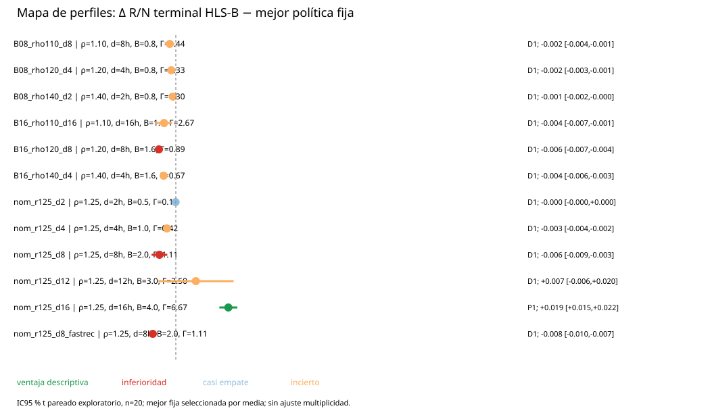

# Dominio operativo de D1, P1 y HLS-B

**Estado de evidencia:** síntesis de confirmatorios previos y exploración nueva. El barrido operativo, SLA y dimensionamiento son exploratorios; no son validación independiente de HLS-B. Los CSV completos están en results locales. No se modificaron las estrategias.

## Pregunta e hipótesis

H1: la ventaja D1/P1 depende de carga y plazos. H2: las colas conservan memoria después de reducirse la tasa. H3: HLS-B puede superar políticas fijas en algunas perturbaciones y no en otras. H4: el orden relativo cambia con escala y separación de SLA. H5: capacidad y heterogeneidad L1/L2 cambian el cuello de botella. Son hipótesis, no resultados presupuestos.

## Evidencia anterior y separación

El contraste confirmatorio D1/P1 a ρ=1,25 encontró R/N 0,5180/0,6162, diferencia P1−D1 +0,0982 [0,0891;0,1073], n=100. En cargas menores P1 puede perder. La validación independiente HLS-B sobre cuatro escenarios equiponderados encontró HLS-B−D1 +0,02820 [0,02526;0,03115], impulsada por sobrecarga estacionaria; las dos transiciones individuales no mostraron ventaja concluyente frente a D1. Estos resultados conservan sus estimandos confirmatorios originales.

Estudios dinámicos de desarrollo previos: un pulso ρ=1,25 de 16 h en H=24 mostró HLS-B−D1 +0,0286 [0,0116;0,0456] y HLS-B−mejor fija +0,0209 [0,0184;0,0234] en 20 semillas exploratorias, como única de seis duraciones favorable; al retorno a D1 persistían unas 136 alertas/31 h de trabajo. Ello motivó acotar la cuadrícula actual alrededor de carga × duración, B/Γ y recuperación. No se combinan semillas ni IC entre esos análisis.

## Diseño central: 12 escenarios completos

H=24 h de admisión; D=24 h sin llegadas. Tasa base ρ=0,85 en [0,4) y después del pulso; comienza siempre en t=4. Sobrecarga única a rho_high y duración indicadas. Roster base 6 L1/3 L2, elegibilidad 2,5 proyectos/analista, competencias, velocidad, mezcla y escalado del modelo de referencia. SLA terminal hipotético crítica/alta/baja = 1/4/12 h. HLS-B congelada (w=4 h, low=1,05, high=1,20). Veinte semillas nuevas 261240000–261240019 por perfil. Las mismas trazas se comparten entre políticas dentro del perfil/semilla.

B=(rho_high−1)T_high y Γ=B/[(1−rho_low)T_low], con T_low=24−4−T_high. B/Γ son indicadores fluidos del exceso y capacidad de recuperación disponibles, no predictores exactos del sistema heterogéneo.

| Perfil | ρ alta | T alta | T baja postpulso | B | Γ | Llegadas esperadas H |
|---|---:|---:|---:|---:|---:|---:|
| B08_rho110_d8 | 1.10 | 8 h | 12 h @ ρ=0.85 | 0.80 | 0.444 | 636.6 |
| B08_rho120_d4 | 1.20 | 4 h | 16 h @ ρ=0.85 | 0.80 | 0.333 | 619.5 |
| B08_rho140_d2 | 1.40 | 2 h | 18 h @ ρ=0.85 | 0.80 | 0.296 | 611.0 |
| B16_rho110_d16 | 1.10 | 16 h | 4 h @ ρ=0.85 | 1.60 | 2.667 | 693.4 |
| B16_rho120_d8 | 1.20 | 8 h | 12 h @ ρ=0.85 | 1.60 | 0.889 | 659.3 |
| B16_rho140_d4 | 1.40 | 4 h | 16 h @ ρ=0.85 | 1.60 | 0.667 | 642.3 |
| nom_r125_d2 | 1.25 | 2 h | 18 h @ ρ=0.85 | 0.50 | 0.185 | 602.5 |
| nom_r125_d4 | 1.25 | 4 h | 16 h @ ρ=0.85 | 1.00 | 0.417 | 625.2 |
| nom_r125_d8 | 1.25 | 8 h | 12 h @ ρ=0.85 | 2.00 | 1.111 | 670.7 |
| nom_r125_d12 | 1.25 | 12 h | 8 h @ ρ=0.85 | 3.00 | 2.500 | 716.1 |
| nom_r125_d16 | 1.25 | 16 h | 4 h @ ρ=0.85 | 4.00 | 6.667 | 761.6 |
| nom_r125_d8_fastrec | 1.25 | 8 h | 12 h @ ρ=0.70 | 2.00 | 0.556 | 619.5 |

Se incluyen tres pares aproximadamente B=0,8 y tres pares B=1,6 con amplitud/duración distintas; cinco duraciones con rho_high=1,25; y un control de recuperación postpulso a ρ=0,70. El control cambia capacidad de recuperación, no pulso. El horizonte fijo iguala tiempo potencial total, aunque duración cambia volumen de pulso y tiempo normal restante; esto se conserva explícito en cada perfil. Tasa base física es 0,85×capacidad fluida base; rho por definición respecto a roster base.

**Corrección de auditoría:** una versión anterior listó 670,7 llegadas esperadas también para `nom_r125_d8_fastrec`. Ese valor aplicaba por error la carga de recuperación ρ=0,85. Configuración y runner confirman ρ=0,70 durante las 12 h posteriores al pulso. Con μL1=28,4185877 alertas/h, la esperanza es μL1×(4×0,85 + 8×1,25 + 12×0,70)=619,5; el CSV de episodios da 618,1 admitidas de media en las 20 semillas. Los restantes perfiles conservan sus tasas y expectativas.

## Dinámica física y mapas de resultados

Cola vacía no equivale a SLA. La recuperación de trabajo se mide con serie de media hora hasta t=48. Cola pendiente es alertas sin inicio en cada pool; trabajo pendiente suma servicio nominal por clase; los plazos se clasifican en métricas por prioridad.

| Perfil | Cola L1+L2 máxima D1 | Trabajo pendiente máximo (h) | Backlog H D1 | Backlog H+D D1 | Recuperación física D1 |
|---|---:|---:|---:|---:|---|
| B08_rho110_d8 | 48.8 | 10.1 | 21.9 | 0.0 | 7.33 h (6/20) |
| B08_rho120_d4 | 39.1 | 8.2 | 14.8 | 0.0 | 8.00 h (10/20) |
| B08_rho140_d2 | 35.6 | 7.6 | 13.6 | 0.0 | 9.46 h (13/20) |
| B16_rho110_d16 | 95.4 | 19.4 | 90.2 | 0.0 | NR antes de 48 h (0/20) |
| B16_rho120_d8 | 74.8 | 15.5 | 44.9 | 0.0 | NR antes de 48 h (0/20) |
| B16_rho140_d4 | 62.6 | 13.3 | 26.5 | 0.0 | 11.60 h (5/20) |
| nom_r125_d2 | 26.6 | 5.6 | 11.8 | 0.0 | 7.00 h (15/20) |
| nom_r125_d4 | 44.2 | 9.2 | 16.4 | 0.0 | 10.41 h (11/20) |
| nom_r125_d8 | 86.5 | 18.0 | 56.9 | 0.0 | NR antes de 48 h (0/20) |
| nom_r125_d12 | 127.2 | 26.2 | 109.5 | 0.0 | NR antes de 48 h (0/20) |
| nom_r125_d16 | 165.2 | 34.2 | 158.1 | 0.0 | NR antes de 48 h (0/20) |
| nom_r125_d8_fastrec | 84.2 | 17.6 | 15.1 | 0.0 | 9.18 h (11/20) |

Recuperación física = primera ventana de tres puntos consecutivos (0,5 h) cuando backlog L1+L2 y trabajo pendiente son ambos ≤ sus valores justo antes del pulso (t=4). Las realizaciones que no recuperan antes de 48 h se cuentan como no recuperadas. No equivale a cumplimiento de SLA ni calidad.

| Perfil | D1 R/N | P1 R/N | HLS-B R/N | Δ HLS-B−D1 [IC95] | Δ HLS-B−P1 [IC95] | Mejor fija | Δ HLS-B−mejor fija [IC95] |
|---|---:|---:|---:|---|---|---|---|
| B08_rho110_d8 | 0.6669 | 0.6339 | 0.6648 | -0.0021 [-0.0038;-0.0005] | +0.0309 [+0.0287;+0.0331] | D1 | -0.0021 [-0.0038;-0.0005] |
| B08_rho120_d4 | 0.6647 | 0.6339 | 0.6631 | -0.0016 [-0.0027;-0.0005] | +0.0292 [+0.0271;+0.0314] | D1 | -0.0016 [-0.0027;-0.0005] |
| B08_rho140_d2 | 0.6637 | 0.6359 | 0.6627 | -0.0010 [-0.0018;-0.0002] | +0.0268 [+0.0243;+0.0293] | D1 | -0.0010 [-0.0018;-0.0002] |
| B16_rho110_d16 | 0.6679 | 0.6340 | 0.6637 | -0.0041 [-0.0069;-0.0013] | +0.0298 [+0.0272;+0.0323] | D1 | -0.0041 [-0.0069;-0.0013] |
| B16_rho120_d8 | 0.6690 | 0.6334 | 0.6630 | -0.0059 [-0.0074;-0.0045] | +0.0297 [+0.0277;+0.0317] | D1 | -0.0059 [-0.0074;-0.0045] |
| B16_rho140_d4 | 0.6676 | 0.6346 | 0.6633 | -0.0043 [-0.0055;-0.0030] | +0.0287 [+0.0268;+0.0305] | D1 | -0.0043 [-0.0055;-0.0030] |
| nom_r125_d2 | 0.6612 | 0.6354 | 0.6611 | -0.0001 [-0.0002;+0.0001] | +0.0258 [+0.0232;+0.0283] | D1 | -0.0001 [-0.0002;+0.0001] |
| nom_r125_d4 | 0.6658 | 0.6349 | 0.6627 | -0.0031 [-0.0043;-0.0019] | +0.0279 [+0.0255;+0.0302] | D1 | -0.0031 [-0.0043;-0.0019] |
| nom_r125_d8 | 0.6676 | 0.6337 | 0.6618 | -0.0058 [-0.0085;-0.0030] | +0.0281 [+0.0264;+0.0298] | D1 | -0.0058 [-0.0085;-0.0030] |
| nom_r125_d12 | 0.6507 | 0.6337 | 0.6577 | +0.0071 [-0.0062;+0.0204] | +0.0240 [+0.0223;+0.0258] | D1 | +0.0071 [-0.0062;+0.0204] |
| nom_r125_d16 | 0.6178 | 0.6341 | 0.6526 | +0.0347 [+0.0182;+0.0513] | +0.0185 [+0.0153;+0.0217] | P1 | +0.0185 [+0.0153;+0.0217] |
| nom_r125_d8_fastrec | 0.6673 | 0.6342 | 0.6592 | -0.0081 [-0.0095;-0.0067] | +0.0250 [+0.0226;+0.0274] | D1 | -0.0081 [-0.0095;-0.0067] |

IC95 % t pareados por perfil (19 gl), exploratorios, sin multiplicidad ni ajuste por selección de mejor fija. Una convención solo visual para el mapa: diferencia media ≥+0,005 y límite inferior >0 = ventaja observable; ≤−0,005 y límite superior <0 = inferioridad; |media|<0,005 con IC que incluye 0 = casi empate descriptivo; resto incierto. 0,005 no es umbral económico validado.

### Cohortes terminales y prioridades

R/N de cohortes pre [0,4), durante pulso y recuperación [fin pulso,24), evaluado hasta H+D y ponderado por admitidas. Se muestran celdas de duración/intensidad nominal a continuación; el CSV contiene las 36 cohortes.

| Perfil | Cohorte | D1 | P1 | HLS-B |
|---|---|---:|---:|---:|
| B16_rho140_d4 | pre | 0.6582 | 0.6391 | 0.6580 |
| B16_rho140_d4 | pulse | 0.6784 | 0.6332 | 0.6582 |
| B16_rho140_d4 | post | 0.6656 | 0.6341 | 0.6668 |
| nom_r125_d8 | pre | 0.6580 | 0.6395 | 0.6578 |
| nom_r125_d8 | pulse | 0.6769 | 0.6331 | 0.6579 |
| nom_r125_d8 | post | 0.6614 | 0.6323 | 0.6670 |
| nom_r125_d16 | pre | 0.6580 | 0.6395 | 0.6578 |
| nom_r125_d16 | pulse | 0.6141 | 0.6333 | 0.6502 |
| nom_r125_d16 | post | 0.5907 | 0.6329 | 0.6605 |
| nom_r125_d8_fastrec | pre | 0.6580 | 0.6395 | 0.6578 |
| nom_r125_d8_fastrec | pulse | 0.6775 | 0.6331 | 0.6577 |
| nom_r125_d8_fastrec | post | 0.6591 | 0.6333 | 0.6616 |

Prioridades (high=crítica, medium=alta, low=baja) se conservan por política y perfil en priority.csv, con RN, SLA, tamaño y calidad entre completadas. No se agregan alertas como réplicas; las unidades de incertidumbre son episodios pareados (semillas).

| Perfil | Política | SLA global | Calidad completadas |
|---|---|---:|---:|
| nom_r125_d2 | D1 | 0.9943 | 0.6650 |
| nom_r125_d2 | P1 | 0.9943 | 0.6391 |
| nom_r125_d2 | HLS-B | 0.9941 | 0.6650 |
| nom_r125_d8 | D1 | 0.9906 | 0.6737 |
| nom_r125_d8 | P1 | 0.9940 | 0.6377 |
| nom_r125_d8 | HLS-B | 0.9940 | 0.6658 |
| nom_r125_d16 | D1 | 0.9105 | 0.6754 |
| nom_r125_d16 | P1 | 0.9943 | 0.6378 |
| nom_r125_d16 | HLS-B | 0.9919 | 0.6579 |

Métricas por prioridad (medias ponderadas por n de alertas del estrato, no IC por alerta):

| Perfil | Prioridad | Política | R/N | SLA | Calidad completadas |
|---|---|---|---:|---:|---:|
| nom_r125_d2 | high | D1 | 0.6427 | 0.9612 | 0.6685 |
| nom_r125_d2 | high | P1 | 0.6152 | 0.9617 | 0.6406 |
| nom_r125_d2 | high | HLS-B | 0.6413 | 0.9600 | 0.6679 |
| nom_r125_d2 | medium | D1 | 0.6665 | 1.0000 | 0.6665 |
| nom_r125_d2 | medium | P1 | 0.6376 | 1.0000 | 0.6376 |
| nom_r125_d2 | medium | HLS-B | 0.6668 | 1.0000 | 0.6668 |
| nom_r125_d2 | low | D1 | 0.6633 | 1.0000 | 0.6633 |
| nom_r125_d2 | low | P1 | 0.6398 | 1.0000 | 0.6398 |
| nom_r125_d2 | low | HLS-B | 0.6633 | 1.0000 | 0.6633 |
| nom_r125_d8 | high | D1 | 0.6508 | 0.9541 | 0.6811 |
| nom_r125_d8 | high | P1 | 0.6121 | 0.9605 | 0.6385 |
| nom_r125_d8 | high | HLS-B | 0.6417 | 0.9605 | 0.6680 |
| nom_r125_d8 | medium | D1 | 0.6760 | 0.9976 | 0.6775 |
| nom_r125_d8 | medium | P1 | 0.6370 | 1.0000 | 0.6370 |
| nom_r125_d8 | medium | HLS-B | 0.6641 | 1.0000 | 0.6641 |
| nom_r125_d8 | low | D1 | 0.6667 | 0.9964 | 0.6689 |
| nom_r125_d8 | low | P1 | 0.6379 | 1.0000 | 0.6379 |
| nom_r125_d8 | low | HLS-B | 0.6663 | 1.0000 | 0.6663 |
| nom_r125_d16 | high | D1 | 0.6231 | 0.9030 | 0.6858 |
| nom_r125_d16 | high | P1 | 0.6128 | 0.9622 | 0.6373 |
| nom_r125_d16 | high | HLS-B | 0.6291 | 0.9610 | 0.6549 |
| nom_r125_d16 | medium | D1 | 0.6265 | 0.9164 | 0.6800 |
| nom_r125_d16 | medium | P1 | 0.6367 | 1.0000 | 0.6367 |
| nom_r125_d16 | medium | HLS-B | 0.6523 | 0.9989 | 0.6530 |
| nom_r125_d16 | low | D1 | 0.6080 | 0.9051 | 0.6690 |
| nom_r125_d16 | low | P1 | 0.6387 | 1.0000 | 0.6387 |
| nom_r125_d16 | low | HLS-B | 0.6597 | 0.9963 | 0.6621 |

El SLA global es proporción puntual bajo deadline terminal; la calidad es la probabilidad modelada media entre completadas. Los estratos low/medium/high corresponden a baja/alta/crítica.

### Resumen de conmutación

La transición de modo se compara con backlog observado en la muestra temporal más próxima; no se interpreta como causa.

| Perfil | Primera P1 media | Retorno D1 tras pulso | Cola L1+L2 al retorno | Trabajo al retorno (h) |
|---|---:|---:|---:|---:|
| B08_rho110_d8 | 8.83 h (8/20) | 2.05 h (6/20) | 56.8 | 13.0 |
| B08_rho120_d4 | 7.27 h (11/20) | 2.08 h (11/20) | 36.5 | 8.2 |
| B08_rho140_d2 | 6.70 h (9/20) | 3.05 h (9/20) | 33.6 | 7.5 |
| B16_rho110_d16 | 12.39 h (18/20) | 1.65 h (10/20) | 97.3 | 21.8 |
| B16_rho120_d8 | 8.12 h (18/20) | 1.96 h (17/20) | 66.1 | 15.0 |
| B16_rho140_d4 | 6.48 h (19/20) | 2.47 h (19/20) | 50.2 | 11.4 |
| nom_r125_d2 | 6.53 h (2/20) | 2.17 h (2/20) | 30.0 | 6.7 |
| nom_r125_d4 | 7.07 h (15/20) | 2.15 h (15/20) | 38.1 | 8.6 |
| nom_r125_d8 | 7.78 h (20/20) | 1.89 h (20/20) | 71.8 | 16.3 |
| nom_r125_d12 | 7.78 h (20/20) | 1.80 h (19/20) | 107.7 | 24.6 |
| nom_r125_d16 | 7.78 h (20/20) | 1.80 h (19/20) | 149.1 | 34.1 |
| nom_r125_d8_fastrec | 7.78 h (20/20) | 1.46 h (20/20) | 66.2 | 15.1 |

La serie fina de modos/colas permite valorar si el umbral de baja devuelve HLS-B a D1 mientras permanece backlog. No se presume que mantener P1 mejore entonces R/N; P1 fija y sus cohortes son referencias observadas.

## Sensibilidad SLA — configuraciones fijadas tras el barrido central

Se eligieron nom_r125_d8 (sin ventaja adaptativa en centro) y nom_r125_d16 (único pulso central con mejora HLS-B). Misma tasa/traza exógena por semilla y perfil entre cinco calendarios de deadlines; el hash excluye deadlines y conserva las otras variables. Hipótesis terminales: high/crítica T0, medium/alta f_high×T0, low/baja f_low×T0.

| Perfil | SLA config | T0 | f alta/baja | Tpulso/Tcrit | D1 | P1 | HLS-B | Δ HB−D1 | Δ HB−P1 |
|---|---|---:|---:|---:|---:|---:|---:|---:|---:|
| nom_r125_d8 | scale_075 | 0.75 | 4/12 | 10.67 | 0.6544 | 0.6336 | 0.6582 | +0.0038 | +0.0246 |
| nom_r125_d8 | reference | 1.00 | 4/12 | 8.00 | 0.6705 | 0.6350 | 0.6637 | -0.0068 | +0.0286 |
| nom_r125_d8 | scale_125 | 1.25 | 4/12 | 6.40 | 0.6723 | 0.6370 | 0.6654 | -0.0069 | +0.0284 |
| nom_r125_d8 | separation_2_8 | 1.00 | 2/8 | 8.00 | 0.6416 | 0.6345 | 0.6516 | +0.0100 | +0.0171 |
| nom_r125_d8 | separation_8_16 | 1.00 | 8/16 | 8.00 | 0.6708 | 0.6350 | 0.6637 | -0.0071 | +0.0286 |
| nom_r125_d16 | scale_075 | 0.75 | 4/12 | 21.33 | 0.5117 | 0.5954 | 0.6019 | +0.0901 | +0.0065 |
| nom_r125_d16 | reference | 1.00 | 4/12 | 16.00 | 0.6247 | 0.6342 | 0.6528 | +0.0280 | +0.0185 |
| nom_r125_d16 | scale_125 | 1.25 | 4/12 | 12.80 | 0.6675 | 0.6358 | 0.6566 | -0.0109 | +0.0208 |
| nom_r125_d16 | separation_2_8 | 1.00 | 2/8 | 16.00 | 0.4454 | 0.5203 | 0.5335 | +0.0881 | +0.0132 |
| nom_r125_d16 | separation_8_16 | 1.00 | 8/16 | 16.00 | 0.6726 | 0.6344 | 0.6549 | -0.0177 | +0.0205 |

En la escala, T0 cambia a 0,75/1,00/1,25 h manteniendo razones 1:4:12. En la separación, T0=1 h y razones 1:2:8 o 1:8:16. Se mantienen mismos IDs, tiempos, clases, dificultades, recomendaciones y semillas en cada traza. Estas diferencias siguen siendo exploratorias; no elegir SLA por mejor política. Cocientes d/T0 se infieren de tabla y perfil.

IC95 pareados de las dos diferencias de HLS-B, calculados sobre las 20 semillas comunes de cada configuración (t, 19 gl):

| Perfil | SLA config | Δ HB−D1 [IC95] | Δ HB−P1 [IC95] |
|---|---|---|---|
| nom_r125_d8 | scale_075 | +0.0038 [-0.0048;+0.0124] | +0.0246 [+0.0204;+0.0287] |
| nom_r125_d8 | reference | -0.0068 [-0.0081;-0.0054] | +0.0286 [+0.0270;+0.0303] |
| nom_r125_d8 | scale_125 | -0.0069 [-0.0086;-0.0053] | +0.0284 [+0.0267;+0.0300] |
| nom_r125_d8 | separation_2_8 | +0.0100 [+0.0010;+0.0190] | +0.0171 [+0.0078;+0.0264] |
| nom_r125_d8 | separation_8_16 | -0.0071 [-0.0086;-0.0057] | +0.0286 [+0.0270;+0.0303] |
| nom_r125_d16 | scale_075 | +0.0901 [+0.0738;+0.1064] | +0.0065 [-0.0019;+0.0149] |
| nom_r125_d16 | reference | +0.0280 [+0.0125;+0.0435] | +0.0185 [+0.0159;+0.0212] |
| nom_r125_d16 | scale_125 | -0.0109 [-0.0164;-0.0053] | +0.0208 [+0.0193;+0.0223] |
| nom_r125_d16 | separation_2_8 | +0.0881 [+0.0765;+0.0997] | +0.0132 [+0.0040;+0.0225] |
| nom_r125_d16 | separation_8_16 | -0.0177 [-0.0197;-0.0157] | +0.0205 [+0.0191;+0.0219] |

Los intervalos describen incertidumbre Monte Carlo dentro de celda; los cinco contrastes SLA no son independientes porque comparten la traza base.

## Sensibilidad al dimensionamiento

Escenarios nom_r125_d8 y d16; misma tasa física λ(t) que equipo base 6×3. Se recalculó capacidad LP efectiva L1/L2 para cada roster y rho(t)=λ(t)/μ_team, sin conservar artificialmente los rhos nominales. Elegibilidad 2,5 y perfiles deterministas existentes; capacidad continua, sin turnos.

| Perfil | Equipo L1×L2 | μL1 | μL2 | ρ normal/pulso real | D1 | P1 | HLS-B | Δ HB−D1 | Δ HB−P1 |
|---|---|---:|---:|---|---:|---:|---:|---:|---:|
| nom_r125_d8 | 5×3 | 23.38 | 3.84 | 1.03/1.52 | 0.6454 | 0.6332 | 0.6542 | +0.0088 | +0.0210 |
| nom_r125_d8 | 6×2 | 28.42 | 2.43 | 0.85/1.25 | 0.6696 | 0.6345 | 0.6632 | -0.0064 | +0.0287 |
| nom_r125_d8 | 6×3 | 28.42 | 3.84 | 0.85/1.25 | 0.6705 | 0.6350 | 0.6637 | -0.0068 | +0.0286 |
| nom_r125_d8 | 6×4 | 28.42 | 5.09 | 0.85/1.25 | 0.6706 | 0.6351 | 0.6639 | -0.0067 | +0.0288 |
| nom_r125_d8 | 7×3 | 33.36 | 3.84 | 0.72/1.06 | 0.6680 | 0.6367 | 0.6655 | -0.0025 | +0.0288 |
| nom_r125_d16 | 5×3 | 23.38 | 3.84 | 1.03/1.52 | 0.4553 | 0.4512 | 0.4711 | +0.0158 | +0.0200 |
| nom_r125_d16 | 6×2 | 28.42 | 2.43 | 0.85/1.25 | 0.6239 | 0.6338 | 0.6521 | +0.0282 | +0.0182 |
| nom_r125_d16 | 6×3 | 28.42 | 3.84 | 0.85/1.25 | 0.6247 | 0.6342 | 0.6528 | +0.0280 | +0.0185 |
| nom_r125_d16 | 6×4 | 28.42 | 5.09 | 0.85/1.25 | 0.6251 | 0.6344 | 0.6528 | +0.0277 | +0.0184 |
| nom_r125_d16 | 7×3 | 33.36 | 3.84 | 0.72/1.06 | 0.6790 | 0.6352 | 0.6740 | -0.0050 | +0.0388 |

Este diseño separa cambio en demanda física de cambio de recursos. Bajar L2 altera μL2, no tasa de entrada L1; se reporta el efecto completo de cuello/routing sintético, no se asume que L1 determine por sí solo el resultado. No se cambió composición de elegibilidad en este primer contraste porque no hay roster operativo validado para motivar otra ablation.

Diferencias pareadas HB−fijas con IC95 % exploratorio (20 episodios por roster y duración):

| Perfil | Equipo L1×L2 | Δ HB−D1 [IC95] | Δ HB−P1 [IC95] |
|---|---|---|---|
| nom_r125_d8 | 5×3 | +0.0088 [-0.0016;+0.0192] | +0.0210 [+0.0142;+0.0279] |
| nom_r125_d8 | 6×2 | -0.0064 [-0.0077;-0.0051] | +0.0287 [+0.0271;+0.0304] |
| nom_r125_d8 | 6×3 | -0.0068 [-0.0081;-0.0054] | +0.0286 [+0.0270;+0.0303] |
| nom_r125_d8 | 6×4 | -0.0067 [-0.0081;-0.0053] | +0.0288 [+0.0271;+0.0305] |
| nom_r125_d8 | 7×3 | -0.0025 [-0.0044;-0.0006] | +0.0288 [+0.0258;+0.0317] |
| nom_r125_d16 | 5×3 | +0.0158 [+0.0019;+0.0298] | +0.0200 [+0.0149;+0.0250] |
| nom_r125_d16 | 6×2 | +0.0282 [+0.0129;+0.0434] | +0.0182 [+0.0156;+0.0209] |
| nom_r125_d16 | 6×3 | +0.0280 [+0.0125;+0.0435] | +0.0185 [+0.0159;+0.0212] |
| nom_r125_d16 | 6×4 | +0.0277 [+0.0122;+0.0432] | +0.0184 [+0.0158;+0.0209] |
| nom_r125_d16 | 7×3 | -0.0050 [-0.0085;-0.0014] | +0.0388 [+0.0354;+0.0422] |

Los rosters comparten la misma secuencia exógena semilla a semilla; cambiar roster cambia rho efectiva y es una comparación de entorno, no una asignación aleatoria de personal.

## Sensibilidad de HLS-B

No se hizo ajuste de umbral ni ventana. El barrido central muestra una oportunidad exploratoria concentrada en un solo perfil de pulso largo; como la selección ocurrió mirando ese mismo barrido, probar variantes aquí optimizaría sobre el dato. Se reserva una eventual comparación de ventanas/umbrales para un protocolo fijado y semillas nuevas si la futura réplica independiente confirma una región.

## Mapa e interpretación

La clasificación del mapa usa la convención explícita anterior, no una frontera económica. Γ complementa B al expresar exceso frente al tiempo/capacidad de recuperación; pares de B semejante no siempre producen resultados equivalentes porque cambia deadline mix, composición, servicio discreto, escalado y la fracción de H consumida por el pulso. La recuperación a ρ=0,70 en el caso nominal de 8 h se contrasta con ρ=0,85, pero una diferencia entre dos perfiles no aísla solo la memoria si llegada y servicio también cambian trayectorias.

## Limitaciones y conclusión para artículo

La demanda es Poisson por tramos; el perfil por hora no está calibrado por datos timestamp restringidos. Volumen SOCTRA es registros, no trabajo activo. Servicios, equipos, competencias, escalado y SLA son hipótesis. Sin turnos/cobertura/pausas, se asume capacidad continua. Colas ilimitadas y no preemptivas. R/N es esperanza de calidad y cumplimiento puntual, no verdad de resolución observada; SLA terminal usa el final L2 para escaladas.

Conclusión defendible: las políticas fijas y HLS-B ocupan regiones condicionadas a intensidad, duración, recuperación y deadline; la matriz encuentra variación de efecto y una ventaja adaptativa exploratoria localizada, no un umbral general. La sensibilidad SLA y roster muestra cómo someter esa región a cambios controlados. Los 20 episodios por celda y múltiples perfiles/configuraciones no constituyen confirmación; no se combina el universo de escenarios como si fueran semillas independientes. Si se considera robusta una región de interés tras revisión, el siguiente paso es una sola validación preespecificada en semillas nuevas, no más búsqueda adaptativa.

## Reproducción y controles

Matriz/config: config/soc_hls_operating_regions.json; sensibilidad: config/soc_hls_operating_sensitivity.json. Runners run_soc_hls_operating_regions.py y run_soc_hls_operating_sensitivity.py; tablas episodes/cohorts/priority/timeseries/modes y manifest en results/soc_hls_operating_regions, y SLA/staffing en results/soc_hls_operating_sensitivity (local ignorado). Se verifican hashes por política, admitidas comunes, conservación completadas+pendientes y uso de 20 semillas por escenario. Las mismas IDs de semilla aparecen entre perfiles; los análisis se hacen dentro de cada perfil y no se agrupan como observaciones independientes.
