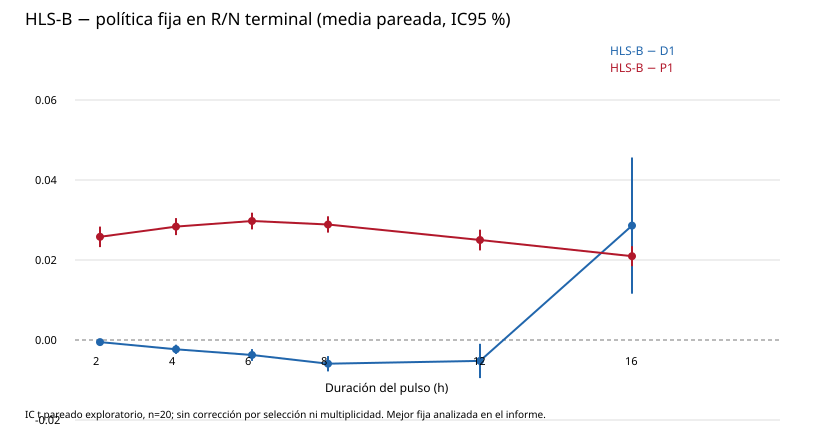

# Duración crítica de sobrecarga y recuperación dinámica

> **OLD MODEL / MODELO VIEJO:** this document records the historical L1-first organizational model and its evidence. Its results remain valid only for that model and do not validate the NEW MODEL. See [MODEL_GENERATIONS.md](../soc_triage_hls_availability_robustness/MODEL_GENERATIONS.md). The current LaTeX manuscript belongs entirely to the OLD MODEL; NEW MODEL transfer is deferred.

**Estado:** piloto exploratorio de 20 semillas nuevas por duración. HLS-B congelada (ventana 4 h, umbral bajo 1,05, alto 1,20). No es validación independiente ni se reajusta el supervisor.

## Hipótesis física y diseño

Con tasa de llegada mayor que la capacidad, el trabajo pendiente crece aproximadamente como la diferencia de tasas acumulada, modificada por clases, elegibilidad, deadlines, escalado y orden D1. Tras volver a la tasa normal, la cola residual determina cuánto tarda en recuperarse el sistema. Por ello, R/N depende conjuntamente de duración del pulso, volumen esperado, tiempo de recuperación restante dentro de H y estados heredados; no se atribuirán todas las diferencias a duración aislada.

ρ normal=0,85, ρ pulso=1,25; H=24 h, D=24 h; inicio del pulso t=4 h; fin t=4+d; retorno inmediato a ρ=0,85 hasta H. Duraciones d=2,4,6,8,12,16 h. Drenaje sin nuevas llegadas hasta t=48. Roster 6 L1/3 L2, servicios, elegibilidad, competencias, deadlines y reglas de escalado son los del estudio HLS-B; se mantienen congelados. Capacidad fluida L1 = 28.419 alertas/h. Semillas 261230000–261230019.

Tasa esperada normal/pulso/recuperación: 24.16/35.52/24.16 alertas/h. Llegadas esperadas en H son {'2': 602.4740592664768, '4': 625.208929427476, '6': 647.943799588475, '8': 670.6786697494742, '12': 716.1484100714725, '16': 761.6181503934707}. El pulso aporta 35.52 d llegadas esperadas durante su duración; al aumentar d, aumenta volumen y disminuye recuperación previa a H.

## Verificación física D1

Primero se ejecutaron 120 episodios D1. Congestión real se define aquí como cola L1+L2 positiva al final del pulso y trabajo pendiente positivo. Recuperación operacional: primer instante postpulso donde durante tres muestras consecutivas de 0,5 h la suma de colas L1+L2 y la suma de trabajo nominal pendiente no superan sus respectivos valores en t=4 h. Recuperar cola no equivale a cumplir SLA. Recuperables: alertas pendientes cuyo deadline aún permite finalización inmediata por al menos un analista elegible del pool, usando su servicio modelado; es un diagnóstico optimista que no reserva esa capacidad. Irrecuperables: deadline ya vencido.

| d (h) | Pulso: llegadas observadas/esperadas | Cola L1 fin | Cola L2 fin | Trabajo L1+L2 (h) | L1/L2 ocupados | Recuperables L1/L2 | Vencidas L1/L2 | Pendientes a H | R/N D1 H+D | Recuperación cola/trabajo desde fin pulso |
|---:|---:|---:|---:|---:|---:|---:|---:|---:|---:|---|
| 2 | 70.8/71.0 | 21.9 | 0.1 | 4.8 | 6.0/1.4 | 21.9/0.1 | 0.0/0.0 | 12.2 | 0.6600 | 9.30 h (20/20) |
| 4 | 140.8/142.1 | 39.9 | 0.0 | 8.3 | 6.0/1.1 | 39.9/0.0 | 0.0/0.0 | 19.9 | 0.6647 | 14.47 h (20/20) |
| 6 | 209.1/213.1 | 56.1 | 0.1 | 11.7 | 6.0/1.1 | 56.1/0.1 | 0.0/0.0 | 33.4 | 0.6675 | 14.45 h (20/20) |
| 8 | 281.1/284.2 | 76.8 | 0.0 | 15.9 | 6.0/1.2 | 76.8/0.0 | 0.0/0.0 | 57.9 | 0.6683 | 13.95 h (20/20) |
| 12 | 421.5/426.3 | 114.3 | 0.0 | 23.4 | 6.0/1.2 | 114.3/0.0 | 0.0/0.0 | 100.5 | 0.6644 | 11.78 h (20/20) |
| 16 | 564.7/568.4 | 153.6 | 0.0 | 31.3 | 6.0/1.1 | 153.2/0.0 | 0.0/0.0 | 147.5 | 0.6261 | 9.43 h (20/20) |

En t=24 se separan L1 y L2 pendientes; durante D no entran nuevos trabajos. La recuperación se busca hasta H+D=48 h; colas vacías al corte no garantizan SLA, pues alertas pueden finalizar tarde. La tabla de D1 separa deadlines vencidos y trabajos con posibilidad inmediata de terminar puntualmente.

## Comparación de políticas

R/N terminal es suma de calidad esperada modelada para resoluciones puntuales L1/L2 dividida por todas las admitidas; corte 48 h. IC95 % t pareado exploratorio (19 gl), sin ajuste por las seis duraciones ni por selección de mejor fija. Mejor fija por duración = mayor media de D1/P1 y se selecciona en esta muestra.

| d (h) | R/N D1 | R/N P1 | R/N HLS-B | HLS-B−D1 [IC95] | HLS-B−P1 [IC95] | Mejor fija | HLS-B−mejor fija [IC95] |
|---:|---:|---:|---:|---|---|---|---|
| 2 | 0.6600 | 0.6337 | 0.6594 | -0.0005 [-0.0013; +0.0003] | +0.0258 [+0.0232; +0.0283] | D1 | -0.0005 [-0.0013; +0.0003] |
| 4 | 0.6647 | 0.6340 | 0.6624 | -0.0023 [-0.0035; -0.0012] | +0.0284 [+0.0262; +0.0305] | D1 | -0.0023 [-0.0035; -0.0012] |
| 6 | 0.6675 | 0.6340 | 0.6638 | -0.0037 [-0.0052; -0.0023] | +0.0297 [+0.0277; +0.0318] | D1 | -0.0037 [-0.0052; -0.0023] |
| 8 | 0.6683 | 0.6335 | 0.6624 | -0.0059 [-0.0078; -0.0040] | +0.0289 [+0.0268; +0.0309] | D1 | -0.0059 [-0.0078; -0.0040] |
| 12 | 0.6644 | 0.6341 | 0.6591 | -0.0052 [-0.0095; -0.0009] | +0.0250 [+0.0224; +0.0276] | D1 | -0.0052 [-0.0095; -0.0009] |
| 16 | 0.6261 | 0.6338 | 0.6547 | +0.0286 [+0.0116; +0.0456] | +0.0209 [+0.0184; +0.0234] | P1 | +0.0209 [+0.0184; +0.0234] |

### Cohortes de llegada

Cohortes pre pulso [0,4), pulso [4,4+d) y postpulso [4+d,24); outcomes evaluados en 48 h, ponderados por admitidas. El tamaño de cohorte pulso crece con d y la cohorte de recuperación se acorta.

| d (h) | Cohorte | n medio | D1 | P1 | HLS-B |
|---:|---|---:|---:|---:|---:|
| 2 | pre | 95.3 | 0.6513 | 0.6319 | 0.6512 |
| 2 | pulse | 70.8 | 0.6766 | 0.6357 | 0.6740 |
| 2 | post | 435.3 | 0.6594 | 0.6337 | 0.6591 |
| 4 | pre | 95.3 | 0.6513 | 0.6319 | 0.6512 |
| 4 | pulse | 140.8 | 0.6792 | 0.6366 | 0.6685 |
| 4 | post | 388.2 | 0.6629 | 0.6336 | 0.6630 |
| 6 | pre | 95.3 | 0.6513 | 0.6319 | 0.6512 |
| 6 | pulse | 209.1 | 0.6793 | 0.6365 | 0.6654 |
| 6 | post | 340.4 | 0.6649 | 0.6331 | 0.6663 |
| 8 | pre | 95.3 | 0.6513 | 0.6319 | 0.6512 |
| 8 | pulse | 281.1 | 0.6795 | 0.6354 | 0.6625 |
| 8 | post | 292.5 | 0.6633 | 0.6322 | 0.6659 |
| 12 | pre | 95.3 | 0.6513 | 0.6319 | 0.6512 |
| 12 | pulse | 421.5 | 0.6734 | 0.6352 | 0.6579 |
| 12 | post | 192.2 | 0.6503 | 0.6331 | 0.6657 |
| 16 | pre | 95.3 | 0.6513 | 0.6319 | 0.6512 |
| 16 | pulse | 564.7 | 0.6243 | 0.6340 | 0.6543 |
| 16 | post | 96.0 | 0.6047 | 0.6344 | 0.6600 |

## Conmutación HLS-B e inercia

Primer cambio D1→P1 y primer retorno P1→D1 después de acabar el pulso. Cola es L1+L2 en la marca temporal más próxima de la serie de 0,5 h. Fracción P1 durante pulso es proporción de tiempo del intervalo [4,4+d) según las épocas de modo registradas; interpolación por intervalos entre decisiones.

| d (h) | Activación desde t=4 (media; episodios) | Retorno desde fin pulso (media; episodios) | Backlog L1+L2 al retorno (media) | Trabajo pendiente al retorno (h) | P1 fracción del pulso |
|---:|---|---|---:|---:|---:|
| 2 | 2.32 h (2/20) | 3.27 h (2/20) | 44.0 | 9.8 | 0.015 |
| 4 | 3.18 h (13/20) | 2.38 h (13/20) | 41.5 | 9.3 | 0.132 |
| 6 | 3.44 h (15/20) | 1.91 h (13/20) | 54.4 | 12.2 | 0.317 |
| 8 | 4.16 h (19/20) | 2.32 h (16/20) | 70.1 | 16.0 | 0.422 |
| 12 | 4.43 h (20/20) | 1.81 h (19/20) | 98.8 | 22.5 | 0.580 |
| 16 | 4.43 h (20/20) | 2.14 h (19/20) | 135.9 | 31.0 | 0.671 |

La entrada a P1 puede ocurrir después de que el pulso termine si la ventana 4 h retarda la estimación; estos casos cuentan con tiempo de activación superior al pulso y se detallan en modes.csv. El retorno a D1 no significa que la cola haya alcanzado su nivel basal. La tabla contrasta explícitamente el backlog residual al retorno.

## Curvas de duración e incertidumbre

IC95 % exploratorios pareados t (19 gl), sin corrección por multiplicidad. La mejor fija se elige por escenario/duración a posteriori.

## Interpretación y respuestas

- **2 h:** HLS-B−D1 -0.0005 [-0.0013; +0.0003], HLS-B−P1 +0.0258 [+0.0232; +0.0283], mejor fija D1, diferencia -0.0005.
- **4 h:** HLS-B−D1 -0.0023 [-0.0035; -0.0012], HLS-B−P1 +0.0284 [+0.0262; +0.0305], mejor fija D1, diferencia -0.0023.
- **6 h:** HLS-B−D1 -0.0037 [-0.0052; -0.0023], HLS-B−P1 +0.0297 [+0.0277; +0.0318], mejor fija D1, diferencia -0.0037.
- **8 h:** HLS-B−D1 -0.0059 [-0.0078; -0.0040], HLS-B−P1 +0.0289 [+0.0268; +0.0309], mejor fija D1, diferencia -0.0059.
- **12 h:** HLS-B−D1 -0.0052 [-0.0095; -0.0009], HLS-B−P1 +0.0250 [+0.0224; +0.0276], mejor fija D1, diferencia -0.0052.
- **16 h:** HLS-B−D1 +0.0286 [+0.0116; +0.0456], HLS-B−P1 +0.0209 [+0.0184; +0.0234], mejor fija P1, diferencia +0.0209.

**A. Congestión persistente:** el pulso produce cola creciente desde la menor duración en este diseño; la persistencia al final del pulso y la pendiente a H se cuantifican arriba. No se debe llamar «persistente» más allá del pulso sin usar el criterio de recuperación explícito.

**B. Duración y recuperación:** el trabajo acumulado al final del pulso crece con d y el periodo restante de tasa normal disminuye. El tiempo medido de recuperación y la fracción que recupera antes de H aparecen en la tabla D1. No interpolar más allá de esos seis puntos.

**C. HLS-B frente a D1:** a 2–12 h las diferencias son negativas; los IC exploratorios excluyen cero entre 4–12 h. A 16 h la diferencia es +0,0286 [0,0116; 0,0456], pero es la única celda positiva y las seis comparaciones no se ajustan por multiplicidad. No se demuestra un umbral a partir del cual la mejora sea consistente.

**D. HLS-B frente a ambas fijas:** solo a 16 h HLS-B supera a la mejor fija media (P1) por +0,0209 [0,0184; 0,0234]; a 2–12 h D1 es la mejor fija y HLS-B queda debajo. El intervalo no ajusta por selección de la mejor fija ni por duración. Una sola celda no establece crossover ni duración crítica.

**E. Retorno del supervisor:** comparar cola/trabajo al retorno con la recuperación D1. Si el retorno ocurre con backlog alto, es compatible con memoria del sistema y evidencia del criterio de carga observada, pero no prueba que mantener P1 fuese mejor.

**F. Conclusión:** estos resultados caracterizan la inercia y un posible beneficio adaptativo en el pulso más largo ensayado, pero no establecen duración crítica. HLS-B vuelve a D1 con backlog residual importante (hasta 136 alertas / 31 h de trabajo en media), evidencia de que el retorno de modo no equivale a recuperación del sistema. P1 fija no domina todas las duraciones: obtiene R/N menor que D1 a 2–12 h y algo mayor a 16 h; HLS-B supera ambas medias solo en esa última celda. El piloto caracteriza límites dinámicos, no justifica modificar el supervisor. Los IC no tienen ajuste multiplicidad y seis duraciones implican selección. Demanda Poisson por tramos, tareas no preemptivas, colas ilimitadas y parámetros operativos hipotéticos. R/N esperado no es precisión empírica; SLA y calidad se informan separadamente. No se reutilizan semillas confirmatorias, contrafactuales individuales, ni se cambia motor/política.

## Controles y reproducción

Se verificaron 120 trazas manifestadas y 360 ternas de políticas: hash exógeno y admitidas comunes por duración/semilla; 720 filas H/H+D con admitidas=completadas+pendientes; D1 de cualificación y brazo D1 comparten el mismo hash y R/N terminal. Todos los cortes H=24 y H+D=48. Una repetición de episodio se puede comprobar regenerando su perfil/semilla.

Ejecutables: run_soc_hls_overload_duration_d1.py, run_soc_hls_overload_duration.py, summarize_soc_hls_overload_duration.py; configuración en config/soc_hls_overload_duration.json; CSV locales en results/soc_hls_overload_duration. No se modificó el motor ni se hizo commit/push.
