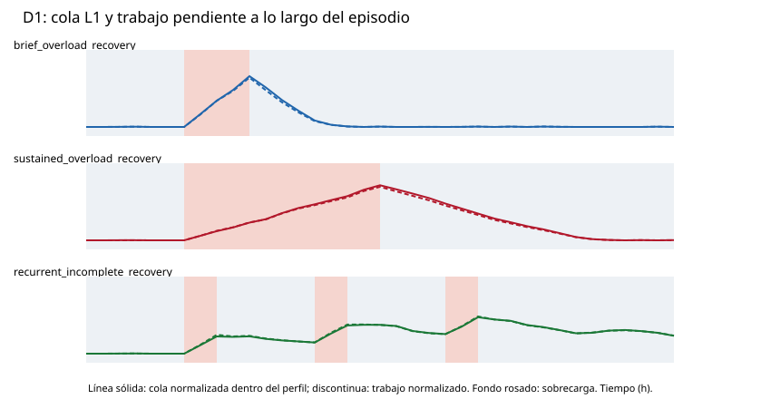

# Dinámica realista de demanda y respuesta del SOC

Estado: piloto de desarrollo, ocho semillas por escenario. Estadísticas de demanda tomadas de la documentación agregada autorizada; el CSV restringido no estuvo disponible en la ruta de trabajo y no se leyó ni reprodujo. Resultados sintéticos, no medición de operación real.

## Dinámica representada

El motor ya modela llegadas temporizadas, colas L1/L2, asignación no preemptiva, elegibilidad, servicio por clase/analista, escalado L1→L2, deadlines y drenaje H+D. Una tasa temporal superior a la capacidad genera cola; al bajar la tasa, el trabajo heredado puede descargarse. No añadimos turnos, pausas, reprocesamiento, abandono ni límite de cola. D1, P1 y HLS-B no se modificaron.

## Demanda y supuestos

El snapshot SOCTRA documentado contiene 214.739 IDs y 993 fechas: media 216,3 registros/día, p95 379, máximo 574, CV diario 0,414, Fano 37,05, autocorrelación diaria lag-1 0,525 y CV de interllegadas 1,604. Esto apoya variabilidad y picos; no mide trabajo activo ni horas de ráfaga. El timestamp es timezone-naive y su semántica no está validada; no inferimos ciclos diarios ni duración de ráfagas.

Se toma 574/216,3=2,654 como multiplicador observado de pico diario, no como perfil horario observado. ρ normal=0,50 y recuperación recurrente=0,85 son supuestos. ρ pico=1,327 conserva el multiplicador respecto a 0,50. La media SOCTRA equivale a 9,01 registros/h; la capacidad fluida sintética L1 es 28,42/h (ρ≈0,317), por lo que mantener la tasa absoluta observada no produciría sobrecarga en este roster. La elevación a ρ=0,50 es un estrés de desarrollo, no calibración realista absoluta. Roster 6 L1/3 L2, servicios, competencias, elegibilidad y routing se heredan de la configuración confirmatoria HLS-B y siguen siendo hipotéticos.

## Escenarios prefijados

En todos: H=36 h, D=36 h, semillas 261220000–261220007; inicia con seis horas normales para calentar la cola. Las llegadas esperadas integran tasa × duración, y son iguales entre políticas dentro de cada escenario/semilla, aunque Poisson produce realizaciones distintas.

| Escenario | Perfil temporal (horas desde inicio) | Llegadas esperadas | Justificación |
|---|---|---:|---|
| brief_overload_recovery | 0–6 h: ρ=0.5; 6–10 h: ρ=1.327; 10–36 h: ρ=0.5 | 605.5 | pulso de 4 h y 26 h de recuperación asumida |
| sustained_overload_recovery | 0–6 h: ρ=0.5; 6–18 h: ρ=1.327; 18–36 h: ρ=0.5 | 793.6 | pulso de 12 h y 18 h de recuperación asumida |
| recurrent_incomplete_recovery | 0–6 h: ρ=0.5; 6–8 h: ρ=1.327; 8–14 h: ρ=0.85; 14–16 h: ρ=1.327; 16–22 h: ρ=0.85; 22–24 h: ρ=1.327; 24–36 h: ρ=0.85 | 891.3 | tres pulsos de 2 h; intervalos a ρ=0,85 asumidos incompletos |

Las duraciones son contrastes experimentales; no se calibran de timestamps SOCTRA.

## Diagnóstico D1 previo a la comparación

Medias de ocho trayectorias. Cola al fin del pulso cuenta alertas aún sin iniciar L1; ocupación es la fracción de analistas L1 ocupados en ese instante.

| Escenario | Fin pulso (h) | Cola L1 | Trabajo pendiente L1 (h) | Ocupación L1 | Máximo cola L1 en H | Pendientes H | Pendientes H+D | R/N terminal | SLA |
|---|---:|---:|---:|---:|---:|---:|---:|---:|---:|
| brief_overload_recovery | 10 | 47.0 | 10.2 | 1.000 | 47.0 | 3.5 | 0.0 | 0.6508 | 0.9961 |
| sustained_overload_recovery | 18 | 146.5 | 30.6 | 1.000 | 146.8 | 5.5 | 0.0 | 0.6559 | 0.9813 |
| recurrent_incomplete_recovery | 24 | 51.5 | 10.7 | 1.000 | 58.4 | 31.8 | 0.0 | 0.6670 | 0.9947 |

A y B permiten observar descarga durante H. C termina el último pulso al cerrar admisión; su recuperación solo se observa en el drenaje.

## Comparación D1/P1/HLS-B

Ocho semillas emparejadas por perfil; R/N y SLA terminales en H+D=72 h.

| Escenario | D1 R/N | P1 R/N | HLS-B R/N | HLS-B−D1 | HLS-B−P1 | SLA D1/P1/HLS-B |
|---|---:|---:|---:|---:|---:|---|
| brief_overload_recovery | 0.6508 | 0.6365 | 0.6480 | -0.0028 | +0.0115 | 0.996/0.996/0.996 |
| sustained_overload_recovery | 0.6559 | 0.6358 | 0.6524 | -0.0035 | +0.0166 | 0.981/0.995/0.994 |
| recurrent_incomplete_recovery | 0.6670 | 0.6367 | 0.6652 | -0.0018 | +0.0285 | 0.995/0.995/0.995 |

### Cohortes de llegada

R/N terminal por cohorte definida por llegada, ponderado por admitidas; cada segmento conserva denominador y CSV incluye conteos.

| Perfil | Segmento | ρ | D1 | P1 | HLS-B |
|---|---:|---:|---:|---:|---:|
| brief_overload_recovery | 0 | 0.50 | 0.6373 | 0.6403 | 0.6373 |
| brief_overload_recovery | 1 | 1.33 | 0.6779 | 0.6342 | 0.6696 |
| brief_overload_recovery | 2 | 0.50 | 0.6426 | 0.6364 | 0.6414 |
| sustained_overload_recovery | 0 | 0.50 | 0.6373 | 0.6403 | 0.6373 |
| sustained_overload_recovery | 1 | 1.33 | 0.6647 | 0.6337 | 0.6542 |
| sustained_overload_recovery | 2 | 0.50 | 0.6458 | 0.6384 | 0.6545 |
| recurrent_incomplete_recovery | 0 | 0.50 | 0.6373 | 0.6403 | 0.6373 |
| recurrent_incomplete_recovery | 1 | 1.33 | 0.6729 | 0.6342 | 0.6718 |
| recurrent_incomplete_recovery | 2 | 0.85 | 0.6677 | 0.6368 | 0.6621 |
| recurrent_incomplete_recovery | 3 | 1.33 | 0.6784 | 0.6394 | 0.6773 |
| recurrent_incomplete_recovery | 4 | 0.85 | 0.6719 | 0.6378 | 0.6685 |
| recurrent_incomplete_recovery | 5 | 1.33 | 0.6813 | 0.6336 | 0.6768 |
| recurrent_incomplete_recovery | 6 | 0.85 | 0.6641 | 0.6358 | 0.6650 |

## Recuperación y conmutación

HLS-B activa con estimación de llegadas en ventana causal de 4 h y umbrales congelados 1,05/1,20. La conmutación no marca por sí misma recuperación de cola. `timeseries.csv` da cola L1/L2, trabajo L1, ocupación, recuperables/vencidas y modo cada hora y semilla. `modes.csv` conserva tiempos de conmutación. `episodes.csv` conserva completadas, pendientes, calidad entre completadas y tiempo medio de finalización.

| Escenario | Fin pulso (h) | Primera P1 HLS-B | Retorno D1 tras pulso | Recuperación D1 cola+trabajo | Prestaciones |
|---|---:|---:|---:|---:|---|
| brief_overload_recovery | 10 | 9.27 h (6/8) | 1.48 h (6/8) | 4.62 h (8/8) | R/N de cohortes terminal arriba |
| sustained_overload_recovery | 18 | 9.52 h (8/8) | 1.77 h (7/8) | 11.50 h (8/8) | R/N de cohortes terminal arriba |
| recurrent_incomplete_recovery | 24 | 13.74 h (8/8) | 3.82 h (1/8) | 5.00 h (2/8) | R/N de cohortes terminal arriba |

Recuperación de cola significa cola y trabajo L1 ambos al nivel de las 6 h, antes del primer pulso. No implica recuperar mezcla de tareas ni cumplimiento de plazos. La prestación se describe por R/N terminal de cohorte porque no hay una medida observada de calidad por hora.

## Interpretación y límites

Comparar tiempos de pulso, máximos de cola D1 y R/N por perfil separa sobrecarga breve, sostenida y recurrente con memoria. El corte C mide congestión residual a H y descarga en D. Ocho semillas son un piloto exploratorio; diferencias de R/N no prueban una ventaja causal general. La carga normal absoluta y todas las duraciones son supuestos. Estadísticas diarias de timestamps no indican duración de trabajo humano, periodo intradía ni servicio. Los resultados no extrapolan a GMV-CERT.

La conclusión sobre respuesta de HLS-B debe distinguir cuándo activa/retorna del estado efectivo de cola y prestaciones. R/N puede mejorar o empeorar por calidad esperada y puntualidad; SLA, calidad entre completadas, espera y pendientes se reportan separadamente en datos completos. No se modifica ni reajusta HLS-B. No se ejecutó confirmación ni commit/push.

## Reproducción

Configuración: config/soc_hls_realistic_dynamics.json. Ejecutar primero run_soc_hls_realistic_d1_diagnostic.py; luego run_soc_hls_realistic_dynamics.py y summarize_soc_hls_realistic_dynamics.py. CSV agregados por episodio/hora en results/soc_hls_realistic_dynamics (local ignorado). Se verifican hashes y admitidas compartidas, conservación completadas+pendientes y coincidencia exacta del D1 de diagnóstico con el brazo D1 del piloto.
