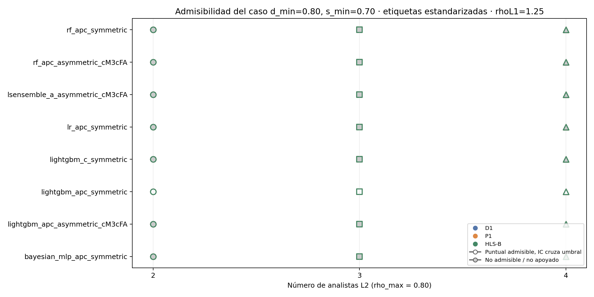
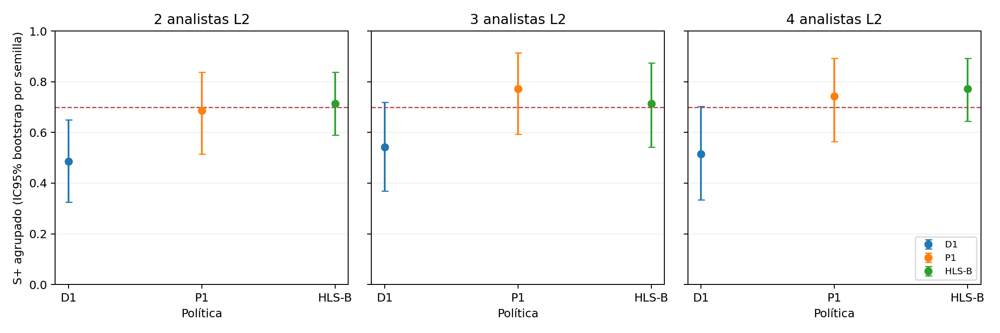

# SOCTRA–HLS: validación de la frontera de viabilidad

## Resumen

Se auditó y reanalizó la campaña de frontera operativa publicada usando conteos por episodio y remuestreo emparejado por semilla. No se ejecutaron simulaciones. La revisión corrige un problema estadístico de interpretación: la media simple de tasas por semilla codificadas como cero cuando no hay necesidades no estima (S_+). El estimador usado aquí es la razón agrupada de necesidades oportunas sobre todas las necesidades.

## Datos, alcance y reproducibilidad

- Campaña: `results/soc_triage_classifier_frontier_campaign/episodes.csv` (18.720 filas; 40 identificadores de semilla, 272600000–272600039).
- Inventario publicado: `results/soc_triage_classifier_operating_impact_source_audit/classifier_inventory_72.csv`.
- Reutilización y trazas: se conservan los hashes `exogenous_sha256` y `trace_sha256`; las comprobaciones de campaña verifican trazas comunes para alternativas emparejadas. Denominadores por semilla son idénticos entre D1, P1 y HLS-B.
- Reanálisis: [script](analyze_feasibility.py), [configuración](config/analysis.json), [tests](test_feasibility.py); 10.000 réplicas bootstrap, semilla 20261121.
- Resultados completos: [estimaciones](../../results/soc_triage_feasibility_frontier/splus_estimates.csv), [contrastes](../../results/soc_triage_feasibility_frontier/splus_paired_contrasts.csv), [rejilla](../../results/soc_triage_feasibility_frontier/feasibility_grid.csv), [carga analítica](../../results/soc_triage_feasibility_frontier/analytic_capacity_load.csv), [límites de capacidad](../../results/soc_triage_feasibility_frontier/heterogeneous_pfa_capacity_boundaries.csv), [validaciones](../../results/soc_triage_feasibility_frontier/validation_checks.json) y [manifest de hashes](../../results/soc_triage_feasibility_frontier/reproducibility_manifest.json).

Las configuraciones/campañas reutilizan identificadores de semilla entre escenarios; por ello, 18.720 filas no son 18.720 réplicas independientes. El bootstrap mantiene juntos todos los escenarios de cada semilla y empareja las políticas. Los IC no son confirmatorios y no incluyen incertidumbre de los parámetros publicados ni de la distribución operativa real.

## Auditoría de (S_+)

En todos los 18.720 episodios se recuperó un numerador entero a partir de `necessary_L2_timely_per_need × true_need_count`. Se verificó que:

- `true_need_count = TP_count + FN_count`;
- el numerador está entre cero y TP;
- las necesidades con recomendación negativa no reciben crédito;
- solo cuentan resoluciones por la ruta requerida, terminadas antes del corte y del deadline;
- los denominadores coinciden exactamente entre políticas emparejadas.

Hubo 66 celdas condición–semilla sin necesidades (27,5% de las 240 celdas únicas de prevalencia × carga × semilla). Esas tasas por semilla son indefinidas. No se les asignó cero en el estimador. La suma agrupada global de (S_+) nunca superó el (p_D) empírico. En 32 contrastes condition–policy, la estimación puntual agrupada superó el (p_D) publicado; los 32 IC bootstrap incluían el valor publicado y ninguno tenía límite inferior superior a este. Es una fluctuación de muestra escasa, no evidencia de que (S_+>p_D) en población.

### Bootstrap

Se remuestrearon los 40 IDs de semilla con reemplazo y el mismo vector de índices para todas las políticas/condiciones. Cada réplica suma (t_j) y (n_j) y calcula su cociente; los contrastes se forman dentro de réplica. Se excluye de cuantiles una réplica con denominador total cero y se reporta el número excluido por celda. En el caso prioritario se excluyeron cero de 10.000 réplicas. Estos intervalos cuantifican incertidumbre Monte Carlo condicionada a las entradas del simulador, no la incertidumbre del (p_D,p_{FA}) empírico SOCTRA.

## Caso prioritario

Configuración: LightGBM A+C, etiquetas estandarizadas, costes simétricos; (p_D=0.8421), (p_{FA}=0.0450); prevalencia sintética de referencia (19/14449); ρL1=1.25; 3 analistas L2. Umbrales ilustrativos predefinidos: (d_{min}=0.80), ρmax=0.80, (s_{min}=0.70). La prevalencia es la inferida de la tabla publicada para etiqueta estandarizada; no se sustituye por la prevalencia original.

La capacidad heterogénea estima λL2=1.635780 investigaciones/h, μL2 efectiva=3.923243/h y ρL2=0.416946. La restricción de capacidad pasa holgadamente al límite 0.80; (p_D) también supera (d_{min}). Por ello, la condición limitante en este caso es el servicio (S_+), no la capacidad L2 fluida.

| Política | Oportunas / necesidades | \(\widehat S_+\) | IC95% bootstrap | Punto cumple 0.70 | Límite inferior cumple 0.70 |
|---|---:|---:|---:|---|---|
| D1 | 19 / 35 | 0.5429 | [0.3684, 0.7200] | No | No |
| P1 | 27 / 35 | 0.7714 | [0.5926, 0.9143] | Sí | No |
| WAPS (HLS-B) | 25 / 35 | 0.7143 | [0.5417, 0.8750] | Sí | No |

Hay 16 semillas sin necesidades de escalado; el denominador efectivo total es 35, con 32 recomendaciones TP y 3 FN, compartidas entre políticas. Así, el resultado puntual declararía admisibles P1 y WAPS, pero ninguna alcanza respaldo por límite inferior de confianza. El aparente cambio de admisibilidad no es estadísticamente establecido.

Contrastes pareados (por política, diferencia en (S_+)):

| Contraste | Diferencia | IC95% bootstrap |
|---|---:|---:|
| WAPS − D1 | +0.1714 | [0.0000, 0.3611] |
| P1 − D1 | +0.2286 | [+0.0286, +0.4231] |
| WAPS − P1 | −0.0571 | [−0.1944, +0.0690] |

Son comparaciones exploratorias sin ajuste por multiplicidad en la gran rejilla. P1-D1 excluye cero en este caso particular; WAPS no se separa de D1 ni P1. No es evidencia independiente/confirmatoria ni valida el umbral ilustrativo como requisito operativo.

Las cifras previas aproximadas de 0.556/0.750/0.740 citadas como medias condicionales por semilla no son el estimador agrupado. En la campaña, una media no ponderada de `necessary_L2_timely_per_need` tras codificar semilla sin positivos como cero produce 0.3333/0.4500/0.4438 para D1/P1/WAPS; ambas formas de promedio no representan (S_+) agrupado. Los conteos exactos, 19/35, 27/35 y 25/35, son la base del estimador correcto.

En esta condición, backlog L1 al final de admisión promedia aproximadamente 215.35 (D1), 209.78 (P1) y 209.38 (WAPS); backlog L2 1.30, 1.15 y 1.13. El backlog terminal tras drenaje es cero en ambos niveles. La utilización media L1 durante admisión es 0.9943–0.9950 y L2 0.3288–0.3339; WAPS utiliza modo P1 en alrededor del 56,2% de las decisiones de despacho L1 y 0% en L2. Los resultados son compatibles con presión dominada por L1 en esa condición; no demuestran mediación causal exclusiva por L1.

## Rejilla y patrones generales

La matriz contiene etiquetas originales y estandarizadas por separado, escenarios L1 ρ=0.85/1.25, equipos L2 de 2/3/4 analistas, las tres políticas y todos los puntos de clasificador compatibles. Se evaluaron (d_{min}=0.60\ldots1), ρmax=0.5/0.8/1.0/1.2 y (s_{min}=0.4\ldots0.95). La tabla `feasibility_grid.csv` conserva 91.728 filas. En el umbral ilustrativo (.8,.8,.7), el conjunto original no tiene casos de servicio admisible porque las restricciones previas de detección/capacidad ya excluyen todas las celdas. Para el grupo estandarizado hay 21 combinaciones con punto estimado sobre .70: 17 puntualmente admisibles pero inciertas y 4 indeterminadas; ninguna queda respaldada por límite inferior al 95%. Hay además una celda con límite superior por debajo de .70. Por política, D1 tiene cuatro puntuales inciertas, dos indeterminadas y una inadmisible por servicio; P1 tiene seis puntuales inciertas y una indeterminada; WAPS tiene siete puntuales inciertas. Estos recuentos describen la rejilla escogida, no probabilidades ni superioridad general.

El test de monotonía no encontró violaciones: endurecer detección, capacidad o servicio nunca incrementa el conjunto admisible. Las comparaciones de carga contra anotaciones originales hallaron una discrepancia máxima de ρ=0.0006128 en variantes de prevalencia original inferida de 40/14.449; con prevalencia auditada 39/14.449 fue 0.0000062 y con prevalencia estandarizada 19/14.449 fue numéricamente nula. No hubo cruces de factibilidad en ρmax=0.5, 0.8, 1.0 o 1.2. Esto es metadato analítico de carga ofrecida; no altera trazas, conteos ni resultados de servicio publicados. El reanálisis informa la carga recalculada para prevalencia objetivo junto con la anotación fuente.

La sensibilidad de prevalencia original 39 frente a 40 positivos se deja como contraste explícito en `prevalence_sensitivity_splus.csv`; todos sus IC pareados incluyen cero. No existe una base para escoger el valor inferido sobre el auditado. Etiquetas originales y estandarizadas nunca se combinan en una frontera.

## Qué permiten concluir los datos

1. (S_+) es distinto del SLA global y queda acotado por el encaminamiento a L2; el estimador agregado correcto es recuperable y reproducible con CSV existentes.
2. En ciertas celdas simuladas, el rendimiento oportuno por necesidad varía entre políticas; en el caso prioritario, P1-D1 tiene diferencia pareada positiva en el bootstrap exploratorio, mientras WAPS no se distingue de P1 ni de D1.
3. Para los umbrales ilustrativos del caso prioritario, la política puntual elegible no es elegible con respaldo estadístico inferior. No se demuestra cambio robusto de admisibilidad organizativa.
4. La capacidad fluida L2 no es limitante en el caso prioritario; la presión observada parece estar asociada sobre todo con L1 saturado. En otras condiciones el mapa identifica capacidad como restricción previa.
5. El número pequeño de necesidades (35 en el caso prioritario) y 16 semillas sin positivos limitan la precisión. La incertidumbre de las tasas publicadas, las prevalencias reales y el significado de la necesidad sintética no se propagan.

No se concluye que WAPS sea superior ni que la organización cambie de forma robusta la frontera de clasificadores. Tampoco se interpreta falta de significación como equivalencia. Las métricas son condicionales a recomendaciones sintéticas con tasas agregadas publicadas y no a decisiones individuales del clasificador sobre alertas reales. Las etiquetas históricas no certifican necesidad técnica de nivel L2, y las hipótesis de aceptación automática, capacidad continua, mezcla de clases y tiempos de servicio limitan la validez externa respecto a GMV-CERT.

## Registro de validación

`validation_checks.json` da estado PASS: 18.720 episodios, hashes y denominadores emparejados, reconstrucción íntegra de numeradores, maduración de deadlines según el corte guardado, 66 celdas con cero necesidades, comprobación (S_+\le p_D) empírica y monotonía de la rejilla. Los seis tests unitarios específicos pasan. Las políticas y el motor no se modificaron; el script solo vuelve a leer episodios, resuelve el LP analítico y genera tablas/figuras.
